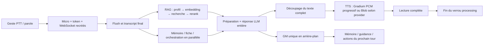

# Audit de latence — conversation libre Max / Emma

Date : 12 octobre 2026, Europe/Zurich. Révisions auditées : `2d83558`, puis mise à jour sur `0433518`, branche `main`. Les mesures historiques restent datées de septembre.
Statut : audit et recommandations, **aucune optimisation applicative implémentée**.
Plateforme : Lovable / Lovable Cloud exclusivement.

Cette mise à jour remplace l'analyse technique du 22 mai 2026, qui décrivait un parcours legacy. Le runtime courant est PRD4. L'historique antérieur reste consultable dans Git. Le [plan d'exécution](plan_optimisation_latence_voice_to_voice.md) et le [snapshot anonymisé](latency_voice_snapshot_2026-10-12.json) accompagnent ce rapport.

## 1. Conclusion

Le gain structurel prioritaire consiste à supprimer l'attente de la **réponse textuelle entière** avant de fournir du texte au TTS. La voix Gradium est déjà streamée dans les tours observés. Une même génération doit établir une intention privée brève, puis produire une réponse continue diffusée progressivement, sans appel LLM indépendant pour chaque phrase.

Dans les mesures historiques, le bloc personnage est le segment séquentiel le plus long dans **40 tours sur 41**. Le GM ne se situe pas sur le chemin du premier son, mais sa durée, sa consommation et la disponibilité de sa mémoire au prochain tour méritent un chantier distinct.

La fiabilité des mesures est une priorité préalable : les métadonnées de fournisseur sont incorrectes sur ces 41 tours et les compteurs STT/TTS n'ont pas toujours la signification indiquée par leur nom. Optimiser à partir des seules étiquettes « bloqueur » conduirait à une mauvaise priorité.

La cible produit validée est : voix avec portrait fixe, dialogue sans texte affiché ni bouton pour chaque prise de parole, écoute pendant la réponse, interruptions naturelles et mémoire privée de ce que le personnage voulait encore dire. Les fournisseurs peuvent être comparés, sous réserve de préserver identité vocale, français, continuité et canon.

## 2. Sources, couverture et méthode

### Mesures réellement accessibles

- **MCP app Ava**, endpoint communiqué par Ulrich : `https://iralfqlslqndgvexixis.supabase.co/functions/v1/mcp`. Les métadonnées OAuth publiques identifient AVA Prototype 1 et ce backend Lovable. La connexion native a permis quatre outils : statistiques d'usage, latences agrégées, coûts LLM, liste de sessions.
- **PostHog**, organisation Memoways, [projet AVA prototype 1, ID 137897](https://eu.posthog.com/project/137897). Identité vérifiée par le connecteur natif avant requêtes.
- Code local, contrats et tests. Aucun appel de synthèse, de transcription ou de génération payant n'a été lancé pour cet audit.

Les outils MCP Ava **ne fournissent ni traces brutes, ni prompts effectifs, ni réglages actifs**. Leur code est maintenant accessible dans `src/lib/mcp/` à la révision `0433518`. Leurs fenêtres glissantes de 30 jours ont retourné six sessions, 113 mesures audio et 82 appels LLM. Trois sessions ont commencé le 12 octobre ; la fenêtre d'un jour contient un STT, trois TTS et deux appels LLM. La vue de latence par tour retourne **zéro échantillon**, alors que des tours PRD4 existent dans PostHog. Le code confirme la cause : `get-voice-latencies.ts` interroge `turn_latencies`, pas `voice_turn_events`. L'accès aux traces backend détaillées reste donc à compléter dans la capacité d'observabilité, sans contourner le connecteur.

PostHog ne contient aucun événement vocal sur les sept derniers jours. Sur 30 jours : 41 `voice_turn_completed`, 41 `prd4_gm_post_turn`, 89 `audio_latency`. Les tours complets viennent du **15 au 17 septembre, heure suisse**, et de trois sessions sandbox/user_test. Ils ne constituent pas une baseline récente de production.

### Calcul

Les 41 tours ont été lus en colonnes numériques, corrélés par `turn_id`, puis pseudonymisés dans le snapshot. Les percentiles de ce rapport utilisent le rang supérieur `ceil(p × n)`. Les agrégats MCP sont conservés tels que renvoyés. La lecture de `src/lib/mcp/stats.ts` confirme une interpolation linéaire à l'indice `(n−1) × p`, arrondie à la milliseconde ; cette méthode diffère du rang supérieur utilisé pour les 41 tours. Le MCP conserve correctement null ; la conversion null → zéro relevée plus bas concerne l'autre proxy, `posthog-latency-stats`.

Le reste non attribué est calculé **tour par tour** :
`response_ready - rag_ms - max_ms`.
Le délai de sortie est également calculé tour par tour :
`voice_ready - response_ready`.
Aucune somme de percentiles n'est utilisée. Pour la décomposition additive, seules les moyennes des mêmes 41 tours sont additionnées.

Les événements de tours terminés ont tous un premier son « measured » et aucun `had_error`. Cela ne signifie pas zéro erreur sur toute l'expérience : un événement audio de sortie distinct est marqué `server` avant une ouverture de session.

## 3. Mesures

### Référence de tours complets — PostHog, 41 tours / 3 sessions

| Mesure, en ms | p50 | p90 | p95 | Moyenne | Maximum |
|---|---:|---:|---:|---:|---:|
| Finalisation manuelle → premier départ audio observé | 4 466 | 5 284 | 5 737 | 4 553 | 7 868 |
| Finalisation manuelle → texte complet prêt | 3 475 | 4 376 | 4 573 | 3 574 | 6 946 |
| RAG | 1 088 | 1 421 | 1 809 | 1 162 | 1 994 |
| Bloc personnage : préparation résiduelle + LLM | 2 136 | 2 655 | 2 915 | 2 182 | 5 447 |
| Texte complet prêt → premier départ audio | 937 | 1 176 | 1 219 | 979 | 1 259 |
| Reste : finalisation STT + préparation non attribuée | 218 | 270 | 293 | 230 | 316 |
| Lecture de la réponse | 14 137 | 20 172 | 21 680 | 14 342 | 33 213 |
| GM post-tour, hors chemin de première voix | 3 632 | 4 734 | 4 942 | 3 853 | 5 567 |

La moyenne de 4 553 ms se répartit en **47,9 % bloc personnage**, **25,5 % RAG**, **21,5 % lancement de sortie** et **5,1 % reste non attribué**. La lecture de 14,3 s n'est pas un délai de réponse : elle montre surtout l'importance du droit de reprendre la parole pendant le personnage.

Emma : 33 tours / 2 sessions, premier son p50 4 556 ms, p95 6 479 ms.
Max : 8 tours / 1 session, premier son p50 4 034 ms, p95 4 959 ms.
Ces cohortes sont trop petites et différentes pour attribuer leur écart à un modèle ou à un personnage.

### Attribution TTS vérifiée par corrélation

**41 / 41 incohérences de fournisseur** : les événements de tour annoncent ElevenLabs / `eleven_multilingual_v2`, mais l'événement `audio_latency` corrélé annonce **Gradium / `gradium-tts` / WebSocket**. Les valeurs de premier son restent utilisables comme observations client ; les comparaisons ElevenLabs/Gradium construites avec l'étiquette du tour ne le sont pas.

Le code fournit une explication plausible et précise : `LocalTTSOutput` et `getConfiguredTTSServiceInfo()` lisent le fournisseur global, tandis que la synthèse reçoit un `providerId` de personnage. Le découpage lit aussi le fournisseur global. Il faut instrumenter le **résultat effectif**, conserver fournisseur demandé et fournisseur exécuté, et utiliser le provider résolu pour le découpage. Aucun benchmark par fournisseur n'est déduit de ces étiquettes contradictoires.

### Mesures audio internes — MCP Ava

Sur 30 jours : 49 STT, 64 TTS, dont 63 premiers octets renseignés.
STT p50 19 ms, p95 1 822 ms ; TTS « first byte » p50 947 ms, p95 1 572 ms ; génération TTS totale p50 4 742 ms, p95 8 230 ms. **Aucune mesure de playback** dans cet agrégat.

Sur un jour : un STT à 436 ms ; trois TTS avec premier octet p50 1 004 ms et total p50 3 119 ms. Trois échantillons ne permettent pas de qualifier un p95 opérationnel.

Ces chiffres ne sont pas interchangeables avec `voice_turn_completed.t_tts_total_ms`, qui reçoit aujourd'hui le délai jusqu'au premier playback, et non le total de génération. Ils confirment aussi qu'une génération audio de plusieurs secondes peut démarrer avant sa fin : **attendre EOS supprimerait un streaming déjà utile**.

### Coût GM — MCP Ava, 30 jours

- GM : 41 appels Gemini 2.5 Flash, 197 762 tokens d'entrée, 22 158 de sortie, 0,133 USD enregistrés.
- Personnage : 41 appels GPT-5.6 Luna, 76 217 tokens d'entrée, 2 855 de sortie, 0,0215 USD enregistrés.
- Part GM : **86,1 % du coût enregistré** ; coût moyen environ 0,00324 USD/appel contre 0,00052 USD pour le personnage.
- Moyennes GM : environ **4 823 tokens d'entrée et 540 de sortie**, contre 1 859 et 70 pour le personnage.
- Un échec de récupération de coût dans chaque groupe : le total enregistré ne prouve pas le montant exhaustif facturé.

Le volume de sortie GM est 7,8 fois supérieur à celui du personnage. Réduire son schéma, les répétitions de contexte et le modèle sur un corpus contrôlé est donc pertinent. Les agrégats de coûts couvrent des dates différentes des 41 tours PostHog : leur égalité de nombre ne prouve pas une jointure un à un. PostHog annonce aussi un autre modèle pour huit tours ; conserver cette divergence comme une lacune d'attribution, sans choisir un modèle sur cette base.

## 4. Graphe effectivement exécuté

`src/App.tsx` route vers `IndexPRD4`. Le parcours legacy n'est pas la cible. Le graphe ci-dessous décrit le chemin PTT mesuré et le cœur de réponse encore commun. La branche mains libres ajoutée sur `0433518` conserve la capture après activation et passe par le tempo applicatif avant le même flush/RAG/LLM/TTS.

PRD4 **n'exécute pas de GM pré-tour, pas de validateur LLM anti-hallucination et pas de deuxième appel pour les labels**. En retirer n'apporterait aucun gain. Le GM post-tour démarre après le texte et peut progresser pendant le TTS ; sa callback UI est attachée après la sortie.

## 5. Audit de chaque étage

### Capture, STT et passage de tour

Le **mode PTT** d'`IndexPRD4` recrée STT et micro à chaque prise de parole, force le mode manuel et bloque une nouvelle prise pendant processing. La **base mains libres désormais présente** conserve la capture après activation, finalise par un timer applicatif et peut interrompre pensée/voix. Elle reste désactivée par défaut ; son activation réelle par environnement n'est pas exposée par le MCP. Ne pas réimplémenter cette base : compléter le [plan mains libres existant](plan_conversation_mains_libres.md).

Le contrat ajouté dans `AGENTS.md` place fin de parole et interruption dans **`handsFreeVoice.ts`, à partir du texte reconnu et de son timing**, jamais dans un timer de silence fournisseur. Les paramètres courants sont 900 ms après mots reconnus, +700 ms si fin hésitante, bornes 300–3 000 ms et seuil d'interruption de deux mots. La réduction 900 → 500 retirerait **400 ms de timer configuré** lorsqu'il se déclenche normalement : ce n'est pas une preuve de 400 ms gagnées sur chaque premier son. Une fin hésitante attend nominalement 1 600 ms.

Le filtre anti-écho ignore une transcription dont au moins 80 % des mots appartiennent à la réplique entière. Cela ne constitue pas une reconnaissance du locuteur : un vrai utilisateur peut réutiliser ces mots. « Non » ou « Attendez » seuls ne passent pas le seuil par défaut de deux mots ; le test existant le confirme pour « Attendez ». Ce compromis doit être évalué sur corrections courtes, écho et parole simultanée. Le barge-in commence après reconnaissance : il ne prouve pas une réaction rapide au début acoustique.

Le contrôleur remet les buffers STT à zéro après flush et après la sortie, mais la réponse entière reste en historique. Les callbacks sont ignorés pendant cinématique/handoff ; la capture et les buffers doivent être vérifiés à ces frontières, car le blocage de callback n'est pas une preuve que le son du film n'a jamais alimenté le STT.

Deepgram capture par MediaRecorder avec timeslice 150 ms ; cela ne garantit pas une livraison toutes les 150 ms. Son timer provider 900 ms suit les **résultats reçus**, pas la dernière voix capturée. Il est désactivé en mode manuel/mains libres ; `speech_final`, `SpeechStarted` et `UtteranceEnd` ne sont pas exploités. Ces signaux peuvent améliorer diagnostic et synchronisation du flush, mais l'application garde la décision de tour.

Le flush Deepgram conserve le préfixe final et l'interim, demande la queue audio puis attend un acquittement ou une condition de secours bornée. Cette protection ne doit pas être supprimée pour afficher un meilleur chiffre.

Gradium STT utilise ScriptProcessor 2 048 samples à 24 kHz, ignore les événements VAD `step` et `end_text`, accepte tout accusé `flushed` reçu après l'envoi sans vérifier son ID et envoie `delay_in_frames=4`. La [référence Gradium STT](https://docs.gradium.ai/guides/speech-to-text) indique une plage 7–55 et retourne la valeur active dans `ready` : il faut vérifier cette valeur effective, puis comparer des valeurs valides. La finalisation remet les buffers à zéro avant de calculer la télémétrie, ce qui peut transformer la mesure en durée depuis l'ouverture. Aucun chiffre « 320 ms » n'est considéré comme prouvé.

AssemblyAI capture 4 096 samples à 16 kHz, soit une fenêtre nominale de 256 ms ; un worklet avec frames adaptées est un candidat à mesurer. Whisper reste un témoin batch ; le registre et les libellés Gradium décrivent encore du batch alors que le client est WebSocket. Gamilab reste derrière la façade existante ; pas de modification d'un projet externe.

La cible consolide le micro de session déjà disponible, l'annulation d'écho native vérifiée par `getSettings()` et la décision centralisée dans `handsFreeVoice.ts`. Les signaux acoustiques servent d'abord à mesurer et vérifier, sans retirer la décision à l'app. Une variante de réaction dès onset acoustique constitue une évolution explicite du contrat, à décider avant implémentation. Les pauses de réflexion, bruits, « oui/non » et reprises de phrase font partie des tests éliminatoires.

### RAG, mémoire et préparation

Le chemin RAG contient des appels séquentiels : garde de requête/quota lorsque activée, lecture du profil actif, embedding Voyage/OpenAI, RPC vectorielle, rerank éventuel. Le client attend un résultat exploitable avant le personnage. Le serveur ne découpe actuellement pas ces sous-durées ; 1 088 ms n'est donc pas « le coût de la base ».

Aucun rewrite LLM n'est appelé dans `processPRD4Turn` : la fonction de rewrite existe ailleurs, mais il n'y a rien à retirer du hot path courant.

Le cache de résumés et la mémoire structurée sont déjà présents ; plusieurs lectures démarrent en parallèle du RAG. Ne pas les sérialiser à nouveau. Les réponses vides de résumé ne sont pas mises en cache, ce qui peut répéter des SELECT inutiles avant le premier résumé. Le runtime orchestration épinglé lit deux RPC au premier accès, puis est caché. Précharger ces données pendant la préparation de session peut retirer des attentes résiduelles sans perdre le cadre commun.

Le bloc `max_ms` commence avant l'attente des promesses mémoire et inclut le montage du prompt. Un TTFT fournisseur et un temps de prefill distincts sont nécessaires. Le RAG garde la provenance par personnage et le profil d'index ; rerank allégé ou retrieval spéculatif restent des expériences après validation de rappel factuel. L'absence de RAG n'est pas utilisée comme raccourci systématique.

### LLM et cohérence des phrases

PRD4 utilise `simulateMaxResponse → callLLMWithUsage` avec `stream:false`. L'entrée streaming legacy `callMaxAgent` est spécifique à Max et n'assure pas les mêmes contextes, traces et annulations ; la brancher directement ferait perdre des protections.

La cible est un nouveau chemin PRD4 partagé Max/Emma, conservant prompt, attribution, RAG, mémoire, rôle et cadre. Une courte **intention communicative** précède la parole dans le même appel ; ce n'est pas une génération indépendante phrase par phrase. L'intention ne doit jamais passer au TTS ni au dialogue entendu.

Les tokens doivent être regroupés par frontières naturelles, sans attendre arbitrairement 80 caractères quand une phrase courte est complète. Abréviations, décimales, citations, ellipses et garde d'identité sont des cas de test. La diffusion irréversible exige une garde incrémentale avant chaque segment, sur le préfixe cumulé et un état de citation ; une correction après lecture serait trop tardive.

`fetchProxyLLM` retire l'écoute du signal parent après les en-têtes ; la lecture SSE et le fetch upstream ne sont pas reliés à l'annulation de bout en bout. Les erreurs SSE, EOF incomplet et timeouts de corps nécessitent aussi une vérification. [OpenRouter distingue arrêt du stream et annulation fournisseur](https://openrouter.ai/docs/api_reference/streaming) : l'arrêt local ne prouve pas que toute génération ou facturation a cessé.

Stabiliser le préfixe du prompt, placer les éléments variables à la suite, mesurer les cache hits et comparer le routage de faible latence sont des candidats. Le modèle doit être choisi sur **TTFT, premier segment, qualité et p95**, pas seulement tokens/seconde. Ne pas raccourcir les réponses au point de retirer leurs nuances.

### TTS et rendu audio

Gradium offre déjà un lecteur PCM progressif. Aujourd'hui il ouvre un token/socket par segment, reçoit le texte complet puis EOS. La [recette Gradium LLM → TTS](https://docs.gradium.ai/guides/recipes/llm-to-tts) permet une connexion ouverte avant la génération, des phrases ajoutées au même contexte et une réception audio parallèle. C'est le premier chemin à optimiser.

Le prébuffer représente 300 ms **d'audio accumulé**, le rebuffer 200 ms, la marge de programmation 30 ms. Ce ne sont pas automatiquement 330 ms de temps mural récupérables : l'arrivée des chunks et EOS influencent leur coût. Comparer des seuils adaptatifs avec underruns, clics et prosodie ; ne pas supprimer la protection à l'aveugle.

ElevenLabs, Inworld, Hume et Cartesia restent des options intégrées à vérifier séparément. ElevenLabs/Inworld attendent un Blob et Inworld demande explicitement `stream:false`. L'opportunité est réelle pour ces chemins, mais elle ne décrit pas le Gradium observé.

Le contexte vocal par personnage et la diction restent stables entre segments. Le premier son est aujourd'hui un événement logiciel : Gradium résout `started` au scheduling, avant la sortie matérielle ; un Blob marque `audio.play()` résolu. Ajouter audio reçu, programmé et sortie estimée via [AudioContext.getOutputTimestamp](https://developer.mozilla.org/en-US/docs/Web/API/AudioContext/getOutputTimestamp), puis contrôler acoustiquement les tests. Ne pas appeler une estimation un timestamp physique exact.

### GM, mémoire d'interruption et concurrence

Le GM fait un seul appel comprenant labels, mémoire, guidance et action. Son plafond de sortie est au moins 950 tokens, même si le réglage historique affiche 180. Le schéma et les répétitions de contexte sont plus importants à mesurer qu'un simple slider. Sa durée déclarée est prise **avant** la persistance mémoire ; ajouter génération, validation, persistance et disponibilité effective pour le tour suivant.

Le code mémorise la réponse entière avant playback. Une interruption rendrait donc une partie non prononcée indistinguable d'un échange entendu. Les résumés et le GM pourraient ensuite promouvoir des révélations jamais entendues.

L'intention privée, le texte généré, les segments effectivement lus et la continuation non prononcée doivent être distincts. Le dialogue partagé ne contient que ce qui a été livré ; le personnage peut reprendre ce qu'il avait l'intention de dire. Une suite jamais générée n'est jamais présentée comme un texte connu. L'isolation Max/Emma est conservée.

Le prochain tour invalide actuellement les callbacks du précédent et son contrôleur ; une écoute libre avec reprises rapides augmenterait les résultats GM perdus. Utiliser des tâches GM séparées, identifiées par tour et version mémoire, sans file bloquante devant la réponse. Les actions tardives sont ignorées ; un résultat ancien ne remplace pas la relation courante. La persistance actuelle utilise compare-and-swap et deux tentatives : conserver cette protection contre les écritures concurrentes.

### Télémétrie, UI et dégradation

Le diagnostic `blocker_step` compare des ratios à des budgets. Il annonce RAG pour 38 tours alors que le bloc personnage est plus long pour 40 : séparer **dépassement de budget** et **attente critique réellement consommée**.

`numberOrNull(null)` dans le proxy PostHog devient 0. Les absences peuvent contaminer les moyennes et percentiles. Conserver null, versionner la sémantique et tester une mesure connue avec valeurs absentes.

Les compteurs doivent inclure tours tentés, interrompus, échoués, sans voix et terminés, avec taux de couverture. Une moyenne de succès seuls ne suffit pas. La capture PostHog reste optionnelle ; la divergence de volume avec le backend ne prouve pas une panne de persistance.

L'UI PTT empêche la prise de parole pendant pensée/voix ; l'UI mains libres permet le micro continu et l'interruption. Les deux affichent encore le dialogue et utilisent le texte comme repli en cas de panne TTS. En mode voix seule, prévoir une réponse sonore de secours préchargée et un état de connexion accessible, sans dépendre d'un texte qui sera caché. L'entrée en expérience peut toujours demander un geste initial pour permissions/autoplay ; aucun bouton par tour n'est requis.

Les cinématiques restent après la réponse, le lecteur Gumlet persistant reste protégé. Les interruptions ordinaires ne déclenchent ni vidéo ni handoff obsolète.

## 6. Classement des gains et limites

1. **Très fort potentiel, non chiffré avant TTFT** : overlap génération textuelle / voix. On retire l'attente de la queue du LLM, pas toute sa durée.
2. **Fort potentiel** : consolider la base mains libres, réduire les délais applicatifs validés et mesurer l'arrêt sonore. La lecture de 14 s médianes impose le droit de reprendre la parole ; elle n'est plus forcément une zone bloquée lorsque le mode mains libres est activé.
3. **Potentiel à mesurer** : préouverture TTS pendant RAG/LLM, contexte de tour unique, découpage naturel, buffer adaptatif. Le 979 ms observé contient plusieurs couches.
4. **Potentiel conditionnel** : embedding, rerank, prompt caching, préchargement et modèle. Les 1 162 ms RAG et 230 ms de reste donnent des masses mesurées, pas des gains garantis.
5. **Coût et continuité** : GM plus compact/rapide, disponibilité mémoire et tâches concurrentes. **Ne pas additionner ses 3 853 ms à l'attente de première voix.**

Aucun gain « milliseconde par milliseconde » n'est inventé pour les sous-étages non instrumentés. Le [plan](plan_optimisation_latence_voice_to_voice.md) précise les jalons à ajouter et les expériences capables de le mesurer.

## 7. Vérifications et frontière de livraison

Vérifications initiales sur `2d83558` : **89 fichiers / 407 tests unitaires passent**, `npm run typecheck` passe. Après synchronisation sur `0433518` : **92 fichiers / 423 tests unitaires passent**. Le premier typecheck de cette révision a signalé le SDK MCP absent du `node_modules` local. Après récupération isolée du SDK 3.0.5 déjà déclaré, le typecheck révèle une incompatibilité réelle : les quatre outils MCP importent les schémas Zod 3 du projet, alors que le SDK attend Zod 4 (`_zod` manquant). La version actuelle n'est donc pas déclarée verte en TypeScript. Une copie temporaire des seuls modules MCP a été vérifiée avec un alias Zod 4.6.6 compatible : son contrôle de types passe sans modifier les formulaires Zod 3 ni les fichiers du repo. Le simple import `zod/v4` du Zod 3.25 installé n'a pas suffi, à cause d'une différence de version de types. Ce sont des protections du comportement courant ; elles ne valident pas encore le VAD libre, le barge-in ou la mémoire de livraison.

Le contrôle de livraison a également relevé que `package.json` et `bun.lock` contiennent le SDK MCP, alors que `package-lock.json` ne le contient pas et que la CI GitHub exécute `npm ci`. `npm ci --dry-run --ignore-scripts` confirme `EUSAGE` et signale également le SDK HeyGen et des dépendances Drizzle non alignés. Le check GitHub `regression-gates` de `0433518` a également été vérifié en échec avant le commit documentaire. Ce sont des divergences préexistantes sur `0433518`, à traiter dans Lovable avant de déclarer la gate GitHub saine ; l'audit documentaire ne les corrige pas silencieusement.

Aucun fichier de runtime, migration, secret, Edge Function ou configuration de fournisseur n'a été modifié par cet audit. Le checkout a seulement intégré les commits Lovable déjà présents sur `origin/main` par fast-forward. Les optimisations restent à implémenter dans des lots distincts, synchronisés puis validés dans Lovable. Les changements de ce lot concernent seulement le rapport, le plan et les preuves anonymisées.

Références projet : [contrat de régression](core_experience_regression_contract.md), [mémoire et expérience](plan_assainissement_mecanique_orchestration_gm.md), [observabilité antérieure](posthog_latency_observability_audit.md), [traces Max](max-causal-tracing.md).
