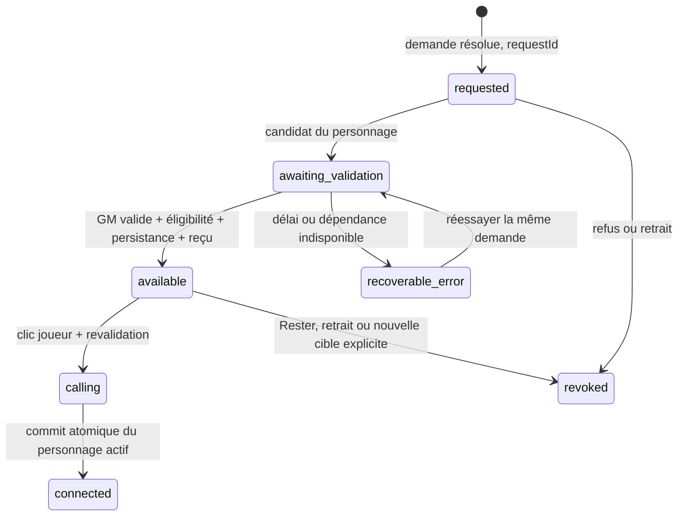

## Reprise du développement — 28 octobre 2026

Reprise effective après demande d'Ulrich de tester les autres connexions :
`git`/`gh` fonctionnent avec Ulrfis depuis le contexte système autorisé. Le
connecteur natif échoue toujours ; ce défaut ne bloque plus le lot.
Correctif du présent canonique implémenté et vérifié localement (24 scénarios
rouges avant/verts après, 99 ciblés, qualité complète verte), livraison PR/CI
en cours. [État courant](plan_optimisation_payload_max.md),
[diagnostic d'accès exact](diagnostic_github_connecteur_2026-10-28.md),
[prompt autonome de recette F4](prompt_reprise_present_canonique_lot_f4_recette.md).

**Décision d’Ulrich : ne pas geler la démo ; poursuivre le développement.**
La priorité immédiate est la cohérence du présent canonique de Max/Emma.
Le gel et la fin de chantier proposés plus bas sont historiques et ne sont plus
à exécuter. Les validations vocales et passages acquis restent conservés.

Nouvel essai `0f88fbde-5f9a-4e27-ba0f-0644e2682dc3` : Emma invoque au présent
un départ de Max avec Anne à l’hôtel, événement canonique de J−2. Le compilateur
optimized_v3 écarte la situation actuelle pour budget ; omission reproduite.
Un prototype hors application protège le présent complet dans 24 cas Max/Emma,
sans dépasser le plafond global. Il n’est pas livré : l’accès GitHub natif échoue
sur `Unknown tool`, sans preuve d’une expiration d’identité. Aucun contournement.
[Diagnostic, preuves, correction candidate et livraison restante](plan_optimisation_payload_max.md).

Le retour grille Emma → Max est maintenant **observé dans la même session** :
appel Emma fermé à 07:40:46 Paris, Max ouvert à 07:40:53, 722 secondes restantes
conservées. C’est un nouvel appel, pas une nouvelle expérience ni un transfert GM.
Le joueur informe Max de son échange avec Emma ; ne pas confondre cette continuité
avec le partage des souvenirs privés.

État technique connu : main/Lovable `c7df835`, dernière CI code vérifiée verte
sur `bf24b37` (40578598650, 109 E2E). Ce dernier contrôle date du 27 octobre ;
aucune CI nouvelle ni correction frontend publiée le 28 par ce diagnostic.
[Prompt de reprise actualisé](prompt_reprise_fiabilite_passage_personnages_lot_f3_finalisation.md).

## Historique — reprise démo et capsule de passage — 27 octobre 2026

Référence courante, avant le bilan historique ci-dessous. Ulrich rapporte un
nouvel échange prolongé avec Max puis un passage vers Emma réussi : « pour le
moment, tout va bien ». Cette observation valide ce passage, pas encore le retour
par grille ni toute la matrice F3. La continuité d’entrée déjà acceptée reste acquise.
Ulrich confirme ensuite explicitement « Non, pas encore » au rappel de Max
depuis la grille : ce complément reste à faire, sans recommencer les critères acquis.

Preuve native Lovable : session sandbox `043712a6-27e5-4364-8b5f-1174b8befdc0`,
27 octobre 20:50:40 Paris ; préparation à 20:53:50, validation à 20:53:57,
clic à 20:54:13, exécution à 20:54:19, puis appel fermé à 20:55:15.
`handoff_count=1`, personnage Emma. Flags épinglés : mains libres=true,
acoustic_confirmed, bargeIn=false, fin 2 000 ms, hésitation 700 ms,
incremental=false. La colonne historique modalite_voix=push_to_talk ne suffit
pas à classer cet essai comme PTT. Aucune confidence ni transcript conservé.

**Lot autorisé : restaurer la capsule de passage.** La demande actuelle remplace
le choix précédent d’une action texte sans pastille. Même largeur, hauteur,
portrait et forme que la capsule du personnage en ligne, juste en dessous :

- Indisponible : capsule visible, atténuée, bouton désactivé, sans clignotement.
- En préparation : capsule désactivée avec indicateur et libellé explicites,
  reflétant la préparation réelle ; aucune progression temporelle inventée.
- Disponible : « Appeler Max/Emma », contraste renforcé et clignotement doux du
  contour ; seul l’accord final autorisé rend le clic possible. Pendant la prise
  de parole ou la validation du clic, libellé d’attente et bouton désactivé.
- Rester retire l’offre ; capsule à nouveau indisponible. Navigation clavier,
  petits écrans et préférence de mouvement réduit préservés.

Périmètre : présentation de ConversationScreen, styles et assertions liées.
Réutiliser handoffIssue/handoffOffer ; aucun changement de voix, prompt, seuil,
GM, persistance ou configuration Cloud. Aucun fournisseur, contrôleur ou refactor
supplémentaire. Base : main/Lovable `4871d9861617f715d78d340f1dd984e14592bbbc`,
CI 40563547468 verte, checkout propre, PR historique #24 préservée.

Validation : tests existants adaptés avant push, états désactivés/préparation/
disponibilité/révocation et clic réels couverts ; replays navigateur des deux
sens, largeur identique mobile/desktop, clavier et mouvement réduit ; qualité
locale puis CI PR sur HEAD exact, fusion, CI main et synchronisation Lovable.
Tout code, preuve et prompt de finalisation sont préparés avant le premier push.
Les tests simulés ne rejouent pas la validation acoustique déjà acquise.

Vérifications locales terminées avant push : 21 tests du composant ; six E2E
ciblés sans retry (1 min 12 s) couvrant dimensions identiques 160 × 56 px sur
390/1280 px, deux sens, clavier/Rester, mouvement réduit et verrous PTT/mains
libres ; captures relues dans output/playwright/lot-3-390.png et lot-3-1280.png.
`npm run test:quality` vert : 71 régressions, 1 083 unitaires, 42 intégrations,
typage et build ; lint sans erreur, avertissement React préexistant.
Livraison code : [PR #102](https://github.com/memoways/ava-proto1/pull/102),
main `bf24b3765733d555fabdac88aed02d02827800e7`, après
[CI PR 40574690336](https://github.com/memoways/ava-proto1/actions/runs/40574690336)
verte sur HEAD exact `dfb1edc5bd3e2954b04527592487b91a218051d8` : 109 E2E
sans retry, 20,9 min. Branche propre supprimée localement et à distance ; Lovable
Ava/Memoways ready au même SHA, composant et CSS comparés intégralement identiques.
[CI main 40578598650](https://github.com/memoways/ava-proto1/actions/runs/40578598650) :
première tentative arrêtée avant E2E par LatencyBlockingTab.test.tsx:108,
assertion immédiate de `/future-video/` après chargement asynchrone (1082/1083
unitaires). Fichier inchangé par ce lot ; vert en local et sur la PR. Les huit
tests ciblés du tableau repassent localement ; unique relance du même SHA **verte** :
qualité complète et 109 E2E sans retry (20,2 min), fin à 21:57:33 Paris.
Aucun code modifié pour cette relance. Livraison technique de la capsule validée ;
recette visuelle/rappel et acceptation de la démo encore attendues, aucune publication.

Inventaire vérifié après livraison : branches distantes `main` et
`agent/test-gap-invitation-validity-multi-use` (PR historique #24) ; branche
`codex/handoff-capsule-states` supprimée localement et à distance. Les seize
branches locales historiques étrangères sont préservées :
`agent/test-gap-invitation-validity-multi-use`, `agent/test-gap-posthog-internal-comparison`,
`codex/bug-scan-gradium-temp-cap`, `codex/character-handoff-contract-lot-1`,
`codex/character-handoff-lot-1-closeout`, `codex/character-handoff-lot-2-closeout`,
`codex/character-handoff-lot-3-closeout`, `codex/character-handoff-lot1-prompt`,
`codex/character-handoff-pill-lot-3`, `codex/character-handoff-runtime-lot-2`,
`codex/handoff-veto-lot-1-finalization`, `codex/plan-character-handoff`,
`codex/test-gap-settings-hydration`, `codex/video-latency-metrics`,
`codex/video-latency-publication-record`, `cursor/d5d2099b`.
La clôture documentaire n’altère pas le code et applique l’exception CI Markdown ;
elle cite la dernière CI code verte, sans nouvelle campagne lourde.
Références d’implémentation : [bouton natif désactivé](https://developer.mozilla.org/en-US/docs/Web/HTML/Reference/Attributes/disabled),
[mouvement réduit](https://developer.mozilla.org/en-US/docs/Web/CSS/@media/prefers-reduced-motion),
composant shadcn existant ; aucune nouvelle dépendance.

Reste démo après livraison : inspection de la capsule puis raccrochage → grille
→ rappel Max dans la même expérience, et acceptation explicite de la démo pour
la geler. Qualification exhaustive et optimisation CI restent séparées ; publication
Lovable seulement sur autorisation explicite distincte. Le prompt de finalisation
est actualisé dans le même lot ; aucun lot suivant lancé automatiquement.

## Point de décision — 27 octobre 2026

Ce bilan précédait la reprise résumée ci-dessus. L’historique conserve les preuves
et les anciennes propositions ; il n’est pas une liste de travaux à relancer.
Objectif de ce tour : expliquer les délais et réviser la reprise, **documentation
seule**. Aucun code, réglage Cloud, workflow CI, contrat AGENTS ou publication modifié.

### Du plan initial à l’état présent

- **Mars, PRD1 « Parle à Max »** : démontrer STT → LLM → TTS, contexte Notion/RAG
  et GM/triggers vidéo avec Max seul sur desktop. C’était un prototype de mécanique.
- **Mai, PRD4** : valider une scène crédible de 3–5 minutes avec Max, rôle libre,
  rappel du film et PTT. Emma/Ava/Léo visibles mais initialement indisponibles.
  La crédibilité du personnage et la fluidité vocale étaient déjà des objectifs.
- **Octobre, contrat de passage enrichi avec Ulrich** : Max et Emma actifs ;
  accord du personnage + validation GM + clic, pas de transfert automatique ;
  au moins quatre échanges complets par appel ; offre conservée après merci ;
  raccrochage vers la grille, même expérience, budget suspendu et souvenirs privés.
  Ces extensions demandent un véritable état d’appel et une persistance cohérente.
- **F1 et F2** : livrés techniquement, PR #88/#90, preuves automatisées conservées.
  **F3** devait qualifier réellement le parcours et préparer une publication
  distincte ; il a absorbé les correctifs #93, #94 et #98 puis les réglages vocaux.
  Le code livré ne suffit donc pas à déclarer F3 accepté humainement.

### État vérifié aujourd’hui

Main de départ de ce bilan : `ccd34143df4cec59b8f4be0418c2ad5c897a434a` (#99),
checkout propre ; Lovable Ava/Memoways au même SHA, ready. Code #98 en `0170ac5`,
CI PR 40488269434 et CI main 40491618695 vertes, 109 E2E sans retry ; #99 est
Markdown seulement. PR #24 et branches historiques hors périmètre, à préserver.

- **Disponible sur preview** : Max/Emma, passages directs autorisés et clic,
  retour grille/rappel dans la même expérience, gardes de contexte et mémoire.
  Pastille animée et messages techniques retirés ; actions texte conservées.
- **Accepté humainement** : fin de parole non tronquée en mains libres, essai
  `373833d0-4ed0-4613-9a6c-b33c3c9460b6`, 27 octobre à 12:03:29 Paris.
  Ulrich confirme « plus de coupures ». Cette preuve est conservée ; un changement
  documentaire n’impose pas de refaire cet essai.
- **À qualifier, sans prétendre à un nouveau bug** : parcours complet Max → Emma
  → Max et grille, qualité audible des deux personnages sur ce réglage final,
  souvenirs isolés en réel et PTT dédié. Les essais antérieurs restent partiels.
  L’interruption volontaire de Max est délibérément désactivée : elle ne constitue
  pas un critère de validation de la version de démonstration actuelle.
- **Inactifs volontairement** : Ava/Léo, sortie incrémentale et barge-in dans
  Sandbox Ulrich. Ils ne sont pas à réactiver pour « terminer » F3.
- **Production** : ne pas confondre site déjà publié et publication de F3.
  Aucune publication F3 par ce travail, ni autorisation distincte reçue.
  La révision du frontend effectivement servi en production n’est pas auditée ici.

Réglages live relus par MCP Lovable pendant ce bilan : mêmes identités Gradium
pour Max/Emma dans les deux environnements. Sandbox : acoustic_confirmed,
bargeIn=false, fin de parole 2 000 ms, hésitation 700 ms, incremental=false.
Production : acoustic_confirmed, bargeIn=true, fin de parole 900 ms,
incremental=true. Une publication de code ne copierait pas automatiquement les
réglages validés de la sandbox. Leur éventuel portage doit être explicite.
Le streaming Gradium est désactivé dans Cloud sandbox ; un log client a montré
websocket : ne pas annoncer REST effectif sans observation du transport réellement utilisé.

### Ce que les retours d’Ulrich ont corrigé

1. **Passage réellement disponible après accord** : F1 conserve la demande,
   l’offre et ses preuves malgré une nouvelle prise de parole ou un pronom.
2. **Raccrocher sans perdre l’expérience** : F2 sépare appel et expérience,
   permet la grille, le rappel, le budget restant et les souvenirs propres.
3. **Le personnage reste dans son rôle** : le repli technique prononcé par Max
   venait de l’app ; #94 puis #98 limitent la préparation et conservent les
   réponses narratives ordinaires. Une mention d’Ava/Emma n’est pas un transfert.
4. **Conserver le changement de personnage** : Ulrich a refusé de désactiver
   les passages pour contourner les problèmes. Cette désactivation n’a pas été appliquée.
5. **Présentation discrète** : suppression des messages de passage et de la
   pastille animée ; cette demande remplace l’ancienne proposition visuelle du plan.
6. **Stabilité vocale** : Max sandbox a repris sa référence Gradium de prod ;
   Emma est conservée. Barge-in et sortie incrémentale restent désactivés.
7. **Parole utilisateur entière** : le repli text choisi par Codex retirait aussi
   la garde acoustique de fin de parole. Retour acoustic_confirmed, bargeIn=false
   et silence 2 000 ms : réglage existant enregistré et accepté, aucun nouveau contrôleur.

### Pourquoi cela a pris trop de temps — mesures et responsabilité

Dernier correctif urgent #98, durées des jobs GitHub, somme sans compter
les intervalles de correction ni les tests locaux :

- [40484077097](https://github.com/memoways/ava-proto1/actions/runs/40484077097) :
  **26 min 34 s**, rouge ; cinq échecs (deux formulations trop restreintes et
  trois assertions de l’ancien portrait/pulse non adaptées).
- [40488269434](https://github.com/memoways/ava-proto1/actions/runs/40488269434) :
  **25 min 04 s**, correctif vert, 109 E2E.
- [40491618695](https://github.com/memoways/ava-proto1/actions/runs/40491618695) :
  **24 min 11 s**, même code rejoué sur main, vert.

Total : **75 min 49 s de CI**, dont **64 min 47 s d’E2E navigateur**.
L’étape complète lint/typage/régression/unitaires/intégration/build prend environ
2 min 20 s par passage. Le nombre d’unitaires ne désigne donc pas le principal
poste d’attente. Playwright est configuré avec un worker CI et des scénarios
séquentiels ; les 109 cas occupent environ 21 minutes sur une exécution verte.

Les tests ont eu une utilité réelle : ils ont empêché de fusionner deux annonces
naturelles de passage cassées. Mais le premier passage rouge était évitable :
Codex avait trop resserré la détection et n’avait pas adapté toutes les assertions
visuelles avant le push. Le repli text a également couplé une correction de sortie
à la garde d’entrée. Ces erreurs ne sont pas un coût nécessaire de la qualité.
Les tests simulent le réseau et l’audio : ils prouvent des contrats logiciels,
pas le timbre, la perception d’une coupure ou une conversation libre réelle.
F3 a aussi mélangé qualification, réparation et expérimentation de voix.

L’exécution complète sur PR puis sur main est imposée par le contrat actuel et
le workflow : elle n’a pas été supprimée pendant ce bilan. Sa seconde exécution
apporte une couverture peu différente dans le cas contrôlé d’un agent unique et
d’arbres identiques après squash ; son utilité doit être discutée, pas supposée.
Le dépôt est public, main non protégée selon GitHub : le sujet immédiat est le
délai, pas une limite de minutes privées. Aucun contrôle n’est retiré ici.

### Objectif prioritaire validé par Ulrich — 27 octobre 2026

**A — Validé : figer une démonstration fiable Max/Emma.** Une qualification
réelle courte (cible 10–15 minutes, pas une attente imposée), dans Sandbox Ulrich,
couvre cohérence des voix, absence de mécanique dans les répliques, un passage
accepté GM/clic et un retour par grille. Conserver la preuve d’entrée déjà acceptée.
Un refus naturel est légitime ; il ne doit ni provoquer une fausse promesse ni
empêcher le recours à la grille. Le seuil de quatre échanges n’est pas de la confiance.
Fin observable : Ulrich accepte explicitement ce parcours comme version de démonstration.
Si ça fonctionne, gel : pas de nouvelle optimisation/extension ou nouveau test exhaustif.
Ne pas qualifier cette acceptation de validation exhaustive de toute la matrice F3.

**B — Ensuite, si retenu : réduire le délai de livraison CI.** Mesurer les doublons
et étudier la répartition des scénarios indépendants sans perdre leur couverture.
Discuter explicitement si le second passage complet sur main reste requis.
Toute modification de workflow ou du contrat AGENTS/ADR est un lot distinct,
à convenir ; ni réduction de contrôle implicite ni changement d’hébergeur.

**C — Plus tard ou en priorité si Ulrich le choisit : qualification F3 complète
et publication.** Parcours PTT/mains libres plus large, confidences isolées,
reprise/timer/annulations selon protocole. Publication Lovable seulement après
acceptation humaine du périmètre choisi ET autorisation distincte. Préparer alors
le portage explicite des réglages prod ; ne pas prétendre qu’ils sont déjà identiques.

Ulrich a répondu : « Démo fiable Max/Emma d’abord (recommandé) ». La priorité A
est donc acquise et ne doit plus être redemandée. L’optimisation CI reste séparée
et ultérieure. La question précisait « pour la reprise, sans la lancer maintenant » :
cette réponse valide l’objectif, pas le démarrage immédiat de la recette ou du
développement, ni une publication. Le prompt reprend cet accord ; aucun nouveau
lot fonctionnel n’est lancé par son enregistrement.

Sources : [PRD1 canonique](https://app.notion.com/p/31c62322e5958026bd87e55eed4af635),
[PRD4 local](PRD_4_prototype_mai_2026.md), décisions du 26 octobre dans l’historique
ci-dessous, [tâche Gamilab](https://app.notion.com/p/1c498377edb94cfea4d4bae8728e8c7f),
GitHub Jobs, configuration Playwright, lectures Cloud et retours humains de ce chat.

## Historique conservé — ne pas exécuter comme une nouvelle feuille de route

## F3 — restauration urgente de la sandbox, 27 octobre 2026

### Entrée utilisateur — réglage corrigé et accepté

Ulrich confirme après le nouveau réglage : « oui maintenant il n’y a plus de
coupures, donc implémenter ça ! ». Réglage déjà enregistré durablement, conservé
sans nouvelle modification de code : mains libres=true, bargeIn=false,
interruptionStrategy=acoustic_confirmed, endOfSpeechMs=2 000,
hesitationExtraMs=700. Session nouvelle `373833d0-4ed0-4613-9a6c-b33c3c9460b6`,
début **12:03:29 Paris**, neuf entrées, Max ; les flags épinglés relus correspondent
exactement au réglage accepté, sortie incrémentale=false. Comparaison par
clé/environnement des JSON Cloud : seuls ces deux champs diffèrent de la première
restauration ; production inchangée. Trois tests existants de handsFreeVoice
verts, dont bargeIn=false et temporisation. Pas de nouvelle implémentation de
contrôleur ni de nouvelle CI de code à lancer.
Cette acceptation vise les coupures d’entrée ; elle ne remplit pas toute la
matrice PTT/mains libres et n’autorise aucune publication production.

Historique du défaut et de sa résolution :

Retour d’Ulrich après la preview corrigée : le temps de réponse de Max convient,
mais la parole utilisateur est tronquée ; sa seconde moitié est envoyée au tour
suivant. Reproductible selon Ulrich, capture reçue. Session nouvelle identifiée
`749a65e6-f21b-4848-9f68-7dede3a41332`, début 11:52:31 Paris, mains libres,
sortie incrémentale=false, bargeIn=false, stratégie=text, fin de parole=900 ms.
Cinq réponses Max Gradium completed ; la réception complète de chaque entrée
n’est pas démontrée par ces statuts. À ce stade, la continuité d’entrée était refusée.

Diagnostic source : en stratégie text, aucun détecteur acoustique n’est attaché ;
la clôture dépend du temps depuis le dernier changement de mots reconnus, pas
de la parole micro en cours. Même en stratégie acoustique, le garde ne vérifie
que voiced à l’instant de clôture, sans conserver une pleine pause après la
dernière activité. Deepgram flush envoie la queue audio puis remet les buffers à
zéro ; la capture reprise peut reporter des mots sur l’énoncé suivant. Ne pas
attribuer sans audio la coupure précise à une pause ou à un retard fournisseur.

Rétablissement immédiat effectué : sandbox seule, fin de parole 2 000 ms (tempo
historique de Deepgram automatique), hésitation 700 ms conservée ; autres flags,
voix, production et passages inchangés. Valeur antérieure 900 ms conservée pour
retour arrière ; nouvelle expérience requise pour ce réglage épinglé.
Ulrich précise ensuite qu’il parlait encore, sans pause. Le repli text appliqué
par Codex avait aussi retiré la garde acoustique existante, ce qui expose la
clôture au retard STT. Correction minimale appliquée et acceptée : rétablir
interruptionStrategy=acoustic_confirmed, en conservant bargeInEnabled=false,
sortie incrémentale=false et les voix restaurées. Le détecteur écoute ainsi le
micro et le garde existant diffère flush tant que la voix continue ; aucun
output réversible ne lui est fourni et Max ne peut pas être interrompu.
Fin de parole=2 000 ms appliquée et relue. Relecture après changement de stratégie
et nouvelle écoute effectuées avant toute nouvelle implémentation.

Piste conditionnelle NON implémentée, sans nouveau travail à lancer puisque le réglage est accepté : la décision reste dans handsFreeVoice.ts ; prendre en compte
le dernier texte nouveau ET la dernière activité micro, indépendamment du droit
d’interrompre Max. Ne pas couper pendant la parole ou envoyer une portion tardive
au tour suivant. Préserver l’accumulation de tous les segments et la frontière de
flush, le PTT, les buffers acoustiques réversibles et la capture unique.
Lire la section 3 du plan de latence (effectué) et reproduire uniquement parole
continue avec retard STT et reprise pendant finalisation avant livraison.
La clôture documentaire en préparation est absorbée dans ce complément F3 sur
codex/ava-f3-input-continuity ; aucun autre lot lancé.


### Branches préservées à la clôture

Après suppression de la branche de code F3, branches distantes vérifiées :
`main` et `agent/test-gap-invitation-validity-multi-use` (PR #24, travail historique
non fusionné, hors périmètre). Aucune branche distante étrangère supprimée.
La branche de clôture courante est uniquement documentaire et sera supprimée
après fusion ; la liste ci-dessous l’exclut explicitement.

Branches locales historiques à préserver (avec main) :

```text
agent/test-gap-invitation-validity-multi-use
agent/test-gap-posthog-internal-comparison
codex/bug-scan-gradium-temp-cap
codex/character-handoff-contract-lot-1
codex/character-handoff-lot-1-closeout
codex/character-handoff-lot-2-closeout
codex/character-handoff-lot-3-closeout
codex/character-handoff-lot1-prompt
codex/character-handoff-pill-lot-3
codex/character-handoff-runtime-lot-2
codex/handoff-veto-lot-1-finalization
codex/plan-character-handoff
codex/test-gap-settings-hydration
codex/video-latency-metrics
codex/video-latency-publication-record
cursor/d5d2099b
main
```

La vérification finale de GitHub/du checkout doit confirmer la suppression de
la seule branche propre de clôture ; aucune autorisation de nettoyer ces branches
historiques n’est déduite du lot F3.

### Livraison technique du rétablissement — vérifiée

[PR #98](https://github.com/memoways/ava-proto1/pull/98) fusionnée le 27 octobre
à 11:50:42 Paris dans `main` **0170ac5e5d324b08c8a154a2aa393c2e4ead7c42**.
[CI PR 40488269434](https://github.com/memoways/ava-proto1/actions/runs/40488269434)
verte sur HEAD exact `941bd50d36754c24fbec4284319c7a54c94c440b` : 1 072 unitaires,
42 intégrations, 71 régressions, lint/typage/build, **109 E2E sans retry** (21,0 min).
Les cinq échecs de la première CI restent documentés plus bas ; ils ne sont pas
masqués par une simple relance du même code. Branche de code supprimée à distance
et localement après comparaison exacte des arbres du squash.

Lovable Ava/Memoways : même SHA `0170ac5`, ready, agentFinished=true. Cinq fichiers
de code modifiés relus au ref natif et comparés octet par octet au checkout :
ConversationScreen, IndexPRD4, characterConversation, handoffCoordinator et
prd4Orchestrator identiques. Réglages et profils Cloud restaurés relus de nouveau :
identiques à la restauration prévue, production et autres champs conservés.

[CI main 40491618695](https://github.com/memoways/ava-proto1/actions/runs/40491618695)
verte sur `0170ac5` : qualité complète et 109 E2E sans retry (20,9 min). Aucune publication production. Recette humaine encore
ouverte ; Ulrich a reçu la preview corrigée avec une seule demande de rechargement
et nouvelle expérience. Ne pas valider le son depuis la seule CI ou une ancienne
session. La clôture documentaire ne change aucun code. Le complément d’entrée ci-dessus ajuste seulement les deux réglages Cloud acceptés.

Demande explicite d’Ulrich : restaurer la continuité et les voix pour la
présentation, sans nouvelle expérimentation ni longue campagne locale ; retirer
les messages techniques et les pastilles de passage. Cible confirmée : preview
Lovable, Sandbox Ulrich, échange « Testeur Cineforom 27 octobre », 10:33.
Production et correctifs d’invitations hors de cette restauration.

Session retrouvée : `4e018bd3-71d8-4967-b4fb-2d5d72c1da48`, début
09:33:53 UTC / 10:33:53 Paris, 12 entrées de conversation. Les événements
confirment Max puis Emma par raccrochage/grille, pas un transfert validé
(`handoff_count=0`). Deux tours Max completed, puis Max interrupted/cancelled et
Emma interrupted/interrupted/cancelled. Le ressenti humain prime : phrases
hachées et variations de voix, recette refusée. Ces statuts prouvent les
interruptions, pas leur cause acoustique exacte.

Écart de configuration vérifié : Max sandbox utilise Fish depuis le 26 octobre
16:34 UTC, alors que la référence prod est Gradium `b5ioHAR7JuHVLskk` ; Emma
reste Gradium `JReEQbhiZbfpeMYy`. Sortie incrémentale, transport Gradium streaming
et interruptions acoustiques sont actifs. Restauration réversible autorisée,
uniquement sandbox : Max reprend sa voix Gradium de référence ; conserver Emma ;
désactiver `VOICE_INCREMENTAL_OUTPUT`, `VOICE_HANDS_FREE.bargeInEnabled` et
`ava_tts_settings_gradium.streamingEnabled`, revenir à la stratégie `text`.
Conserver mains libres activé, délais, modèles narratifs, mapping expressif et
réglages propres à chaque personnage. Relire après écriture avec comparaison des
champs non concernés. Nouvelle expérience nécessaire : l’ancienne épingle les
réglages défectueux.

Retour arrière de ces seuls réglages si nécessaire : Max fish / référence
`4f9c9d8df44847049a8a281f1fdf52dd`, incremental=true, bargeInEnabled=true,
interruptionStrategy=acoustic_confirmed, Gradium streamingEnabled=true. Ne pas
restaurer le dépôt entier ni les anciennes sessions. Aucune publication.

Ulrich précise ensuite : conserver les passages entre personnages, corriger
leur influence excessive sur la voix. Aucune désactivation d’orchestration
n’a été appliquée. La cause locale identifiée : `handoffRequested` imposait une
préparation et remplaçait même une réponse normale du personnage ; le détecteur
de sortie associait aussi n’importe quel mot en pass*/appel* à un pronom ou nom,
sans sujet ni proximité. Corriger ces deux déclenchements : seule une annonce
de transfert du personnage prépare l’opération (ou son accord bref à une demande
ouverte), jamais la demande du joueur à elle seule ; garder le texte et son état
de parole originaux dans les autres cas. Une envie d’Ava/Emma de parler à un
tiers ne constitue pas non plus une demande du joueur. Accord/GM/reçu/clic
conservés, configuration d’orchestration v7 inchangée, pas de nouveau seuil.

Interface : supprimer les messages techniques de préparation/échec ; remplacer
la pastille animée et le portrait de transfert par les actions texte simples
existantes, en conservant consentement/clic/gardes et navigation par grille.
Contrôles ciblés de typage et rendu, puis CI de livraison imposée par le dépôt ;
pas de nouvelle suite expérimentale ni modification d’algorithme vocal.
Confiance 95 % sur l’isolation de cette restauration par les mécanismes déjà
présents ; son résultat acoustique demande une nouvelle écoute réelle.

Restauration Cloud effectuée et relue : comparaison canonique des JSON avant /
après égale aux seules modifications annoncées ; production identique et tous
les autres profils identiques. Le mapping expressif et la v7 restent inchangés.
Révision de départ `97f3a79`, dernière CI main complète verte
`40477874691` sur `aafafa7`. Les correctifs #94 et invitations sont donc conservés.
Validation locale ciblée : typage vert, 135 tests sur sept fichiers verts,
lint sans erreur (un avertissement de dépendance React déjà présent), build vert.
Trois E2E ciblés couvrent persistance refusée et disponibilité retardée : absence
de message technique, nouvelle demande utilisable, aucune promesse libérée avant
préparation. Un premier collecteur de nouvelle demande avait une entrée undefined,
corrigée dans la fixture ; un démarrage Vite a été refusé par la sandbox, relancé
avec autorisation système. Pas de modification d’algorithme audio ni de nouvelle
campagne E2E complète locale. Livraison PR/CI puis main/synchronisation à vérifier.

Première CI urgente [40484077097](https://github.com/memoways/ava-proto1/actions/runs/40484077097)
sur `83ca58544f170f00b2f8b64dd20315abf9f889ae` : qualité verte (1 070 unitaires,
42 intégrations, 71 régressions, lint/typage/build), mais 104 E2E verts et cinq
échecs. Deux vraies formulations de passage ont été trop resserrées :
« je vais l’appeler » et « je vais aller le chercher » ; trois contrôles
attendaient encore le portrait/pulse retirés par demande humaine. Corriger la
garde pour conserver ces annonces avec pronoms et adapter les assertions
de présentation, sans enlever accès clavier, révocation ou reprise de l’offre.
Rejouer les cinq échecs sur code figé avant le push correctif ; ne pas présenter
ce premier passage rouge comme livré. Pas de fusion ni de publication sur ce HEAD.
Après correction : typage vert, 137 tests ciblés verts et les cinq E2E identifiés
verts sans retry sur code figé (56,4 s). Une faute initiale de variante
appeler/appelle a été repérée par le test ciblé T10 et corrigée avant ce replay.
Les deux vrais transferts, la reprise et les actions clavier/révocation restent
vérifiés ; code prêt pour la CI du nouveau HEAD de la même PR #98.

## F3 — recette humaine engagée, publication en attente

### Second retour réel PTT — frontière personnage / mécanique

Ulrich a demandé « Est-ce que je peux parler avec Emma ? », et non la question
sur un échange passé proposée pour le premier correctif. Session PTT dédiée
`fb0e8b40-432d-4aab-8564-ec88f96e4e66`, début 08:34:41 Europe/Paris,
sandbox-ulrich v7, handsFree épinglé false, zéro transfert. Accueil et réponses
audibles sans autre gêne rapportée. T2 a entièrement délivré la phrase technique
« Le passage n'est pas prêt… », jugée inacceptable dans la voix par Ulrich.
Ce test ne valide pas humainement le cas de question passée corrigé par #93.

Cause vérifiée : phrase injectée par l'application dans prd4Orchestrator, pas une
sortie du personnage à corriger dans sa fiche Notion. La sortie LLM initiale
restait dans la scène ; une recherche de solution, avec une mention de l'autre
personnage dans une autre phrase, déclenche le garde lexical de préparation.
Le GM ne recommande aucun passage ; la préparation échoue assessment_missing,
puis l'app remplace la réponse par son message technique. Le consommateur
progressif distingue ce repli par égalité exacte de chaîne, à remplacer par un
état explicite pour conserver la retenue de toute promesse non préparée.

Complément F3 autorisé : conserver les réponses narratives sans faux candidat
de transfert (chercher une solution n'est pas chercher l'autre personnage),
utiliser un repli vocal dans la scène lorsque la préparation reste indisponible,
et garder les motifs/réessais techniques dans l'interface. Le repli demande le
motif de la demande sans prétendre qu'une confiance est acquise, sans inventer
un refus de l'autre personnage ni une panne audio. Aucun nouveau seuil chiffré
de confiance, aucune permission implicite, aucune modification éditoriale Notion.
Accord, preuve GM, seuil d'échanges, reçu complet, CAS et clic restent nécessaires.
Le seuil technique de quatre échanges n'est pas une confiance acquise et n'oblige
jamais à accepter. Le personnage répond selon la relation et le motif réellement
connus ; il peut demander pourquoi l'interlocuteur veut parler à l'autre.

Reproductions avant code : chercher une solution ne doit pas créer un besoin
de passage ; un candidat réellement bloqué ne doit jamais prononcer la mécanique
ni libérer sa promesse initiale. Couvrir Max/Emma et batch/progressif, parole
réellement envoyée au TTS, mémoire/reçu/GM fondés sur le seul repli délivré.
Puis qualité et E2E complets, PR/CI HEAD exact/main, synchronisation Lovable.
Même branche F3 réutilisée ; la clôture documentaire en préparation est absorbée
dans ce complément. Recette humaine et publication restent non acceptées.

Confiance avant correction : 95 %. Quatre reproductions unitaires rouges et huit
replays E2E rouges sur le code précédent, dans le vrai chemin TTS des deux sorties.
Le premier collecteur E2E était erroné ; le replay avant/après a été refait avec
les collecteurs HTTP/PCM existants et les reçus de livraison. Après correction :
55 tests ciblés verts et huit E2E verts, puis quatre contrôles supplémentaires
du reçu/journal GM verts. Le texte narratif demeure intact ; le repli ne révèle
pas la mécanique et ne laisse entendre aucune promesse retenue. Le candidat
remplacé ne fournit plus son état de parole au repli ; la trace porte source=fallback.
Le statut `handoffPreparationBlocked` remplace l'égalité de chaîne dans le
consommateur progressif. Aucun nouvel appel LLM, fournisseur ou algorithme vocal.
Qualité complète du complément verte : 1 056 unitaires, 41 intégrations,
69 régressions, lint/typage/build. 109 E2E complets verts sans retry (18,2 min),
code figé pendant ces validations. PR/CI HEAD exact/main et synchronisation
Lovable du complément restent à vérifier avant nouvelle écoute.

### Livraison du correctif F3 — 27 octobre

[PR #93](https://github.com/memoways/ava-proto1/pull/93) fusionnée dans main
`e38b189d080457ba2090882ea3cb43e453183a31`, après
[CI PR 40464406310](https://github.com/memoways/ava-proto1/actions/runs/40464406310)
verte sur HEAD exact `52fd04352417c10cbe0541ec6cfd6047fe497c5d` : qualité
complète et 101/101 E2E sans retry (19,9 min pour les E2E).
[CI main 40466999897](https://github.com/memoways/ava-proto1/actions/runs/40466999897)
verte sur ce commit de fusion : qualité complète et 101 E2E sans retry (19,0 min).
Branche de code supprimée localement et à distance après fusion ; même nom
réutilisé pour le complément vocal F3 et sa clôture. PR #24 sans chevauchement
et branches historiques préservées.

Lovable Ava/Memoways : SHA `e38b189d080457ba2090882ea3cb43e453183a31`, ready,
agentFinished=true. `src/services/characterConversation.ts` relu à ce ref par
le connecteur natif et comparé intégralement au fichier local : identique.
Aucune migration, Edge, secret, fiche éditoriale ni publication.

Préparation de la recette : première lecture native de `ava_gameplay_settings` dans
sandbox-ulrich, `VOICE_HANDS_FREE.enabled=true`, sortie progressive et interface
voix seule activées. La modalité est épinglée au démarrage et restaurée à la
reprise : une nouvelle expérience est nécessaire pour la recette PTT. Le choix
PTT s'effectue dans admin preview → Sandbox Ulrich → Expérience → Orchestration,
désactiver « Conversation mains libres », puis Enregistrer. Une action humaine
précise a été effectuée par Ulrich (« fait ») : la relecture native confirme
`VOICE_HANDS_FREE.enabled=false`, sortie progressive/interface voix seule toujours
activées. La nouvelle expérience PTT est observée plus haut : Ulrich a posé une
demande directe d'Emma, pas la question sur un échange passé. Aucun réglage Cloud modifié par Codex. Le
contrôle mains libres se fera ensuite dans une autre expérience, après activation
de ce mode. Ne pas changer les seuils, quotas ou fiches pour forcer les résultats.

### Retour réel du 27 octobre — correction du faux message

Ulrich confirme avoir parlé avec Max puis Emma sans blocage du passage et sans
réponse coupée ou répétée remarquée. Deux captures ont motivé les contrôles.
Session `d770e7af-9404-45b5-bbfe-c8cade3259df`, démarrée à 07:27:41
Europe/Paris, Chrome, sandbox-ulrich v7. Le libellé initial est push_to_talk,
mais les huit tours vocaux terminés portent micro_ouvert et un déclenchement STT
silence ; ne pas la comptabiliser comme une double recette.

- Max T4 : preuve GM rejetée `consent_reference_invalid` (openRequest à la place
  de speech_N), puis `handoff_blocked/assessment_missing`. Aucun accord valide
  attesté sur ce tour. Une question sur un échange passé avec Emma est prise à
  tort pour une demande de transfert par le détecteur local après normalisation
  des accents ; elle ouvre une demande et l'alerte à tort.
- Max T5 : quatrième échange complet (T2 est un fragment sans réponse délivrée),
  préparation, reçu complet, validation, clic puis transfert GM à 07:30:18.
  Même expérience/film/version, nouvel appel Emma, compteur de transfert 1.
- Emma T9 : `Missing response intent` sur la première tentative, récupération
  avant toute parole soumise, réponse finale de 209 caractères, reçu completed,
  un segment lu et zéro segment échoué. Premier son mesuré 18 251 ms après le
  transcript final. La trace finale ne conserve que la génération récupérée :
  le contenu exact de la première tentative reste inconnu. Ulrich ne rapporte
  aucune gêne audible ; ne pas inventer une coupure ni modifier le parseur strict.

Correction F3 sur `codex/ava-f3-past-contact` : reproduction rouge du faux positif
dans le détecteur, l'état de demande et les deux parcours navigateur. Le détecteur
ne reconnaît plus le seul verbe conjugué « parle », confondu avec « parlé » après
suppression des accents ; infinitif, demande explicite et « Passe-moi » restent
reconnus. Conserver les demandes
explicites, limites d'appel, preuves GM, reçu complet, CAS et clic. Aucun changement
éditorial, fournisseur, réglage Cloud ou publication. Validation : tests rouges
avant correction, ciblés, E2E du faux message, qualité complète, E2E complets,
PR/CI HEAD exact/main et synchronisation Lovable. Recette humaine F3 à reprendre
après livraison ; acceptation et autorisation de publier absentes.

Confiance avant correction : 95 %, cause locale reproduite, point de détection
unique et architecture existante conservés ; tests existants de demande et de
preuve GM réutilisés, sans dépendance ajoutée. Références :
[normalisation Unicode MDN](https://developer.mozilla.org/en-US/docs/Web/JavaScript/Reference/Global_Objects/String/normalize),
[expressions régulières MDN](https://developer.mozilla.org/en-US/docs/Web/JavaScript/Reference/Regular_expressions/Word_boundary_assertion).
Les six reproductions unitaires pertinentes et deux E2E sont rouges avant code.
Après correction : 212 tests ciblés verts ; qualité complète verte (1 048 unitaires,
41 intégrations, 67 régressions, lint, typage et build), 101/101 E2E locaux sans
retry, 17,1 min. Premier passage qualité : timeout à 5 s d'un test inchangé du
tableau de latence, puis 8/8 verts isolément et qualité complète verte sans aucune
modification. Le code est resté figé pendant les contrôles complets.
La livraison PR/main/Lovable est suivie dans la section précédente ; l'écoute
humaine de la preview corrigée reste à réaliser et à accepter.

### Préparation historique du 26 octobre

F3 démarré à la demande d’Ulrich. Préparation documentaire uniquement à cette date :
aucune écoute F3 attestée, aucun résultat humain accepté, aucune publication.
Le [protocole de recette](recette_humaine_ava_f3.md) porte les parcours PTT et mains
libres et les résultats à renseigner avec Ulrich. Les simulations F1/F2 restent
des preuves techniques distinctes.

### État vérifié au démarrage

- `git fetch --prune`, log, statut, branches et PR lus avant action ; main propre
  `b642e406c660418a30a90b064073761078c9c4e2`, `git pull --ff-only` sans changement.
  Remote unique GitHub memoways/ava-proto1. PR étrangère #24 et seize branches
  locales historiques préservées ; aucun autre agent ni worktree créé.
- Notion Gamilab confirmé par get-self : `7e1a9a09-09cb-4deb-a306-83a29b831bc2` ;
  tâche `1c498377edb94cfea4d4bae8728e8c7f` et application
  `97462322e595822ca21601814e915159` lues. Aucun prompt éditorial modifié.
- Lovable Ava `1265958d-b74e-40f2-917d-182fe05163fc`, workspace Memoways
  `5glbtPltldwz9tgNwIi4`, synchronisé au même SHA, ready, agentFinished=true.
  Cloud activé ; lectures SQL exclusivement par ce connecteur, aucune mutation.
- Sandbox Ulrich vérifiée : v7 publiée
  `98145fe3-96f1-4525-84c2-0e0a1cc5c6da`, Max/Emma actifs, seuil 4,
  pause 2, quota 8. Aucun nouveau snapshot ni réglage requis pour démarrer.
- Dernière CI complète du code [40385670472](https://github.com/memoways/ava-proto1/actions/runs/40385670472)
  relue verte sur `d59d51055222d46508e598cedcfb00886412e524` ; la clôture #91
  ne change que Markdown. L’exception documentaire s’applique à cette préparation.
- Dernière session sandbox lue : `6120f397-19e5-4213-a75a-b5b64f57a006`, clôturée
  avant F3 ; aucune nouvelle session de recette F3 attestée. Aucun transcript copié.

### Portes de sortie

1. Ulrich écoute réellement les deux modalités et renseigne les observations du
   protocole ; Codex rapproche ces observations des traces de la session ciblée.
2. Tout défaut nécessaire est documenté avant correction puis livré selon le
   contrat complet code/tests/PR/CI/main/Lovable ; les prompts Notion restent hors
   correction par défaut. Aucun ajustement de réglage pour forcer un résultat.
3. L’acceptation humaine F3 est explicite. L’autorisation de publier la production
   est une décision séparée ; une simple recette verte ne la donne pas.
4. Après autorisation seulement : publication via Lovable, contrôle de l’interface
   servie et des parcours autorisés. Sinon, conserver la production.

Une seule branche documentaire `codex/ava-recette-humaine-f3` prépare cette recette.
La [reprise de finalisation F3](prompt_reprise_fiabilite_passage_personnages_lot_f3_finalisation.md)
et le [prompt Lovable de recette](prompt_lovable_recette_humaine_f3.md) sont fournis
dans le même lot. Aucun prochain lot ni nouveau chat lancé automatiquement.

## F2 — cycle des appels — 26 octobre 2026

**F2 livré techniquement : CI PR et main vertes, E2E compris ; Lovable synchronisé et prêt.** [PR #90](https://github.com/memoways/ava-proto1/pull/90),
main code `d59d51055222d46508e598cedcfb00886412e524`. [CI PR verte](https://github.com/memoways/ava-proto1/actions/runs/40382029766)
sur HEAD exact `146f2f66a7bd2ffa16d3371e183d3ee1d8b4d274`, qualité complète et 99/99 E2E
sans retry (19,3 min). [CI main du commit de fusion](https://github.com/memoways/ava-proto1/actions/runs/40385670472)
verte sur ce SHA exact : 98 E2E sans retry et T11 vert au retry (18,7 min).
Son assertion immédiate interroge le journal `handoff_validated` avant l’arrivée
asynchrone de l’événement, alors que le bouton est déjà visible ; même cas
historique qu’en F1, aucune absence d’offre produit attestée. E2E locaux finaux :
99/99 sans retry (17 min), même commit de code.

Lovable natif Ava/Memoways : SHA `d59d51055222d46508e598cedcfb00886412e524`, ready,
agentFinished=true ; `src/services/callCycle.ts` relu à ce ref et comparé intégralement
au fichier local : identique (SHA-256 `bcceb68a53a06a3727baf077878bdb8d0495c4ba8295e9b101c77fec75a3dd52`).
Aucune opération Cloud additionnelle requise, aucune migration/Edge ni publication.
La branche de code F2 locale/distante a été supprimée après fusion ; même nom réutilisé
uniquement pour cette clôture documentaire. PR #24 et seize branches locales
historiques conservées. Le SHA final documentaire sera vérifié dans GitHub/Notion.
[Prompt F3 autonome](prompt_reprise_fiabilite_passage_personnages_lot_f3.md), préparé
sans lancer F3 ; recette humaine et autorisation de publication restent distinctes.

Base vérifiée `debea012d115110fb7fd308fa00901e9a5099792`, checkout canonique propre,
une branche `codex/ava-call-cycle-f2`, un agent. PR #24 et branches historiques préservées.
Notion natif get-self Gamilab `7e1a9a09-09cb-4deb-a306-83a29b831bc2`, tâche/application
lues. Lovable Ava/Memoways au même SHA, ready, agentFinished=true ; Cloud activé.

### Contrat et réalisation prévue avant code

- Séparer fermeture d'appel et fin d'expérience. Raccrocher coupe immédiatement
  capture, sorties, vidéos et callbacks, suspend le budget et affiche la grille.
  Les appels suivants réutilisent la session et la version épinglée ; aucun reset
  du film, rôle/posture, mémoire, historique, vidéos ou quota de transferts.
- Enregistrer dans le JSONB conversation_log existant un marqueur explicite
  `callStart` sur chaque accueil (ID, budget, temps restant, échéance active), puis
  `callClose` sur cet accueil (motif, instant, temps restant). Ces métadonnées
  ne sont pas une confidence et ne sont pas injectées comme texte au modèle.
  Le CAS existant renouvelle pending_handoff et atomise marqueur + transcript.
  Un nouvel appel grille renouvelle sourceCallId même en rappelant le même acteur.
  L'accueil ne compte jamais comme échange complet. Le compteur global est conservé.
- La grille conserve le temps restant ; les sonneries du rappel ne le consomment
  pas. Une recharge pendant un appel retire le temps écoulé depuis son échéance ;
  une recharge sur grille retrouve sa pause. Expiration technique fixe de reprise
  distincte (4 h depuis création), non prolongée par les rappels. Les anciens
  clients/sessions sans marqueur conservent la reprise historique.
- Préparer et revalider fiche + garde admin au décroché ; verrou synchrone des
  sélections/décrochés. Après fermeture, seul un CAS acquitté permet le prochain
  appel ; panne/conflit visibles et récupérables, jamais de dialogue d'une cible
  non persistée. Les callbacks tardifs ne peuvent ni réarmer micro ni écrire
  dans l'appel suivant. Préserver intégralement coordinateur et replays F1.
- Réutiliser JSONB/CAS/RLS existants : aucune migration/Edge attendue. Vérifier
  Cloud séparément ; si l'inspection impose un changement, le documenter avant
  application exclusivement via Lovable. Pas de publication production.

### Vérifications et livraison prévues

Tests ciblés compteur/marqueurs/reprise/expiration et timer ; E2E Max → grille →
Emma → grille → Max (session, film/version, souvenirs séparés, retour), réseau,
double clic, ancien STT/GM/audio, PTT et mains libres ; replays F1, test:quality,
E2E complets. PR/CI HEAD exact avant squash, CI main E2E, nettoyage de notre seule
branche, Lovable synchronisé/prêt, tâche Notion relue après écriture. Recette
humaine et production réservées à F3 ; prompt autonome F3 livré dans le dépôt
et prêt à copier dans la réponse, ou reprise de finalisation si F2 incomplet.

Confidence Check : 95 %. Cause et points de reset identifiés ; primitives
existantes réutilisées, pas de dépendance. Références vérifiées :
[cycles React](https://react.dev/reference/react/useEffect),
[AbortSignal officiel](https://supabase.com/docs/reference/javascript/using-modifiers-abortsignal),
[source OSS PostgREST](https://github.com/supabase/supabase-js/blob/master/packages/core/postgrest-js/src/PostgrestBuilder.ts).

### Réalisation et preuves locales F2

- `callCycle.ts` porte le budget par appel, l’identité source et les marqueurs
  `callStart`/`callClose`. Les fermetures et les ouvertures sont écrites avec le
  CAS existant, dans la même ligne autorisée de session. La grille ne nécessite
  ni consentement narratif ni consommation d’un quota de transfert GM ; elle
  revalide la disponibilité admin et la version épinglée au décroché.
- Raccrocher arrête immédiatement capture, détecteur, sorties, vidéo, watchdogs
  et propriétaires asynchrones ; retour grille avant l’écriture réseau. Le
  rappel attend l’acquittement. Une intention de fermeture locale conserve
  uniquement identifiants/révision/motif/temps (aucun transcript) et se rejoue
  après recharge seulement sur l’appel et la révision attendus. Un conflit
  d’onglet reste explicite, sans adoption d’une révision étrangère.
- Le rappel possède son accueil de retour, sans inventer que l’autre personnage
  a passé la ligne. Aucun reset d’expérience/mémoire/film/contexte/version/
  vidéos/quota ; seule la nouvelle frontière d’appel remet ses échanges à zéro.
  Le transfert GM garde son CAS, ses gardes et son séquencement F1 ; ses marqueurs
  consignent aussi le motif de fin et conservent exactement l’échéance active.
- Le timer actif utilise une échéance murale ; pause immédiate, reprise du même
  restant et lecture du marqueur à la recharge. Expiration de budget à zéro
  (`timeout_configured_duration`) distincte de `resume_expired` à quatre heures.
  La RLS Cloud « Participant update own active session » a été lue : propriétaire
  courant et session créée depuis moins de quatre heures. Aucune règle changée.
  Les sessions historiques sans marqueur sont enrichies sur leur accueil
  existant, avec la même identité source, sans perdre leurs échanges ni offre.
- Tests ciblés verts : cycle Max/grille/Emma/grille/Max, film/version/session,
  prompt Max avec son souvenir sans secret Emma et réciproquement, doubles clics,
  fermeture hors réseau puis recharge/réessai, reprise à budget expiré, expiration
  technique sur grille, STT tardif PTT/mains libres et réponse LLM quittée.
  La première passe E2E complète a été invalidée par des modifications locales
  pendant son exécution ; une nouvelle passe sur code figé est lancée avant PR.
  Le test d’expiration technique a d’abord échoué car l’horloge simulée était
  installée après le timer natif ; installé avant navigation, il passe. Pas de
  délai produit modifié pour satisfaire cette simulation.
- Qualité locale complète verte : 67 régressions, 1 037 unitaires, 41 intégrations,
  lint (0 erreur, avertissement historique), typage et build. Passe complète sur
  code figé : 99/99 E2E locaux sans retry ; CI PR complète verte sur le HEAD exact,
  99/99 E2E sans retry. CI main verte : 98 sans retry + T11 vert au retry sur
  son assertion de journal asynchrone (bouton déjà visible), distingué ci-dessus.
- Cloud inspecté par Lovable Ava uniquement : JSONB et RLS existants suffisent.
  Aucune migration, Edge, secret, flag, réglage de production ou publication.
  Le scénario transfert F1 → grille → rappel du même acteur vérifie aussi que
  les promesses CAS terminées ne remplacent pas le snapshot du nouvel appel.
  Lovable synchronisé et prêt sur le SHA de fusion, source du cycle comparée
  identique. CI main verte vérifiée sur le SHA de fusion ; clôture documentaire
  seule ensuite, avec exception CI Markdown et référence à cette dernière CI code.


---

# Passage Emma ↔ Max : validation narrative et pastille d’appel

## Exécution F1 — 26 octobre 2026

Code F1 fusionné par [PR #88](https://github.com/memoways/ava-proto1/pull/88), main `5bf1bd51617adc5ae06c656767ea02b29aca3371`. **F1 livré techniquement : CI PR et main vertes, E2E compris ; Lovable synchronisé et prêt.** Base initiale `25142b338e0f1082e0675aab26cbe102cf4d5f33`.
Contrôles : Notion natif get-self Gamilab `7e1a9a09-09cb-4deb-a306-83a29b831bc2`, tâche/application lues ; Git actualisé, PR étrangère #24 hors périmètre ; Lovable Ava/Memoways au même SHA, ready et agentFinished=true. Un seul agent.

Ordre d'exécution : replays rouges intégrés T15/T17/T21 ; coordinateur à durée de vie métier et preuve candidate distincte du reçu livré ; préparation persistée avant confirmation et disponibilité après reçu complet ; comptage des échanges complets par appel ; tests ciblés, qualité et E2E complets ; PR/CI HEAD exact/main, nettoyage, vérification Lovable et capitalisation. F2 et production exclus.

### Réalisation et preuves F1

Confidence Check : 95 %, recherche des primitives existantes, architecture/RLS/CAS réutilisée, API AbortSignal vérifiée dans la documentation officielle Supabase et les sources postgrest-js, causes reproduites avant correction. Pas de nouvelle dépendance. Références : [AbortSignal](https://supabase.com/docs/reference/javascript/using-modifiers-abortsignal), [implémentation PostgREST](https://github.com/supabase/supabase-js/blob/master/packages/core/postgrest-js/src/PostgrestBuilder.ts), [cycles React](https://react.dev/reference/react/useEffect).

Rouge effectivement observé avant correctif : `npx playwright test tests/e2e/prd4-happy-path.spec.ts --project=chromium --workers=1 --grep 'F1 T15'` : 2 échecs, bouton absent ; même commande ciblant `F1 T17|F1 T21` : 2 échecs. Test GM T21 : 44 verts/1 rouge. Ces replays démontrent le mécanisme reproductible du code, sans attribuer à une instruction précise le T15 historique.

- `handoffCoordinator` porte la préparation/finalisation, la durée de vie de la demande et le comptage des échanges complets. Les baux sont testés avec trois identités fictives ; le runtime déployable reste Max/Emma seulement.
- Identité persistée `requestId`/`sourceCallId`, version et révision CAS. Une continuation conserve l'offre et sa preuve initiale, mais renouvelle la révision CAS du transcript. Un accusé HTTP perdu ne provoque jamais une seconde écriture : une lecture bornée peut reconnaître uniquement le JSON complet émis, avec session/version/personnage/compteur exacts (ordre des clés JSONB indifférent). Un autre état reste un conflit. Le retrait explicite, « Rester », l'appel/version changé ou un conflit ne réutilisent pas l'accord. Les états historiques restent lisibles et ne gagnent pas de droits implicites.
- Les références candidates sont déclarées comme non encore prononcées dans le contexte GM. Un seul appel GM ; aucune mutation mémoire ni état joué avant le reçu réel. Le catalogue vidéo n'est pas lu sur ce chemin. La confirmation est retenue pendant la préparation persistée `prepared`, puis le bouton est créé après reçu complet et finalisation CAS. `prepared` seul ne permet ni reprise d'offre ni appel.
- Préparation GM/dépendances : 16 000 ms au total ; cible et chaque requête de persistance : 3 000 ms ; en cas d’accusé HTTP ambigu, une lecture de reconnaissance supplémentaire est bornée à 3 000 ms, toujours dans les 16 000 ms de préparation. Annulation réelle des écritures et du GM ; les lectures de profil qui dépassent leur borne peuvent terminer leur transport, mais leur résultat est ignoré avant toute mutation. Attente propre au passage journalisée par `handoff_prepared.preparationMs` ; les délais réseau simulés ne sont pas une mesure de latence fournisseur réelle.
- Les recommandations GM sans accord conservent leur guidance pour le tour suivant, après gardes et lecture bornée de la cible ; elles ne créent jamais une offre. Deux assertions UI ajoutées ont été rouges avant restauration, puis vertes sur refus/accord. La préparation et l’offre ne dépendent pas de cette lecture auxiliaire.
- Une mutation relationnelle incorrecte conserve son audit de rejet et aucun delta ; elle ne supprime plus une preuve de transfert indépendamment valide. Un JSON globalement incomplet/illisible, une preuve absente ou une persistance GM en échec restent neutralisés.
- Quatre réponses entièrement délivrées de l'appel courant, accueil exclu ; fragments STT regroupés, réponse interrompue exclue, remise à zéro au transfert. Le réglage existant est conservé, aide admin corrigée. Le compteur utilise les reçus et marqueurs d'appels existants ; F2 devra fournir le marqueur de nouvel appel après grille.
- Erreurs durables dans l'interface, réessai explicite ; conflit d'onglet avec rechargement de l'appel. Les CAS, revalidations clic/décroché, verrou double clic et états avant/après commit restent actifs. Aucun retour grille ou changement de timer ajouté.
- Lovable Cloud lu via le connecteur Ava : colonnes `pending_handoff`/`conversation_log` déjà JSONB, compteur et personnage existants. Aucune migration, Edge Function, secret, fournisseur ou réglage production modifié ; aucun déploiement Cloud additionnel requis par ce diff.

Validation locale complète : `VITEST_MAX_FORKS=2 VITEST_MIN_FORKS=1 npm run test:quality` vert (67 régressions, 1 031 unitaires, 41 intégrations, lint/typage/build) ; `npm run test:e2e` : 91/91 verts sur le HEAD final, aucun retry, 15,2 min.

La première CI PR [40363778865](https://github.com/memoways/ava-proto1/actions/runs/40363778865) a validé toute la qualité puis 80 E2E sans rouge avant annulation. L'annotation GitHub confirme « The job has exceeded the maximum execution time of 20m0s ». Le plafond de `regression-gates` passe de 20 à 30 minutes pour laisser terminer les 91 E2E séquentiels CI. Aucun contrôle ni navigateur retiré, aucune installation/build supplémentaire, outil/hébergement/budget/facturation inchangés. Dépôt public confirmé par API : CI PR et main conservées. [Syntaxe officielle du délai](https://docs.github.com/en/actions/reference/workflows-and-actions/workflow-syntax#jobsjob_idtimeout-minutes). Une nouvelle CI a été exécutée sur le HEAD exact final, puis vérifiée verte avant fusion ; le résultat annulé n'a pas servi à autoriser la fusion.

### Livraison F1 vérifiée — 26 octobre 2026

- [PR #88 fusionnée](https://github.com/memoways/ava-proto1/pull/88), HEAD `7afdb7ed44ddb7a6e797d25fad32fe92c0118c1c`, main code `5bf1bd51617adc5ae06c656767ea02b29aca3371`.
- [CI PR verte sur ce HEAD exact](https://github.com/memoways/ava-proto1/actions/runs/40370058542), qualité complète et E2E compris. 90 E2E sans retry + T11 vert au retry : son assertion immédiate a interrogé le journal avant l'arrivée de l'événement asynchrone `handoff_validated`, alors que le bouton était présent. Aucune absence d'offre produit attestée par ce retry.
- [CI main du commit de fusion](https://github.com/memoways/ava-proto1/actions/runs/40374094704) : **verte sur ce SHA exact**, qualité complète et 91/91 E2E sans retry (17,9 min).
- Lovable natif Ava/Memoways : SHA `5bf1bd51617adc5ae06c656767ea02b29aca3371`, `ready`, `agentFinished=true`. `src/services/handoffCoordinator.ts` relu à ce ref par le connecteur et comparé intégralement au fichier local : identique.
- Diff propre à F1 (`78510f6..5bf1bd51617adc5ae06c656767ea02b29aca3371`) : aucune migration ni Edge Function. Le plan vocal et la migration `0010_seed_sandbox_from_prod` ajoutés par Lovable pendant l'attente sont hors F1 et préservés sans modification ni application par ce lot. La source GitHub/Lovable n'est pas une preuve d'application de cette migration étrangère.
- Branche de code F1 supprimée localement/distante après fusion ; même nom réutilisé uniquement pour la clôture documentaire. Cette dernière ne change que cinq fichiers Markdown et applique l’exception CI documentaire : code inchangé, dernière CI code main verte ci-dessus. Le nettoyage final et le SHA documentaire sont revérifiés dans la tâche Notion et le compte rendu après sa fusion. PR étrangère #24 préservée. Distant hors clôture : `main`, `agent/test-gap-invitation-validity-multi-use`. Seize branches locales étrangères conservées selon AGENTS, inventaire ci-dessous.
- Aucune opération Cloud supplémentaire requise pour F1, donc aucun prompt d'intervention Lovable nécessaire. Aucune publication production, recette humaine acoustique restante en F3. F2 non lancé ; [prompt autonome F2](prompt_reprise_fiabilite_passage_personnages_lot_f2.md).

Branches locales étrangères préservées :

```text
agent/test-gap-invitation-validity-multi-use
agent/test-gap-posthog-internal-comparison
codex/bug-scan-gradium-temp-cap
codex/character-handoff-contract-lot-1
codex/character-handoff-lot-1-closeout
codex/character-handoff-lot-2-closeout
codex/character-handoff-lot-3-closeout
codex/character-handoff-lot1-prompt
codex/character-handoff-pill-lot-3
codex/character-handoff-runtime-lot-2
codex/handoff-veto-lot-1-finalization
codex/plan-character-handoff
codex/test-gap-settings-hydration
codex/video-latency-metrics
codex/video-latency-publication-record
cursor/d5d2099b
```


## Audit de production et nouveau contrat — 26 octobre 2026

**État historique lors de l'audit : plan sans correctif produit ni publication.** Le bilan F1 en tête décrit la livraison actuelle. Cette section
prime sur les anciennes propositions de durée de vie des offres. Les lots
historiques restent conservés comme preuves de ce qui a été réalisé, et non
comme garantie que la mécanique actuelle répond au nouveau contrat.

### Demande, décisions et périmètre

Ulrich signale la session Production du 26/10 à 15:04, Max, 27 messages joueur,
fin `user_hangup`. Il demande un audit profond, une explication des récidives,
un plan fiable et des questions avant le prochain développement.

Décisions explicitement confirmées dans ce chat le 26 octobre :

- Règle commune à Max, Emma et aux futurs personnages ; seuls Max et Emma
  restent joignables aujourd'hui. Les restrictions particulières d'Ava feront
  l'objet d'un autre lot ; ne pas activer Ava ou Léo.
- Transfert direct : le personnage accepte, le GM valide et l'application
  présente un bouton d'appel ; le joueur clique. Aucune bascule automatique.
- Le minimum du back-office reste applicable : **quatre échanges complets dans
  l'appel courant**, comptés sur des réponses effectivement délivrées au joueur,
  et non quatre fragments de transcription dans toute l'expérience. L'accueil
  initial ne compte pas. Une réponse interrompue ne compte pas comme échange
  complet ; une réponse affichée sans voix ne doit pas compter implicitement.
- Une réticence ne doit pas emprisonner le joueur. Le transfert direct requiert
  l'accord ; en cas de refus, le joueur peut raccrocher puis appeler librement
  l'autre personnage depuis la grille, dans la même expérience.
- Raccrocher termine **l'appel**, revient directement aux quatre portraits
  (Max/Emma actifs, Ava/Léo indisponibles), sans questionnaire imposé.
- Un nouvel appel conserve l'expérience, le contexte commun et les souvenirs
  propres à chaque personnage. Il ne donne pas accès aux confidences de l'autre.

Décisions complémentaires explicitement confirmées par Ulrich le 26 octobre :

- Une fois l'accord donné et l'offre validée, le bouton reste disponible jusqu'au
  clic, à « Rester » ou à un changement explicite de demande. Dire « merci » ou
  continuer brièvement la conversation ne révoque ni la demande ni l'offre.
- Le temps de l'expérience est suspendu pendant l'affichage de la grille et
  reprend au prochain appel, avec le temps restant conservé.

Ces deux questions produit sont tranchées ; ne pas les redemander à la reprise.
Les choix techniques de réalisation ci-dessous restent à mettre en œuvre.

### Sources et état vérifié

- Checkout canonique et GitHub : `memoways/ava-proto1`, main de départ
  `7e36e94476dc541c9f3f371b9a92d6b09ad8abd4`, propre et actualisé.
  PR étrangère #24 et ses fichiers préservés ; aucun agent parallèle lancé.
- Lovable natif : projet `1265958d-b74e-40f2-917d-182fe05163fc`, workspace
  Memoways `5glbtPltldwz9tgNwIi4`, ready, agentFinished=true, même SHA que main.
  Cela identifie la source de preview ; ce SHA n'est pas attribué au site public.
- Production HTTP relue : `https://proto1.parle-a-ava.com/`, HTTP 200, bundle
  `/assets/index-BhfS0uYD.js`, le 26/10 à 16:25 Europe/Paris. Aucun déploiement.
- Lovable Cloud, lectures SQL uniquement : session
  `2dc01921-c517-4e4e-b88f-6c5bb1b5bb8d`, début 14:04:07 UTC = **15:04:07
  Europe/Paris**, fin 15:10:01 locale, durée enregistrée 342 s, Max actif,
  27 messages joueur, zéro transfert, 12 entrées GM. Le nombre de messages
  inclut des fragments sans réponse et ne signifie pas 27 échanges complets.
- Version épinglée prod v8 `74450a74-d1dc-47e6-9f06-4a177a7c5f6a` : seuil 4,
  maximum 8 transferts, pause 2, Max/Emma actifs, transferts autorisés. Ni le
  seuil ni le quota épuisé n'expliquent à eux seuls T15. Aucun réglage modifié.
- `gm_code_version=gm-2026-10-25-safe-response-handoff`. Diagnostic détaillé
  désactivé ; des événements voix structurés restent présents. La session
  annonce push-to-talk dans ses métadonnées, mais les tours 15–17 portent
  hands_free / micro_ouvert dans les événements : utiliser la modalité par tour.
- Notion Gamilab confirmé via get-self : `7e1a9a09-09cb-4deb-a306-83a29b831bc2`.
  [Application](https://app.notion.com/p/97462322e595822ca21601814e915159),
  [tâche existante passages/GM](https://app.notion.com/p/1c498377edb94cfea4d4bae8728e8c7f),
  [PRD historique](https://app.notion.com/p/31c62322e5958026bd87e55eed4af635).
  Ce PRD de mars est historique ; les décisions du présent chat prévalent.

### Ce qui échoue réellement dans cette conversation

**T15 : l'accord est valide, mais aucune offre n'est attestée.**

Demande : « j'aimerais bien en parler avec elle […] tu peux me la passer ».
Réponse : « Oui. Je te la passe. Emma est dans la cuisine. ». Le reçu indique
`completed`, generated=delivered ; le GM recommande Emma et conserve une preuve
exacte « Je te la passe. », cible explicitement ancrée dans « Emma ».
Le rejeu de cette évaluation et du reçu dans `validateCharacterHandoff` retourne
`authorized: true`. Aucun événement `handoff_validated`, `handoff_proposed`,
`handoff_accepted` ou de persistance ratée n'est enregistré pour T15. Ne pas
conclure que le bouton a été créé, ni qu'une panne de base est démontrée.

Chronologie des événements serveur : fin de sortie T15 vers 15:07:48.33 ;
début de capture T16 vers 15:07:50.02 ; résultat GM T15 vers 15:07:51.93.
Sa génération dure 3 159 ms et sa persistance 391 ms environ. Le message joueur
T16 est horodaté côté client à 15:07:51.797. **La reprise de parole chevauche
la validation du transfert**. Les horloges client/serveur ne sont pas une preuve
à la milliseconde près de la branche JavaScript exécutée.

Le consommateur UI attend ensuite profils Max/Emma et vidéos, revérifie
`isCurrentTurn()` et peut revenir silencieusement si un nouveau tour a pris la
main. Le signal d'annulation du tour vocal est également celui du GM. Ce chemin
explique structurellement une perte d'offre après accord ; il est reproduit
par les E2E existants de GM tardif. L'endroit exact où **ce** T15 est sorti reste
à isoler par un replay intégré avec retards contrôlés. Les traces actuelles ne
permettent pas de choisir définitivement entre annulation, attente auxiliaire
et rejet après retour. Une absence d'événement n'est pas une preuve de la cause.

**T17 : la demande perd sa cible en devenant pronominale.**

Réponse pleinement délivrée : « Oui. Je te la passe maintenant. ». Le GM
recommande encore Emma mais la matérialisation de preuve échoue avec
`handoff_proof_rejected / request_unresolved`, puis le consommateur affiche
`assessment_missing`. Ni la demande courante ni la réponse ne nomment Emma.
La cible de T15 n'a pas été gardée comme demande en attente : l'état
`openRequest` ne se conserve actuellement que pour un consentement différé
valide, pas pour un accord accepté dont l'offre n'a pas abouti. La conversation
humaine garde son sens ; la machine ne possède plus le lien autorisé vers Emma.
Il faut conserver une demande typée, pas inventer une cible depuis tout le log.

**T21 : un contrôle relationnel neutralise le transfert.**

Réponse pleinement délivrée : « D'accord. Je te passe Emma. ». L'évaluation GM
est `invalid / relationship_invalid`, et l'événement dit `gm_not_executed`.
Le code remplace alors l'action par `none` et supprime la preuve de transfert.
Cela ne démontre ni un refus de Max ni une preuve de transfert valide avant
neutralisation : le journal conservé ne contient plus cette sous-décision.
En revanche, le couplage est certain : une proposition relationnelle incorrecte
annule actuellement toutes les actions de l'évaluation, même indépendantes.

**Raccrochage : le code ferme l'expérience entière.**

`handleHangUp → finalizeAndEnd → endPRD4Session` écrit ended_at puis
`endExperience` impose `end_session`. Continuer mène à `questionnaire` ou
`thanks`. Revenir seulement à `character_select` ne suffirait pas :
`handleAnswered` réinitialise historique, compteur, timer et état d'appel ;
le parcours de nouvel appel doit être distinct du premier appel.

### Pourquoi les corrections successives n'ont pas stabilisé le système

1. **Deux vérités non transactionnelles.** Le personnage annonce un transfert
   avant la décision GM et avant l'offre persistée. Une phrase entendue peut
   donc annoncer une opération que l'application n'a jamais préparée.
2. **Mauvais propriétaire de durée de vie.** L'accord métier dépend du tour
   vocal courant. Le joueur peut reparler après la fin audio pendant les
   quelque 3,5 s de GM ; cela peut annuler le processus. Toute nouvelle
   soumission révoque aussi l'offre existante, même un simple acquiescement.
3. **Chaîne de dépendances trop large.** L'affichage dépend aussi d'une liste
   de vidéos et des deux profils. Une erreur relationnelle du GM désactive
   le passage. Ces dépendances ajoutent des pannes sans changer le sens de
   l'accord. Ne pas confondre découplage et suppression des contrôles nécessaires.
4. **Contrat de preuve fragile au langage naturel.** Des références strictes
   empêchent des transferts inventés, mais ne représentent pas durablement une
   demande résolue ; les pronoms naturels deviennent alors inexécutables.
5. **Les tests protègent aussi l'ancienne règle.** Les tests de nouveau message
   attendent explicitement zéro bouton ; ceux de succès utilisent des JSON
   simulés conformes et attendent souvent networkidle. Ils ne prouvent pas la
   stabilité d'un GM réel et d'une conversation libre. Les régressions citées
   sont des lacunes de contrat/couverture démontrées ; aucun commit récent
   précis n'est accusé sans bisection reproductible.
6. **Observabilité incomplète.** Un tour sans intention de transfert est marqué
   `handoff_blocked / assessment_missing`, ce qui noie les véritables incidents.
   Certains retours après attente ne produisent aucun motif terminal, comme
   l'illustre T15. Une CI verte ne comble pas ce trou de preuve.
7. **Seuil portant sur les mauvais événements.** Le code compte les messages
   user du log global ; il n'applique pas les quatre échanges complets par appel
   confirmés aujourd'hui. Une longue conversation peut contenir plusieurs
   fragments STT pour une seule réponse.

### Architecture proposée : un seul coordinateur de passage

Réutiliser `characterHandoffState`, `sessionHandoff`, le garde du directeur et
les reçus de sortie. Extraire la coordination de `IndexPRD4` dans un service
unique ; aucune seconde implémentation dans les composants ou les prompts.



Le schéma expose les événements métier ; les sous-états de préparation audio
restent explicites dans le protocole de réalisation. Un état disponible doit
être prouvé, pas déduit d'un changement de couleur du bouton.

**Propriété et cohérence.** Une demande porte session/expérience, appel source,
requestId, cible, version, révision, origine et preuve. Une prise de parole sans
retrait n'est pas automatiquement une nouvelle demande. Le maintien de l'offre
après acquiescement ou continuation est confirmé par Ulrich ; seuls le clic,
« Rester » ou un changement explicite de demande terminent cette disponibilité
ordinaire. Les invalidations techniques nécessaires (appel clos, cible devenue
indisponible, conflit de révision) restent explicites et récupérables.
La fraîcheur porte sur la demande et l'appel : un callback d'une demande révoquée ou d'un ancien appel
reste rejeté. Ne jamais réinterpréter une preuve historique invalide comme une
preuve courante pour contourner la fraîcheur.

**Accord et opération synchronisés.** Le personnage fournit un candidat ; le
GM conserve la validation narrative ; le moteur autorise l'opération. Pour
promettre « je te le passe » de manière fiable, préparer l'offre avant de laisser
sortir la confirmation définitive. Une piste à prototyper est de retenir la
clause de transfert, faire valider le candidat par le même appel GM, préparer
l'offre, puis diffuser la confirmation ; activer le bouton quand son reçu de
livraison est confirmé. Les réponses ordinaires restent en streaming.
C'est un changement de séquencement réservé aux transferts, avec attente bornée,
à mesurer ; il ne faut pas prétendre conserver exactement leur latence actuelle.
Ni regex seule ni repli silencieux ne doivent accorder le passage sans le GM.

**Échec visible et récupérable.** Le GM peut échouer ou le réseau couper : une
fiabilité honnête signifie alors « préparation en cours », puis motif/action
réessayer ou retour grille ; jamais une promesse suivie de rien. Le bouton ne
prétend pas être disponible tant que la source de vérité ne l'autorise pas.
Délai proposé : état d'attente visible immédiatement, échec récupérable au plus
tard au timeout configuré ; valeur chiffrée fixée et testée dans le premier lot.
La conversation ordinaire ne ferme pas son micro pour attendre le GM.

**Validation par responsabilité.** Séparer statut JSON global inutilisable,
statut de passage, statut de relation et statut de mémoire. Une proposition de
relation rejetée garde la relation précédente et ne valide aucune relation
inventée ; elle ne doit pas invalider une preuve de transfert séparément valide.
Un résultat sans identité, version ou preuve requise reste non autorisant.
Même appel GM ; aucune dépendance aux vidéos pour matérialiser une offre.

**Cible conversationnelle.** Conserver requestId/cible dès qu'ils sont résolus,
pour que « elle », « tu peux me la passer » et « oui » répondent à cette demande
seulement. Nouvelle cible, ambiguïté réelle ou révocation : clarification ou
nouvelle demande. Ne pas rouvrir toutes les demandes anciennes du transcript.

**Contrôles avant la promesse.** Seuil par appel, autorisation admin, quota,
pause, cible active et prête doivent être évalués avant d'accepter un candidat.
Quota/pause restent réglés dans le back-office ; une restriction doit être
visible et interdire au personnage de promettre une opération impossible.
La sélection libre après raccrochage ne dépend pas du consentement du personnage
quitté ; distinguer ses statistiques d'un transfert direct validé.

**Persistance et transport.** Garder les compare-and-swap et la revalidation au
clic/décroché. Un seul clic consomme une offre ; double clic/retry ne crée pas
un second transfert. L'échec avant commit garde la source ; après commit garde
la cible et permet de relancer sa sortie audio. Les opérations sont bornées,
annulables par demande/appel, et journalisées avec un résultat terminal.

**Personnages extensibles.** Le registre et les profils déterminent les cibles.
Le runtime actuel reste binaire (`RuntimeCharacter`, schémas Zod et certaines
RPC) : ne pas annoncer « tous personnages supportés » grâce au seul registre.
Le prochain lot doit isoler ces dépendances et prouver le contrat avec un
registre fictif de trois personnages ; toute extension réelle DB/sécurité et
l'activation d'Ava/Léo restent un lot futur distinct.

### Raccrocher n'est plus terminer l'expérience

Séparer les actions `closeCall` et `endExperience`. La première :

- arrête micro, STT, TTS/avatar, vidéos et callbacks de l'appel quitté ;
- conserve l'identifiant d'expérience, film, rôle/posture, version et mémoires
  privées ; enregistre le motif et la durée de chaque appel ;
- revient directement à la grille et ouvre un nouvel appel du personnage choisi,
  avec un compteur d'échanges de cet appel remis à zéro ;
- retrouve les souvenirs du personnage rappelé et utilise son accueil de retour,
  sans rejouer le premier onboarding et sans réinitialiser toute la mémoire.

La clôture définitive (timeout/fin explicite) reste distincte. Questionnaire
éventuel uniquement dans un parcours de retour d'expérience explicite, hors
raccrochage ordinaire. Ne pas simplement laisser une session ouverte sans règle
d'expiration. **Timer confirmé : suspendu sur la grille, repris au prochain
appel à partir du temps restant.** Une recharge ou un changement de personnage
ne doit ni remettre le budget à zéro ni décompter l'attente passée sur la grille.
Distinguer ce temps d'expérience de l'expiration technique de reprise.
Une migration éventuelle de suivi des appels passe seulement par Lovable Cloud,
avec autorisation par session, RLS, reprise et compatibilité des anciens clients.

### Lots proposés et portes de validation

**F1 — Contrat, replay intégré et coordinateur.** Avant correctif, conserver un
replay minimal de T15 avec audio terminé, GM accepté, nouvelle capture et profils
retardés ; le test du contrat nouveau doit être rouge. Rejouer T17 pronominal et
l'indépendance relation/transfert de T21. Définir les états, les compteurs par
appel, l'identité de demande et les motifs terminaux. Intégrer le séquencement
confirmation/offre ; mettre à jour les aides du back-office et retirer l'ancienne
règle d'expiration au prochain message. Un même scénario doit expliquer le refus
et vérifier la disponibilité de l'offre après correction. Ne pas qualifier T15
de cause entièrement démontrée avant ce replay.

**F2 — Cycle d'appels et retour grille.** Mettre en œuvre closeCall, rappel dans
la même expérience, timer suspendu sur la grille, souvenirs cloisonnés, métriques
par appel et fin d'expérience. S'appuyer sur les primitives de transfert ; ne pas copier
handleAnswered et ses réinitialisations. Test : Max → raccrochage → grille →
Emma → raccrochage → Max, avec même expérience et souvenirs Max retrouvés.

**F3 — Validation réelle et publication distincte.** Recette sandbox Max → Emma
→ Max, mains libres et PTT, conversations longues avec fragments et demandes
pronominales. Puis acceptation humaine explicite, publication Lovable autorisée
et vérification de l'interface réellement servie. La CI/preview ne vaut pas
recette humaine ; le présent audit ne lance aucun de ces lots.

Chaque lot de code passe ses tests ciblés, test:quality, E2E complets, PR avec CI
verte sur HEAD exact puis main vert selon AGENTS. Une seule branche de lot,
nettoyée après livraison ; PR #24 étrangère préservée. Livrer CHANGELOG/STORY,
plan et prompt de reprise dans le même tour. Aucun autre hébergeur ni Supabase.

### Continuité et livraison à chaque lot — rappel explicite du 26 octobre

Le plan est la référence conservée dans le projet. À l'ouverture de chaque lot,
le relire, contrôler Notion Gamilab par get-self puis lecture de la tâche et
actualiser le plan avant implémentation. Les décisions déjà tranchées restent
acquises, y compris le bouton persistant et le timer suspendu sur la grille.

Chaque lot de code va jusqu'à commit/push, PR, CI verte du HEAD exact,
squash-merge sur main, CI main verte et nettoyage de sa branche. Vérifier ensuite
la synchronisation et l'état prêt de Lovable ; vérifier séparément toute migration
ou Edge Function nécessaire. La publication production reste une étape distincte
qu'Ulrich pourra autoriser après la recette.

Si une action dans Lovable reste à faire par Ulrich, sauvegarder dans docs un
prompt Lovable spécifique au lot et au SHA livré, avec environnement, actions
exactes et vérifications ; le donner prêt à copier dans le compte rendu. Si rien
n'est nécessaire, le préciser. Ne pas annoncer un lot technique complet si une
intégration indispensable reste à faire.

À chaque clôture, même partielle, actualiser ce plan et Notion, sauvegarder la
reprise du prochain lot (ou la finalisation du lot incomplet), puis **donner le
prompt prêt à copier dans la réponse finale avec son lien**. La reprise comprend
la vérification Notion, les sources, les invariants, les tests, le parcours GitHub/
Lovable complet et cette même obligation de passation. Elle ne lance pas le lot
suivant. À la fin du chantier, produire une clôture autonome sans lot inventé.

[Démarrage autonome du lot F1](prompt_reprise_fiabilite_passage_personnages_lot_f1.md).

### Contrat de tests qui empêchera une récidive

- Avant 4 échanges complets dans l'appel : aucun transfert direct ; au 4e,
  éligibilité selon règles admin. Dix fragments d'une prise de parole comptent
  comme un seul échange. Après changement de personnage, compteur d'appel à zéro.
- Accord sémantique Max → Emma et Emma → Max, réponse brève, pronoms et
  demande différée ; refus/demande ambiguë restent distincts. Future cible
  fictive de registre : même comportement, sans activer Ava.
- Même scénario avec GM immédiat, 500 ms, 3,5 s, timeout ; profil et vidéo
  lents/indisponibles ; échec relationnel indépendant ; erreur persistante de
  stockage. **Chaque demande finit en offre utilisable ou erreur visible**.
- « Merci », silence, nouveau sujet, retrait explicite, nouvelle cible,
  rechargement et deux onglets : l'offre demeure après « merci » ou continuation ;
  retrait explicite, nouvelle cible et « Rester » la révoquent. Préserver les gardes de reprise/deux onglets,
  sans autorisation périmée ni disparition silencieuse.
- Reçu partiel/interrompu, audio en échec, raccrochage pendant GM/sonnerie,
  double clic, cible désactivée après offre et commit concurrent : ni transfert
  fantôme, ni double compteur, ni micro rouvert par un ancien callback.
- Retour grille immédiat après raccrochage ; même expérience, timer suspendu sur la
  grille puis repris sans reset ; retour vers chaque personnage avec sa mémoire
  seule ; aucune réouverture d'une expérience définitivement expirée ou terminée.
- Replays déterministes indépendants des formulations exactes d'un fournisseur ;
  sorties GM réalistes valides et malformées, pas uniquement les JSON idéaux.
  Recette réelle complémentaire : aucun test simulé ne prétend prouver l'audio.

La matrice de retards doit vérifier les deux sens, chaque résultat terminal et
l'absence de fuite mémoire ; répéter des tests qui passent déjà sans nouvelles
entrées n'est pas une preuve supplémentaire de fiabilité.

### Vérifications effectivement réalisées dans cet audit

- Harness Vitest temporaire sur les trois évaluations/réponses réelles, appelant
  le validateur produit : T15 accepté ; assertions « accord délivré ⇒ autorisable »
  rouges sur T17 (`assessment_missing`) et T21 (`gm_not_executed`). Commande
  exécutée : `npx vitest run src/services/auditHandoffProductionTemporary.test.ts`,
  1 vert / 2 rouges attendus, 1,16 s. Harness supprimé ; aucun transcript complet
  enregistré dans le dépôt. Ce rejeu ne reproduit pas l'écran ni la course T15.
- `npx vitest run src/services/characterHandoff.test.ts src/services/characterHandoffState.test.ts src/agents/gameMasterPRD4.handoff.test.ts src/services/experienceDirector.test.ts src/services/sessionHandoffResume.test.ts` : **176/176 verts**.
- `npx playwright test tests/e2e/prd4-happy-path.spec.ts --project=chromium --workers=1 --grep 'lot 2 : un GM du tour précédent arrive après une nouvelle soumission sans ouvrir d’offre|lot 3 : Max, GM tardif ignoré puis nouvelle confirmation utilisable'` : **2/2 verts, 24,6 s**, sans retry. Les tests prouvent le comportement actuel de perte/reconfirmation ; ils ne démontrent pas la conformité au nouveau contrat.
- Relecture SQL, chaîne de code et historique des plans ; aucun nouvel appel
  LLM/TTS, aucune nouvelle session réelle, aucune écriture Cloud ni publication.
- Lot livré exclusivement documentaire : dernière CI complète du code
  [40298606848](https://github.com/memoways/ava-proto1/actions/runs/40298606848),
  code `26cfc2caf5812e1907d3a2d4db1730ed8f8948ec`. Les nouveaux replays rouges
  ne sont pas une régression introduite par ce lot.

[Prompt autonome F1](prompt_reprise_fiabilite_passage_personnages_lot_f1.md).

---

## Suite de recette — 25 octobre 2026

Proposition actuelle : [lot 3 de fiabilisation de la recette](plan_parole_incarnee_personnages.md#lot-3-proposé--réponse-sûre-et-transfert-fiable),
puis accueil/jeu vocal séparés. [Prompt de reprise](prompt_reprise_fiabilisation_recette_lot_3.md).
Lot 3 implémenté ; qualité locale et 78 E2E complets verts, livraison GitHub
en cours.
[Exécution et preuves](plan_parole_incarnee_personnages.md#exécution-du-lot-3--25-octobre-2026).

La session sandbox `abb58e39-763d-465e-baeb-203c3f99bae0` utilise bien le lot 2
de parole sur main `5b56c0e987b04caf98f09726dae8ed62bd2d61cc`, le GM compatible
et la version publiée v7 `98145fe3-96f1-4525-84c2-0e0a1cc5c6da`.
Zéro transfert, huit traces causales, six évaluations persistées dans le log GM.

- T8 : demande de parler à Emma ; réponse « Je… oui, peut-être. Attends. J’ai
  du mal à me concentrer, mais je peux lui passer l’appel. Je lui annonce que
  tu veux lui parler ? ». Audit `gm_late`, échec de persistance GM enregistré.
  Ne pas affirmer que le réseau personnel explique cette course sans preuve.
- T9 : « Oui, oui, annonce-lui, ouais, que je veux lui parler, ouais. » →
  « D’accord… je vais lui dire. Un instant. ». Le GM recommande Emma mais émet
  `consentRef: "currentUserMessage"`, alors que le contrat exige `speech_N`.
  Rejet correct du schéma, puis `assessment_missing` au validateur. Une annonce
  future ne doit pas être réparée arbitrairement en accord immédiat.
- T12 : « comment, enfin, tu as pu me passer Emma ou pas » → « Non… pas encore.
  J’ai dit que j’allais lui annoncer. Je te la passe maintenant. ». Le GM produit
  une preuve courante sur « Je te la passe maintenant. », effectivement livrée.
  Le veto local répond `character_refused` sur le « Non » initial : faux refus
  reproduit avec le validateur pur. Sans le préfixe, la même preuve est acceptée.

Le diff #74 → #75 ne modifie pas `characterHandoff.ts`. Ces résultats révèlent
une fragilité du contrat/validateur et des cas concurrents ; ils ne démontrent
pas que le lot de parole a régressé le code du passage. Les 92 tests passage
et 34 tests parseur existants passent, sans couvrir cette négation rétrospective.

Couverture ajoutée au lot 3 : replay des formulations exactes avec une preuve valide dans
les deux sens, refus/rétractations toujours bloqués, référence invalide toujours
refusée, course voix/GM/nouveau tour et absence d'offre tardive. Ne pas retirer
fraîcheur, version, reçu, preuve, gardes, persistance atomique ou clic. Ne pas
attendre le GM en fermant le micro ni reconstruire une autorisation ancienne.

Résultat local : préambule rétrospectif de T12 accepté seulement avec sa preuve
courante ; refus/condition/rétractation conservés. T9 toujours rejeté avec
consent_reference_invalid visible dans le journal GM. Annulation après retour
LLM ou persistance neutralisée ; parent_aborted distinct de persistence_failed.
Les replays ne démontrent pas la cause exacte de l'échec historique T8.
Aucun snapshot v7 ni réglage sandbox modifié ; recette humaine restante.

## Lot 1 — compatibilité GM et passage fiable (25 octobre 2026)

Base revérifiée : `f77ad835db6b3ea2c765d0f9a781b1c775f5ca41`, main propre,
Lovable ready/agentFinished. PR étrangère #24 préservée, aucun fichier commun.
Branche unique : `codex/gm-compat-handoff-lot-1`. Production hors périmètre.

1. Reproduire via evaluatePostTurnPRD4 avec le prompt publié sandbox v7
   `98145fe3-96f1-4525-84c2-0e0a1cc5c6da`, lu par MCP Lovable, et un JSON ancien
   sans next_speech_state. Conserver ces fixtures sans modernisation.
2. Rendre ce champ réellement facultatif, centraliser le contrat technique et
   l'ajouter après tout prompt éditorial effectif, avec priorité explicite.
   Conserver les preuves de passage strictes, le même appel, modèle et budget.
3. Distinguer syntaxe JSON, champs requis absents, état inconnu et preuve refusée
   par des métadonnées bornées sans transcript ni réponse brute supplémentaires.
4. Vérifier les accords Max ↔ Emma, différé puis confirmation pronominale,
   offre persistée, clic, sonnerie, connexion et mémoires privées ; négatifs et
   persistance atomique conservés. Exécuter test:quality et les E2E requis.
5. Mettre CHANGELOG et STORY à jour ; sauvegarder le prompt autonome du lot 2.
   Livrer par PR, attendre regression-gates vert sur son HEAD exact, squash,
   vérifier main/E2E, supprimer uniquement la branche de ce lot, vérifier Lovable.

Limite historique : six rejets invalid_json ne prouvent ni six erreurs de syntaxe
ni une cause unique ; les sorties brutes n'étaient pas conservées. Les tests
simulés ne remplacent pas une recette vocale humaine. Aucun changement aux fiches,
compilateurs personnages, voix/TTS, mains libres, versions publiées ou snapshots.
### Preuves de diagnostic et vérifications locales

- SELECT MCP Lovable du 25 octobre : la version v7 publiée ne mentionne pas
  `next_speech_state`. Copie exacte de son prompt dans
  `src/agents/fixtures/gm-published-sandbox-v7.txt` ; aucun UPDATE Cloud.
- Session `0f1343e4-f929-407a-b84d-dfec0319fd8f` : six évaluations invalid_json
  (tours 2, 5, 9, 10, 12, 13), preuves nulles, active_character=max, handoff_count=0.
  Lecture des seules métadonnées, sans exporter de transcript ni réponse brute.
- Reproduction rouge : `npx vitest run src/agents/gameMasterPRD4.handoff.test.ts -t
  'actual published v7'` : attendu executed, reçu invalid. Le JSON de réponse est
  synthétique, conforme à l'ancien schéma ; ce n'est pas une sortie brute retrouvée.
- Après correction : tests de contrat, de preuve et de machine d'état verts ;
  champ absent/null/inconnu et état valide, appel unique/950 tokens/12 s,
  schéma incomplet, JSON tronqué, référence inconnue, accord non délivré,
  persistance échouée et différé puis confirmation pronominale dans les deux sens.
- `npm run test:quality` vert : lint (un avertissement préexistant IndexPRD4),
  typecheck, 62 tests de régression, 859 unitaires, 41 d'intégration, build.
  L'intégration vérifie aussi le CAS mémoire/reçus et l'isolation des personnages.
- Le premier passage E2E a révélé un faux fournisseur batch obsolète : texte simple
  malgré le protocole privé demandé, récupération supplémentaire et compteurs
  décalés (traces « Missing response intent »). Il est adapté au contrat demandé,
  sans modification du runtime personnage ni des fixtures GM historiques.
- [Documentation de validation utilisée](https://zod.dev/api) ; schémas Zod déjà
  présents réutilisés, aucune dépendance ajoutée. Le seuil de confiance préalable
  est satisfait par la reproduction, les invariants locaux et ces schémas existants.

- `npm run test:e2e` : **72/72 verts** (10,9 min), Chromium + contrôles média
  Firefox/WebKit. Les deux nouveaux scénarios v7 couvrent Max → Emma et Emma → Max :
  demande nommée, différé, confirmation pronominale, accord livré nommant la cible,
  offre visible et persistée, clic, sonnerie, connexion dans la même session et
  absence de la confidence source dans le prompt cible.
- Le banc teste aussi refus/condition, cible ambiguë, reçu absent/non joué, preuve
  périmée, quotas/disponibilité, panne de persistance et courses inter-onglets.
- CHANGELOG et STORY mis à jour ; prompt autonome du lot 2 sauvegardé dans
  `docs/prompt_reprise_parole_incarnee_lot_2.md`. Lot 2 non démarré.

### Livraison et limites

Branche de ce seul lot : `codex/gm-compat-handoff-lot-1`, depuis la base main
`f77ad835db6b3ea2c765d0f9a781b1c775f5ca41`. GitHub App existante limitée au dépôt
réutilisée ; session personnelle conservée. Aucun workflow modifié.

La PR du lot porte la version `gm-2026-10-25-compatible-contract`. Son bilan
GitHub et le compte rendu final donnent les SHA et runs exacts : contrôle
`regression-gates` sur HEAD avant squash, puis sur main/E2E après fusion.
Ne pas fabriquer dans ce fichier le SHA de son propre commit final.

[Historique du workflow](https://github.com/memoways/ava-proto1/actions/workflows/core-experience-quality.yml).
Le contrôle Lovable doit vérifier source synchronisée et preview ; il ne publie
pas la production. Les limites demeurent : recette au casque à effectuer,
classification réelle du prochain appel non garantie par les mocks, aucune
réparation rétrospective des six rejets et aucune publication lancée par ce lot.
La PR étrangère #24 et sa branche restent hors périmètre.

Date du diagnostic : 19 octobre 2026. État au 23 octobre : **lots 1, 2 et 3 livrés ;
recette humaine du lot 4 acceptée et frontend publié via Lovable**. La clôture
documentaire #71 suit les contrôles du HEAD exact puis de main décrits ci-dessous.
Périmètre du diagnostic du 19 octobre : analyse et plan. Le lot 1 du 21 octobre est décrit au §5 ; aucun réglage Cloud ni déploiement produit modifié.
Base examinée : `main` / `d0f72b601680b65b50e901e61bcae92a5752addd`, également HEAD Lovable au contrôle.

## 1. Résultat attendu

Pendant un appel avec Emma, sa pastille « en ligne » reste en haut à gauche. Dès qu’Emma accepte le passage et que le GM le valide, une seconde pastille apparaît **juste en dessous** : portrait de Max, « Appeler Max », pulsation discrète. Le joueur clique : capture et sortie d’Emma s’arrêtent, l’écran d’appel existant joue les sonneries, puis Max répond. Le même parcours fonctionne de Max vers Emma avec une nouvelle autorisation.

Une [maquette interactive locale](prototypes/character-handoff.html) permet de simuler l’accord, le clic, les sonneries, le retour et un échec de disponibilité. Elle illustre la proposition ; elle ne valide pas le runtime.

La pastille constitue le bouton d’acceptation. Une demande vocale seule n’appelle personne. Le choix du premier personnage reste celui du parcours actuel : Emma dans le scénario analysé. Ava et Léo restent hors périmètre.

## 2. Session réellement lue et preuves

Session demandée : **Ulrich · 19.10.26 13:32 · Emma · 11 tours · user_hangup**.

- ID : `2d6a3f7d-6680-479b-879a-5739a2ce6717` ; sandbox `sandbox-ulrich`.
- Appel du 19 octobre **13:32:49 à 13:36:12 Europe/Zurich** ; `push_to_talk`, sortie `tts`, film `vu`.
- 11 entrées utilisateur, dont deux fragments courts sans réponse autonome ; 9 réponses d’Emma et son salut initial. Huit évaluations GM sauvegardées.
- État final : `active_character=emma`, `handoff_count=0`, `pending_handoff=null`.
- Sources : connecteur AVA natif pour l’identification, puis lectures SELECT du connecteur **Lovable Cloud** pour `sessions`, `experience_events`, `conversation_turn_traces`, profils runtime et version d’orchestration. Cible vérifiée : projet `1265958d-b74e-40f2-917d-182fe05163fc`, workspace Memoways `5glbtPltldwz9tgNwIi4`, Cloud Supabase `iralfqlslqndgvexixis`. Le connecteur Supabase autonome ne liste pas cette base gérée par Lovable ; aucun autre projet n’a été interrogé.

### Tour 6 — intention comprise mais accord différé

Joueur : « est-ce que je pourrais parler avec lui ». Emma : « Je peux lui demander, mais je ne vais pas lui passer le téléphone sans lui expliquer. Quelle est votre question ? »
Le GM recommande `handoff → max`, mais classe l’accord `defer`. **Ne pas activer le bouton à ce tour est cohérent.** La détection locale ne résout pas « lui ».

### Tour 9 — promesse d’intermédiation encore ambiguë

Emma : « Je vais lui demander de vous parler. Mais je ne sais pas s’il a digéré quoi que ce soit […] ». Le GM retourne `action=none`, sans demande structurée. Ce tour ne prouve pas un accord immédiat pour l’appel. Le veto actuel vise aussi « je ne sais pas si », sans distinguer l’état émotionnel de Max d’un refus de transfert.

### Tour 10 — accord GM perdu par deux filtres locaux

Joueur : « Ok, Matt, j’aimerais bien pouvoir lui parler. » Emma : « Je vais l’appeler. C’est Max, pas Matt. […] »
GM à **13:35:44.051** : `executed`, `action=handoff`, cible `max`, `player_switch_request.stance=accept`.
Mais `detectPlayerSwitchRequest(..., "emma")` retourne `null`, et `hasCharacterHandoffConsent(..., "max", "accept")` retourne `false` : pronom/faux prénom côté demande et « Je vais l’appeler » côté accord ne passent pas les motifs attendus.

### Tour 11 — demande reconnue, accord naturel rejeté

Joueur : « Alors j’aimerais bien parler avec Max. Comment je peux faire ? » Emma : « Je vais aller le chercher dans le salon et lui dire que vous voulez lui parler directement. […] »
GM à **13:36:09.942** : `executed`, `handoff → max`, stance `accept`.
La demande locale retourne bien `max`, mais le consentement retourne toujours `false`. Le chemin d’offre ramène alors l’action à `none` avant la validation du directeur : aucune offre ne devient affichable.

**Cause confirmée : la décision GM et la compréhension de la réplique par les filtres locaux divergent.** Une pastille seule resterait invisible.

### Limites et facteurs secondaires

- Aucune ligne `experience_events` ni `conversation_turn_traces` pour cette session. Le journal GM ne prouve pas une bascule : `executed` désigne l’exécution de l’évaluation GM. L’absence de traces empêche de certifier le rendu DOM ou toutes les étapes asynchrones.
- GM T10 sauvegardé 9,387 s avant l’entrée utilisateur T11 ; GM T11 sauvegardé 2,590 s avant le raccrochage. Un résultat tardif reste un risque du code, **pas la cause démontrée de cet appel**.
- Deux répliques « la ligne accroche » aux tours 3 et 7 perturbent l’échange. Leur cause n’est pas établie par cette analyse ; ce lot ne prétend pas corriger le pipeline voix.
- Les profils Max et Emma actuellement lus sont activés et portent les validations de prompt/RAG/isolation/qualité. Ce constat ne reconstitue pas leur disponibilité technique exacte au moment du clic, puisqu’il n’y en a pas eu.
- La configuration publiée de cette session, v6 `9217fd34-321a-45c7-8363-6a8cf0b0157c`, fixe **minimum tour 4, maximum 1 transfert, pause 2 tours**. Le quota n’explique pas l’échec du premier passage (compteur 0), mais empêcherait un retour après celui-ci. Le défaut de code à 8 ne remplace pas la valeur publiée à 1.

## 3. Socle à réutiliser

- `src/services/characterConversation.ts` : demande, consentement, offre approuvée et isolation par `spokenWith`.
- `src/agents/gameMasterPRD4.ts`, `src/services/gameMasterPromptBuilder.ts`, `src/types/index.ts` : contrat structuré et prompt GM post-tour.
- `src/services/experienceDirector.ts` : gardes de version publiée, résultat courant, seuil/quota/pause, personnage distinct, disponibilité.
- `src/pages/IndexPRD4.tsx` : création de l’offre vers l.1586–1667, acceptation vers l.2292, `switchToCharacter` vers l.2169, reprise vers l.863. Les lignes se rapportent à la base examinée.
- `src/components/prd4/ConversationScreen.tsx` : pastille active vers l.232 ; carte d’offre en bas vers l.284.
- `src/components/prd4/CallingMaxScreen.tsx` : trois sonneries espacées de 1 500 ms, délai final de 500 ms. Réutiliser la séquence existante.
- `src/services/sessionService.ts` et `src/services/sessionConversationMemory.ts` : persistance et mémoire privée. Conserver le PATCH accepté avant le changement visible de personnage.

## 4. Décisions d’implémentation

### A. Une décision narrative structurée, appuyée sur les paroles entendues

Étendre le résultat GM existant avec une évaluation de passage indépendante de la regex de demande : cible, intention du joueur (tour courant ou demande encore ouverte), accord du personnage (`accept|object|defer`), preuve textuelle et identifiant du tour. Le même appel GM post-tour doit traiter la demande directe et une proposition initiée par le GM ; pas de nouvel appel LLM dans le chemin vocal.

Une fonction pure dédiée, proposée dans `src/services/characterHandoff.ts`, produit l’état effectif à partir de cette évaluation, du texte **réellement délivré**, de l’état courant et des gardes existantes. La regex de demande peut aider à préparer une consigne ; elle ne doit plus annuler une cible explicitement résolue et justifiée par le GM dans le même échange.

Le GM doit fournir un extrait exact de la réplique du personnage justifiant l’accord, rattaché à la cible de la demande. Vérifier localement que cet extrait existe dans le texte délivré, que l’identité et la cible concordent et que la décision est courante. Le GM classe sémantiquement la réplique complète et fournit aussi, s’il existe, l’extrait de refus qui contredit l’accord. L’extrait affirmatif seul n’est pas une preuve suffisante. La fonction pure vérifie les extraits et la cohérence de cette classification ; ses vetos déterministes restent limités à des refus explicites du transfert, jamais à une inquiétude générale « je ne sais pas si ». Un refus de transfert garde la priorité ; une hésitation sur les sentiments ou la réponse future de Max ne constitue pas automatiquement un refus. Si la résolution de « lui » / « Matt » n’est pas univoque dans cet échange, garder `defer` et demander une clarification naturelle. Pas d’alias global `Matt → Max`.

Les phrases T10 et T11 constituent des cas positifs avec contexte GM cohérent. « Je vais lui demander s’il accepte », « plus tard », « je ne vais pas te le passer » restent des cas négatifs ou différés. Une réponse interrompue avant l’accord ne peut pas débloquer l’appel. Un ancien résultat GM sans preuve structurée reste lisible, mais n’ouvre pas de nouvelle offre via ce contrat.

### B. État explicite et durée de validité bornée

États proposés : `none → awaiting_character → available → validating → calling → switching → completed`, avec sorties `declined`, `revoked`, `failed`. Séparer une recommandation encore à formuler de l’offre réellement acceptée par le personnage.

L’offre disponible porte un `schemaVersion`, `offerId`, `sessionId`, source, cible, tour de consentement, version d’orchestration, preuve de consentement et révision de validité. Réutiliser `pending_handoff` JSON pour sa persistance, sans nouvelle table dans ce premier lot. Stocker l’extrait utile et ses références, pas une copie du transcript.

Choix proposé pour la V1 : **l’offre reste disponible jusqu’au prochain message utilisateur finalisé, au choix Rester, à un changement de personnage/version attachée à la session, à la fin de session ou à un refus métier de validation.** Le message suivant la révoque avant sa réévaluation GM ; le même accord ne doit pas être automatiquement recyclé. Une demande ouverte expire après deux nouveaux messages utilisateur finalisés sans accord, ou dès son refus explicite. Elle ne vaut jamais autorisation. Persister uniquement les états stables `none` (témoin de révocation), `awaiting_character` et `available` dans une enveloppe JSON versionnée contenant une révision et, si nécessaire, une offre imbriquée ; les états de transport `validating/calling/switching` restent locaux. Les anciens lecteurs sans support de cette enveloppe ne doivent pas y trouver un ancien objet offre réactivable. Une offre restaurée nécessite le nouveau contrat et les revalidations courantes ; les anciens stamps sont affichés dans l’historique sans réactiver le bouton.

La version de référence est **la version d’orchestration figée dans la session**. Publier une nouvelle version ne modifie pas les gardes d’un appel déjà engagé. Un changement explicite de version attachée à la session révoque son offre ; ne jamais croiser décision v6 et gardes v7.

Toutes les créations, révocations et consommations utilisent une écriture conditionnelle comparant session active, personnage source, enveloppe JSON précédente et compteur attendu. Chaque nouveau message finalisé fait avancer la révision persistée avant de lancer sa réévaluation. Conserver une enveloppe `none` après révocation évite qu’un ancien résultat puisse recréer une offre à partir d’un ancien `null`. Une mise à jour qui affecte zéro ligne est un conflit, jamais une réussite. Viser une comparaison atomique du JSONB existant via les filtres du client Supabase, à prouver par test de concurrence ; si le contrat ne peut pas être garanti ainsi, une RPC/migration minimale Lovable Cloud doit être décrite et revue avant application. Aucun nouveau stockage ni assouplissement de RLS n’est présumé nécessaire. Déploiement coordonné du nouveau lecteur/écrivain ; les anciens onglets doivent être rechargés pour la recette.

Un résultat GM arrivé après un nouveau tour est journalisé comme périmé et n’ouvre pas de pastille. À la reprise, aucune sonnerie ni transition ne démarre seule. Garder le principe existant d’ignorance des callbacks périmés et ajouter les raisons observables.

### C. Pastille d’appel en haut à gauche

Empiler sous la pastille active un bouton arrondi avec portrait runtime et texte « Appeler Max » ou « Appeler Emma ». Il apparaît seulement à l’état `available`. Pulsation douce de l’anneau, sans flash, supprimée avec `prefers-reduced-motion`. Cible tactile d’au moins 44 px, focus visible, activation clavier, nom accessible « Appeler Max », annonce discrète à l’apparition. La disponibilité reste lisible sans animation.

Ajouter à côté ou immédiatement dessous l’action secondaire « Rester avec Emma ». Elle révoque cette offre ; une nouvelle offre exige une nouvelle décision GM. Remplacer la carte d’acceptation en bas pour conserver un seul emplacement d’appel. Les raisons techniques restent dans l’admin, pas dans l’expérience du joueur.

**Offre disponible ne signifie pas appel en cours** : continuer à parler avec Emma doit rester possible. Aujourd’hui `handoffOffer` bloque PTT et mains libres. Découpler ces gardes dans `ConversationScreen` et `IndexPRD4` ; geler l’appel pendant `mic_starting` / finalisation d’un nouveau message et révoquer l’offre à sa soumission. Le clic autorisé peut couper une sortie audio en cours par les primitives existantes ; aucune décision de fin de parole ou barge-in n’est déplacée hors de `handsFreeVoice.ts`.

### D. Clic, sonneries, connexion et échecs

1. Verrouiller synchroniquement `offerId` pour empêcher doubles clics ; revalider session active, source, cible, version, gardes et profil avant la sonnerie.
2. Fermer capture/sortie par `cleanupAudio`, invalider les anciens contrôleurs et callbacks. Ne pas ouvrir de micro pendant l’appel.
3. Réutiliser l’écran d’appel et ses sonneries. Un raccrochage annule toute connexion ultérieure.
4. Revalider au décroché, persister acteur/counter/offre consommée, puis appliquer fiche, voix, portrait et salut. Conserver session, échéance du timer, film, rôle et posture.
5. Avant persistance réussie, un échec laisse Emma active avec un message clair ; un incident technique transitoire conserve une offre revalidable pour réessayer, tandis qu’un refus métier (cible désactivée, version incompatible, quota) la révoque. Après persistance réussie, une panne TTS ne doit pas prétendre revenir chez Emma : Max est connecté, micro fermé, statut d’erreur audio et reprise explicite.

Premier appel : phrase d’ouverture du profil. Retour : salut bref de reprise (« Oui, je suis là. » par défaut), sans redemander l’identité et sans révéler l’autre conversation. La génération ultérieure reçoit uniquement l’historique et la mémoire propres au personnage revenu. `experienceFrame.ts` reste l’unique source du contexte partagé ; film `vu` conservé même si le cadre éditorial est désactivé. Le scénario reste un appel à une personne à la fois : les guidances ne doivent pas promettre une conférence ou transmettre la question privée d’Emma à Max.

### E. Réglages et observabilité

Pour la recette bidirectionnelle, créer dans **sandbox-ulrich** un brouillon issu de la v6 et proposer `maximumHandoffsPerSession=8`, seuil 4 et pause 2 conservés. Publier cette version via le flux Lovable Cloud lors de l’implémentation validée. La production garde ses réglages jusqu’à validation de la recette. Chaque retour nécessite une nouvelle autorisation et le respect de la pause. La contrainte SQL actuelle non négative n’a pas à être élargie de nouveau.

Tracer chaque évaluation de passage, y compris les décisions ramenées à `none` avant le directeur : `request_unresolved`, `character_deferred`, `character_refused`, `consent_evidence_missing`, `consent_not_delivered`, garde narrative, `gm_late`, cible indisponible, offre révoquée, erreur de persistance et résultat final. Réutiliser `appendExperienceEvent` et ses clés idempotentes. Ajouter la distinction **GM recommande / moteur autorise / offre affichable / joueur clique / personnage connecté** dans `src/components/admin/SessionsTab.tsx`. Le journal `executed` du GM ne doit plus être interprété comme transfert effectué.

Corriger dans `GameMasterSettingsTab.tsx` les textes d’aide incohérents avec le moteur : aujourd’hui le texte dit que le seuil ne s’applique pas aux demandes explicites alors que `validateDirectorDecision` l’applique ; le compteur mesure les transferts exécutés, pas les simples propositions. Conserver les règles actuelles et rendre leurs libellés exacts.

## 5. Lots ordonnés et critères de sortie

1. **Contrat et diagnostic reproductible.** Transformer les extraits nécessaires de cette session en fixtures minimales ; tests rouges T10/T11 et refus contradictoires. Étendre types, prompt GM, nettoyage JSON, moteur pur et audit de décision. Critère : les accords naturels valides sont reconnus ; refus, ambiguïté et texte non entendu restent bloqués. Pas d’assouplissement global des regex.
2. **Offre, persistance et audio.** Brancher l’état explicite, révocation, reprise, revalidation et événements dans `IndexPRD4`, `characterConversation` et `sessionService`. Critère : aucune offre périmée, double transition ou parole de l’ancien personnage ; panne avant/après commit correctement distinguée.
3. **Pastille et symétrie.** Modifier `ConversationScreen`, portraits et callbacks existants ; remplacer la carte basse ; continuer l’échange tant que le joueur n’appelle pas. Corriger les aides admin. Critère : pastille sous le personnage actif, accessible, animation optionnelle, appel dans les deux sens sous contrôle GM.
4. **Recette et livraison Lovable.** Qualité complète, E2E avec décisions GM contrôlées, configuration sandbox de recette, synchronisation GitHub/Lovable, vérification preview puis conversation humaine sandbox. Publication du produit uniquement après résultat observable accepté ; aucune chaîne externe. Ne pas déclarer l’expérience corrigée sur la seule base des mocks.

### Exécution par chats frais — consigne du 19 octobre 2026

### Lot 1 — exécution du 21 octobre 2026

Base vérifiée : `b113e351fad3260316942211cd806e4778a331eb`, checkout canonique propre,
CI main `39249573270` verte, Lovable au même SHA (projet et workspace vérifiés).
Branche : `codex/character-handoff-contract-lot-1`. Baseline ciblée : 53 tests verts.

Étapes autorisées : fixtures minimales T6/T9/T10/T11 et reproduction des deux
faux négatifs historiques ; contrat optionnel `handoff_assessment` versionné ;
nettoyage additif ; validateur pur ; instructions GM exportées mais jamais
concaténées au prompt effectif. Aucun consommateur runtime ne change.
Le contrat porte la source, la cible, le tour, la version, l'origine et des
citations exactes (demande/proposition, résolution de cible, accord et refus).
Le validateur confronte ces citations au reçu de livraison existant et à
l'échange courant, ou à une demande ouverte explicitement fournie et bornée
par l'appelant. Il ne réinterprète pas les pronoms et ne crée aucun alias.
Son autorisation narrative ne remplace jamais les gardes du directeur
(disponibilité, seuil, pause, quota), à brancher seulement au lot 2.

Confiance avant implémentation : 95 % — cause reproduite et modules vérifiés,
pas de moteur structuré concurrent, abstractions et reçu de livraison réutilisés,
aucune dépendance ajoutée. Références du parseur : [API Zod](https://zod.dev/api)
et [tests objets Zod v3](https://github.com/colinhacks/zod/blob/v3/src/__tests__/object.test.ts).
Contrôles : tests ciblés, qualité complète, E2E existants, revue des consommateurs,
CI verte du HEAD exact avant fusion, main et synchronisation Lovable après fusion.
Publication produit exclue. Résultats de clôture vérifiés ci-dessous.

**Réalisé localement :** `src/types/characterHandoff.ts`, champ GM optionnel,
`cleanHandoffAssessment` et `validateCharacterHandoff` dans le nouveau module pur.
Les citations restent exactes (pas de troncature ou reformulation), les champs
inconnus sont retirés. Les métadonnées du GM et du reçu doivent correspondre au
tour, à la version et à la source ; l'action GM doit viser le même personnage.
Une ancienne demande doit être explicitement encore ouverte et porter sa borne
de validité. Les refus du texte complet priment sur une citation affirmative.
Un accord entièrement délivré avant interruption peut rester valide ; une
portion incertaine, privée ou coupée avant l'accord n'autorise rien.
Les gardes narratives restent la responsabilité du directeur, séparée du consentement.

**Preuves :** rejeu des anciens filtres T10/T11 : `expected true, actual false`
dans les deux cas, sortie 1. Ces deux échecs attendus sont conservés en
`it.fails` comme caractérisation de l'ancien moteur, distincts des tests positifs
du nouveau validateur. Suite nouvelle d'abord rouge (module absent), puis verte.
Un veto émotionnel trop large a été reproduit rouge puis corrigé sans toucher
aux filtres existants. 76 nouveaux tests dont deux caractérisations attendues.
Qualité complète locale verte : lint 0 erreur (avertissement préexistant
`finishInputTelemetry` dans IndexPRD4), typecheck, 48 régressions, 707 unitaires,
34 intégrations et build. Avertissements habituels de taille de bundle conservés.
Premier E2E complet : 44/45, teaser WebKit en échec sur la sélection du personnage.
Isolation verte (1/1, 3,4 s), puis suite complète avec un worker comme la CI :
**45/45 sans retry, 8,5 min**, sans modification des tests. CI GitHub : également
45/45 sans retry (7,6 min). L'échec initial est conservé dans ces preuves ; les
assertions n'ont pas été affaiblies.

**Revue :** types, nettoyage, consommateurs GM, reçu de livraison et fixtures
relus. `REQUIRED_GM_JSON_FIELDS` inchangé ; le nouveau champ n'est jamais requis.
Dernière revue de clôture : restreindre les vetos aux verbes avec un objet de
transfert (pronom, nom de personnage ou téléphone/ligne). Des expressions comme
« pas passionnée » ou « pas passé un bon moment » ne doivent pas être assimilées
à un refus. Trois tests rouges avant correction, puis 79 tests du contrat verts (70 moteur,
9 GM). Cette finalisation et la clôture sont réunies dans la
[PR #55](https://github.com/memoways/ava-proto1/pull/55) ; aucune activation runtime.
Qualité locale finale à 710 unitaires ; les 707 cités ci-dessus décrivent la
première livraison #54. Les E2E locaux sont ceux de cette première livraison ;
la CI de #55 rejoue tout le contrat sur son HEAD final avant fusion.
Test du même prompt effectif, de 950 tokens / 12 s et d'un seul appel LLM.
`GM_CODE_VERSION` incrémentée pour tracer le nettoyeur, sans changement du prompt.
Recherche des usages : aucun appel au validateur hors tests, aucune injection
des instructions préparées dans les builders actifs. Pas de changement dans
IndexPRD4, UI, sessionService, director, experienceFrame ou handsFreeVoice.

**Livraison vérifiée :** [PR #54](https://github.com/memoways/ava-proto1/pull/54),
[CI 39574552872](https://github.com/memoways/ava-proto1/actions/runs/39574552872)
verte sur le HEAD exact `2a48a9754fe1118076647f09fb9d6b21e43d8bba` avant fusion.
Fusion le 21 octobre à 11:21 Europe/Zurich dans
`3d53298962f97cc3924b13b4bff60024f9965e35`. Main local/distant identiques et
checkout propre après fusion. Contrôle Lovable natif : même SHA, workspace
Memoways/projet Ava corrects, `project.status=ready`, `agentFinished=true`.
Code synchronisé ; pas de nouvelle publication produit, de réglage Cloud ou
recette humaine. La CI post-fusion est contrôlée séparément de la CI pré-fusion.

[Prompt autonome du lot 2](prompt_reprise_switch_personnages_lot_2.md) actualisé
après la fusion avec les références réelles. Il impose de vérifier le main
courant (les commits de clôture documentaire peuvent suivre cette référence
technique), de finaliser le lot 1 en cas de régression et de répéter les mêmes
obligations à chaque clôture. Lot 2 non démarré. Décision durable distillée dans
la mémoire Notion AVA, ajout relu ; Source conservée, Last updated by = Codex.

Le [prompt autonome du lot 1](prompt_reprise_switch_personnages_lot_1.md) lance uniquement le contrat et les tests. Ce premier lot prépare types, nettoyage compatible, instructions GM testables et validateur pur ; il ne branche pas encore la nouvelle autorisation dans le runtime et ne change aucun prompt effectif publié. L’audit de décision est d’abord un résultat pur, sa persistance attend le lot 2.

À chaque clôture : actualiser `CHANGELOG.md`, `STORY.md` et ce plan avec les preuves et l’état réel ; vérifier la CI du HEAD avant fusion vers `main` ; produire et sauvegarder un prompt autonome du prochain lot pour un nouveau chat. Si le lot reste incomplet, le prompt doit d’abord en permettre la finalisation. Répéter ces obligations dans chaque prompt suivant. Aucun enchaînement automatique de lots ni publication produit pour le lot préparatoire. Les choix de quota et de validité d’offre du §8 n’ont pas à être activés dans le lot 1.

### Finalisation supplémentaire du lot 1 — 21 octobre 2026

L'intégration du lot 2 (13/14 parcours ciblés verts) révèle un refus non couvert :
« Non, je préfère que tu restes avec moi. » Une offre restait possible avec le
nouveau validateur. Travail du lot 2 préservé séparément avant de poursuivre.
Trois tests isolés échouent sur les formulations restes/restiez, puis passent
avec un veto limité au souhait affirmatif de rester. Revue : trois souhaits niés
reproduisent un faux refus, puis passent après restriction du motif. 85 tests
ciblés verts ; qualité locale 48 régressions, 713 unitaires, 34 intégrations
et build verts sur la première correction ; CI finale requise sur le motif revu. Filtres historiques, prompt actif, Cloud et UI inchangés.
Finalisation livrée par #56 dans `a26d1e7167da3c11d68cd3d66952c0db2bcb1250`,
CI `39594897594` verte sur le HEAD exact `970cea0d99774f4970b4a79a7a3ba38815e411f7`
avant fusion ; deux revues finales sans constat et 45 E2E locaux sans retry.
Lovable synchronisé sur `a26d1e7`, ready/agentFinished. Reprise du lot 2 sur ce main.

### Lot 2 — périmètre engagé le 21 octobre 2026

Base vérifiée : `d89a68b5d004174ce731c1e9811387ec09e0d603`, main local/distant
identiques, checkout propre ; #54/#55 fusionnées, CI #55 `39577587425` et main
`39579238573` vertes. Lovable au même SHA, ready/agentFinished. Baseline ciblée :
109 tests verts. Branche : `codex/character-handoff-runtime-lot-2`.

Ce lot branche uniquement le contrat, les offres et l'audio existant. Enveloppe
JSON versionnée dans `pending_handoff`, révision unique conservée après révocation,
comparaison atomique de l'ancien JSONB + session active + source + version + compteur.
Zéro ligne signifie conflit. Tests Postgres/PGlite et client REST réel prévus pour
prouver les courses (deux acceptations ; révocation contre GM tardif), sans migration.
Au prochain message finalisé l'offre expire ; demande ouverte bornée à deux nouveaux
messages, jamais une autorisation. La demande et les preuves restent privées au
personnage source. Reprise : relecture des preuves dans la conversation/reçu existants,
pas de réactivation des anciens stamps GM. Revalidation au clic et au décroché,
persistance avant affichage de la cible ; panne audio après commit distincte.

Même appel GM enrichi des identifiants exacts et du reçu disponible, sans appel LLM
supplémentaire ni hausse du budget 950 tokens / timeout existant ; citations courtes
et réponse compacte. Pour le batch, reçu conservateur créé après lecture complète
confirmée ; aucune estimation partielle. L'absence de preuve reste fermée.
L'UI basse est conservée ; nouvelle pastille et ergonomie du lot 3 exclues.
La durée d'offre du §8 est retenue dans le périmètre demandé. Le quota sandbox 8,
sa publication Cloud et la recette humaine attendent le lot 4 ; seuil/quota/pause
restent ceux de la version figée (v6 : 4/1/2). Aucun provider, voix, algorithme HF,
cadre commun, secret, Edge Function ou configuration Cloud modifié.

Confiance préalable : 95 %. Cause et seams vérifiés ; pas d'état concurrent existant,
primitives audio et tests de concurrence réutilisables. Références consultées :
[filtres Supabase](https://supabase.com/docs/reference/javascript/eq),
[implémentation OSS PostgREST](https://github.com/supabase/postgrest-js/blob/master/src/PostgrestFilterBuilder.ts),
[refs React](https://react.dev/reference/react/useRef). Vérifications : tests rouges
avant correction, ciblés, qualité complète, E2E, revue des consommateurs/persistance,
CI sur HEAD exact avant fusion puis main/Lovable. Aucune publication produit.

### Lot 2 — réalisation et premiers contrôles

`characterHandoffState.ts` porte les états stables et les preuves référencées ;
`sessionHandoff.ts` porte lecture, CAS et revalidation. `IndexPRD4` garde les
transports validating/calling/switching/completed/failed et les primitives audio.
Enveloppe v2 sans champs d'offre à la racine : les anciens lecteurs ne peuvent
pas la réactiver. Reçu batch conservateur : seule une lecture intégralement
terminée est une preuve ; GM attend la livraison, sans bloquer la voix ni ajouter
un appel modèle. Le PATCH d'acquisition de tour précède sa génération pour
refuser également un onglet dont l'acteur a changé ; ce coût réseau n'est pas
présenté comme un gain de latence. Budget/timeout GM inchangés, JSON compact,
échec fermé si résultat tronqué/invalide. Aucune mesure de latence réelle nouvelle.

Preuves initiales : module d'état absent puis tests verts ; 6 tests Postgres via
le vrai client REST Supabase prouvent les filtres JSONB, la concurrence, la
révocation et les changements session/version/source/compteur. 14 E2E d'appel
existants verts après la finalisation #56. T10/T11, révocation, GM tardif,
accord non joué, reprise et panne audio après commit passent. Une classification
accept sans action conservait à tort une demande ouverte : régression ajoutée
et corrigée, aucune offre autorisée par cette classification. Un test de fin
attendait Merci au lieu de l'écran intermédiaire réel « La communication se coupe » :
attente corrigée, assertions sur absence de commit et compteur conservées.
Les tests de composant suivent la poursuite de la discussion prévue (micro
utilisable avec une offre) ; le mock admin inclut le nouveau lecteur d'événements.

Revue de `bfb8f18` : deux courses de callbacks corrigées (révision acquittée après
watchdog conservée avant le contrôle de tour ; révocation ancienne interdite sur
nouvelle session/tentative). La ref de recommandation devenue sans lecteur est
retirée. Le transcript du tour, ses preuves et l'offre utilisent maintenant le
même CAS ; les reçus et labels du tour passent aussi par ce filtre, pour ne pas
écraser un tour avancé dans un autre onglet. Le salut après connexion utilise
également la révision consommée. Mutation en conflit : aucun effet directeur.
Une demande ouverte doit être confirmée defer par le GM à chaque tour ; résultat
absent/invalide/refus/retrait la ferme, sans prolonger la borne de deux messages.
Cette fermeture conservatrice évite de ressusciter une demande retirée. Régression
pure dédiée et instructions GM cohérentes, sans champ JSON supplémentaire.
Le clic ferme immédiatement les primitives de capture/sortie avant la revalidation.
Deux reproductions E2E des anciens comportements sont rouges (snapshot préexistant
pour le watchdog ; révocation différée puis nouvel appel), puis les trois parcours
de revue sont verts avec le correctif. Qualité locale corrigée : 726 unitaires,
41 intégrations, 48 régressions, typecheck/lint/build verts ; avertissement hooks
préexistant conservé. Suite E2E complète à relancer sur cette révision.
Revue complémentaire : la validation réseau laissait les handlers micro actifs.
Deux E2E rouges reproduisent les ouvertures 4→6 (PTT) et 4→5 (mains libres).
Verrou de transport vérifié synchroniquement par les handlers et reflété dans
l'UI, fermé au clic jusqu'à la fin du salut ou à l'échec ; bouton Terminer conservé.
Les deux parcours et le scénario de révocation/recommencement passent ensuite,
avec deux tests de composant pour les contrôles et le clavier. Les relances
complètes interrompues pour ces corrections ne sont pas comptées comme vertes.

La suite complète sur `540738c` révèle deux attentes E2E à adapter au contrat :
l'ancien test P1 interdisait l'accord incertain dans tout le contexte GM, alors
que le lot 2 exige ses champs generated/delivered/uncertain séparés. La trace
confirme « Bonjour. » seul délivré, accord incertain et aucun appel. L'assertion
vérifie maintenant les quatre champs exacts du reçu et l'absence de cet accord
dans le dernier échange évalué. L'autre test lisait l'audit avant son arrivée ;
la trace contient bien `consent_not_delivered`. Attente conditionnelle de cet
événement, sans changer la raison attendue ni le produit. Relance complète requise.

### Lot 2 — livraison vérifiée le 21 octobre 2026

Deux revues Standards/Spec sans constat restant sur les corrections finales.
La revue Spec valide également l'adaptation des assertions de livraison partielle.
Qualité locale complète : **48 régressions, 728 unitaires, 41 intégrations**,
lint sans erreur, typecheck et build verts. Avertissement hooks préexistant
`finishInputTelemetry` et avertissements de taille du bundle conservés.
Suite locale complète finale : **61/61 E2E sans retry**, avec un worker.
La précédente suite sur `540738c` avait 59 succès et les deux échecs d'attentes
décrits ci-dessus ; elle n'est pas présentée comme verte.

[PR #57](https://github.com/memoways/ava-proto1/pull/57) fusionnée dans
`8ff0bad230a67123fb7f82d966a5ce1abfbeb06b` seulement après la
[CI 39601205173](https://github.com/memoways/ava-proto1/actions/runs/39601205173)
verte sur le **HEAD exact `d7c264348967664e747a69882536de1b8e22653c`**.
Ce contrôle inclut qualité complète et 61 E2E. Les runs des anciens HEAD
échoués ne servent pas de preuve de livraison. Local : main identique à origin/main,
checkout propre au relevé après fusion. Lovable natif : même SHA, projet ready,
agent terminé. Aucun réglage Cloud, migration, Edge Function ou fournisseur modifié.

Mémoire AVA Notion relue, décision durable du lot 2 ajoutée et écriture vérifiée ;
Source conservée, Last updated by=Codex. CHANGELOG/STORY et
[prompt autonome du lot 3](prompt_reprise_switch_personnages_lot_3.md) actualisés
dans une clôture documentaire après le merge technique, avec CI du HEAD exact
requise avant sa fusion. Le prochain départ reste le main réel après fetch.
Stash temporaire du lot 2 `7b42b9160e7672bfd2a45e3b505c3cd815a3d586`
conservé après refus du nettoyage par le contrôle automatique ; son contenu
antérieur aux corrections finales ne doit pas être réappliqué sur main.

États : contrat préparé au lot 1, moteur branché/testé/synchronisé au lot 2,
pastille à réaliser au lot 3 ; recette humaine, quota sandbox et publication
au lot 4. La synchronisation ne prouve ni conversation humaine ni publication.
Aucun lot 3 ou 4 commencé ; aucune publication produit ni changement Cloud.

### Lot 3 — démarrage du 21 octobre 2026

Base réelle après fetch : `9f5a405d475d7f8c36f350515a7eae0a7a9b637f` (#58),
main local/distant identiques, checkout propre ; CI post-fusion `39605824874`
verte, CI #57 et #58 vertes sur leurs HEAD respectifs. Lovable même SHA,
ready/agentFinished, workspace Memoways et Cloud `iralfqlslqndgvexixis` vérifiés.
Identité GitHub existante `Ulrfis` confirmée par requête authentifiée hors sandbox ;
configuration App absente (aucune identité remplacée). PR tierces préservées.
Branche : `codex/character-handoff-pill-lot-3` dans le checkout canonique.
Baseline du lot 2 : **105 tests ciblés verts**, dont reprise, CAS/concurrence,
consentement, conversation et sonneries. Aucun défaut de ce moteur établi.
La vérification clavier révèle un risque dans le raccourci Espace global :
reproduit rouge (micro ouvert sur Espace dans Appeler), puis corrigé en laissant
les contrôles interactifs gérer leur activation native. 27 tests de reprise,
concurrence, état et composant repassent avant le démarrage de la pastille.

Périmètre : une seule offre sous la pastille active, portrait runtime de la cible,
action Appeler/Rester, annonce discrète, focus et cible tactile >=44 px,
pulsation douce désactivée sous reduced-motion. Réutiliser les callbacks du lot 2.
Acheminer le portrait runtime également dans la sonnerie ; conserver les voix,
fiches et mémoires existantes. Corriger les deux aides admin (seuil même pour
une demande explicite ; quota des transferts exécutés), sans changer les gardes.
Aucune configuration Cloud, migration, publication ou recette humaine du lot 4.

Seams autorisés par le prompt : DOM/callbacks de ConversationScreen, parcours
Playwright réels avec frontières réseau simulées, état persistant et événements
existants. Baseline → reproduction rouge → correction minimale, par tranche.
Tests ciblés puis qualité et E2E complets ; deux revues Standards/Spec indépendantes,
CI verte sur HEAD exact, main/Lovable vérifiés. Prompt du lot 4 seulement à la
fin complète du lot 3, sinon reprise de finalisation de ce lot.
Confiance préalable : 95 % (moteur unique réutilisé, cause UI localisée,
aucune dépendance nouvelle). Références : [rendu conditionnel React](https://react.dev/learn/conditional-rendering),
[variantes mouvement Tailwind](https://tailwindcss.com/docs/hover-focus-and-other-states#prefers-reduced-motion),
[implémentation Tailwind v3.4.17](https://github.com/tailwindlabs/tailwindcss/blob/v3.4.17/src/corePlugins.js).

### Lot 3 — réalisation et revue

La carte basse est remplacée par l'unique bouton d'appel sous la pastille active,
avec portrait de la cible et action Rester. Annonce aria-live discrète, boutons
natifs, focus visible, cibles 48/44 px, anneau à pulsation 3 s seulement si
motion-safe ; disponibilité lisible sans animation. Aides admin corrigées sans
modifier seuil/quota/pause. Les profils déjà lus par le GM fournissent les portraits ;
la revalidation au clic alimente aussi l'écran de sonnerie, sans nouvel appel LLM.
Contrats de consentement/reprise et CAS inchangés, voix et fiches appliquées au
commit existant, aucun changement dans experienceFrame ou handsFreeVoice.

Preuves rouge/vert : Espace focalisé sur Appeler déclenchait le micro (1 appel
indésirable), corrigé avant la pastille. Les deux tests d'emplacement/portrait
dans le header échouaient avant remplacement, puis passent. Gardes de capture
et contrôles bloqués pendant validation conservés. Premiers contrôles : 19 tests
composants, puis 14 tests ConversationScreen ; typecheck et qualité complète verts
(48 régressions, 734 unitaires, 41 intégrations). Avertissement hooks préexistant
finishInputTelemetry et taille du bundle conservés.

Quatre parcours ciblés verts : deux sens avec portrait runtime dans l'offre,
la sonnerie et après connexion ; double clic, Espace natif, timer décroissant
sans remise à zéro. Mobile 390 px et desktop 1280 px : choix unique sous actif,
focus et cibles >=44 px, aucun débordement, pulsation absente sous reduced-motion,
Rester au clavier sans ouverture micro. Captures locales inspectées visuellement :
output/playwright/lot-3-390.png et lot-3-1280.png (simulations, pas recette humaine).

Les deux revues indépendantes de dbce411 repèrent la même régression introduite :
le profil opposé était attendu à toute reprise. Première reproduction sans tour
persisté non concluante (appel non reprenable), puis session réelle du fixture
avec un tour : rouge, portrait actif absent quand RPC cible retenue. Correctif :
aucune requête cible sans offre restaurable ; pour une offre, chargement seulement
d'affichage non bloquant, résultat ignoré si session/offre remplacée ou terminée.
La reprise de l'offre teste aussi son portrait runtime. Suite complète interrompue
pour correction (3 succès, 1 interrompu, 59 non exécutés) : pas comptée verte.
Qualité/E2E et revues à confirmer sur la révision corrigée avant livraison.

### Lot 3 — livraison vérifiée le 21 octobre 2026

Correctif de reprise et variante avec offre retenue verts : l'actif est utilisable,
Rester révoque, puis la réponse cible tardive ne réactive rien. Deux revues
Standards/Spec finales sans constat sur `c0b15cbbf08406834618fe50f1227696b2f4306f`.
Qualité locale corrigée : **48 régressions, 734 unitaires, 41 intégrations**,
lint sans erreur, typecheck/build verts ; seul avertissement hooks préexistant.
Suite locale complète corrigée : **65/65 E2E sans retry, un worker, 10,2 min**,
Chromium, Firefox et WebKit. Aucune assertion affaiblie ni régression masquée.

[PR #59](https://github.com/memoways/ava-proto1/pull/59), fusionnée à 22:05:56
Europe/Paris dans `6860d1450f4df5db3a3d8213887d5d4bf19bc1f3`, seulement après
[CI 39665006628](https://github.com/memoways/ava-proto1/actions/runs/39665006628)
verte sur le **HEAD exact `c0b15cbbf08406834618fe50f1227696b2f4306f`** :
qualité complète et **65 E2E réussis en 11 min**. La commande de fusion vérifie
PR HEAD, SHA du run, conclusion et tous les checks, puis protège le HEAD attendu.
Base main restée à 9f5a405 pendant les contrôles ; PR tierces préservées.

Relevé après fusion : main local/distant identiques à `6860d14`, checkout propre.
Lovable natif confirme le même SHA, workspace Memoways, projet ready et agent
terminé. Code testé et synchronisé ; aucune nouvelle publication produit, aucun
réglage Cloud, provider, migration ou Edge Function modifié. La [CI post-fusion 39667347427](https://github.com/memoways/ava-proto1/actions/runs/39667347427)
est également verte sur `6860d14`, avec 65 E2E réussis. La clôture suit sur
`codex/character-handoff-lot-3-closeout`, avec CI de son propre HEAD exact requise
avant fusion. Dernière relecture : conserver explicitement l'assertion historique
de visibilité du portrait pendant la sonnerie en plus de son nouveau contrôle
src runtime. Une assertion ajoutée au test, aucun code produit changé ; la CI
doit vérifier ce HEAD de clôture corrigé, pas une ancienne révision.

Mémoire AVA Notion relue puis décision durable du lot 3 ajoutée et relue :
Source conservée, Last updated by=Codex. CHANGELOG/STORY et le
[prompt autonome du lot 4](prompt_reprise_switch_personnages_lot_4.md) sont
actualisés après la fusion technique avec les références réelles. Au prochain
chat, partir du main réel après fetch, y compris l'éventuelle clôture documentaire.
Aucun lot 4 commencé. Restent seulement la recette humaine coordonnée, le quota
sandbox de recette et la publication après résultat observable accepté.

### Lot 4 — préparation, recette et correctif du 22 octobre 2026

Nouvelle recette réelle `ce05527f-a7f5-4a1c-b914-f82227fb5419` : demande
explicite nommant Max, réponse d'Emma conditionnelle (« peut-être… à condition »),
aucune offre ni transfert. Le diagnostic brut T10 établit un JSON GM incomplet,
coupé dans `handoff_assessment` après 938 tokens de complétion (budget 950).
Le refus `invalid_json` est conservé. Ulrich précise que le personnage doit
proposer de **passer l'appel**, sans promettre la venue physique de l'autre.
Appel du 22 octobre, **09:08:31–09:21:55 Europe/Paris**, v7, Emma, compteur 0,
film vu, rôle/posture null ; trois réponses entendues confirmées par Ulrich,
puis demande unique et absence de pastille confirmée. Session clôturée
`user_hangup`, micro fermé, persistance relue. Aucune mémoire privée transférée.
Correction prévue dans ce seul lot : contrat de sortie runtime complet et compact,
preuve avant mémoire, mémoire différentielle brève ; même modèle/appel/950 tokens
et parseur strict. Rappeler la procédure téléphonique dans la guidance de demande
et dans l'extension GM, sans toucher au cadre éditorial partagé, au rôle/posture,
aux preuves ou aux refus. Une hésitation reste defer ; aucun accord forcé.
Les revues ont identifié deux prérequis de compatibilité : garder
`action.proposalGuidance` dans l'exemple complet (sinon action neutralisée), et
respecter l'absence de proposition relationnelle dans un delta compact.
`ConversationMemoryDelta.relationship` est optionnel, mais son nettoyeur créait
un objet vide même si la clé était absente, puis invalidait le GM. Correction
bornée prévue : préserver cette absence, tout en validant et rejetant comme avant
toute proposition relationnelle explicitement fournie mais invalide. Reproduire
les deux cas avant correction et contrôler la conservation de la mémoire privée.
Probe supplémentaire : demander au veto déterministe de bloquer la nouvelle phrase
conditionnelle même avec un GM `accept` a échoué. Ce cas dépasse ses vetos étroits
existants ; aucune regex générale « proposer/venir/condition » n'est ajoutée,
conformément au partage sémantique GM / preuves moteur. La nouvelle fixture vérifie
`character_deferred` avec une évaluation GM defer comme T6/T9, et le prompt classe
explicitement cette condition en defer. Limite conservée : une fausse classification
GM accept sur cette phrase n'est pas aujourd'hui un veto déterministe. La recette
réelle rejetée pour JSON incomplet n'a produit aucune autorisation abusive.

Complément de vérification du 22 octobre : la CI documentaire
[39736840084](https://github.com/memoways/ava-proto1/actions/runs/39736840084)
échoue sur le test de révocation ancienne (64 E2E passent, même échec au retry).
La trace confirme que la fixture désactive Max avant le chargement de disponibilité
post-GM, donc avant la création de l'offre ; le moteur refuse correctement
`target_not_ready`. Finalisation prévue : attendre et vérifier l'offre visible
et persistée avant de désactiver Max, puis conserver toutes les assertions de
révocation retardée et de nouvelle session. Aucun timeout ni garde produit assoupli.
La PR #62 reste non fusionnée jusqu'à une CI verte sur son nouveau HEAD exact.

Preuves de cette finalisation : quatre vérifications rouges du format complet et
du transfert téléphonique, puis 134 ciblées vertes ; deux constats des revues
reproduits rouges (action sans proposalGuidance et relation absente), puis
139 ciblées vertes avant la probe de déféré documentée ci-dessus ; **140 ciblées
vertes** après finalisation des consommateurs et du motif prioritaire de refus T6.
Les deux revues finales source sont sans constat restant. Un contrôle
qualité concurrent aux E2E a rencontré un timeout de 5 s sur la pagination
inchangée (735/736 unitaires) ; fichier isolé ensuite 8/8 vert. Aucune hausse
de délai ni modification de ce fichier. Le contrôle qualité séquentiel suivant
est vert (739 unitaires, 41 intégrations, 48 régressions), avant les derniers
tests de compatibilité. La dernière qualité complète est **rouge : 742/744
unitaires**, après 48 régressions vertes ; `LatencyBlockingTab` ne trouve pas
`future-video` et le test T6 attendait à tort defer au lieu du refus prioritaire.
Ce dernier motif est corrigé et revalidé dans les 140 ciblés, sans changer le
veto produit. Le test future-video est inchangé et reste à diagnostiquer/revalider ;
ne pas qualifier la qualité finale de verte. L'intégration et le build de cette
dernière commande n'ont pas été exécutés après l'échec unitaire.
L'E2E intermédiaire a été interrompu après découverte du JSON brut et des nouveaux
correctifs : 44 passent, un interrompu, 20 non exécutés ; il ne vaut pas réussite.
Une nouvelle exécution complète est requise sur le correctif final.
Ulrich demande ensuite un nouveau chat frais : sauvegarder les correctifs et cette
limite dans la branche/PR #62, sans fusion ni nouvelle publication. La reprise
doit commencer par terminer ces validations, puis seulement la recette humaine.

**État : partiel.** Correctif livré sur main et synchronisé dans Lovable ;
aucune nouvelle publication produit. La recette humaine bidirectionnelle
reste nécessaire. Aucun lot suivant ni nouveau chat lancé.

#### État réel et contrôle du lot 3

Base après fetch : `f01532be27840025836aee44316da5d50518defd`, main
local/distant identiques, checkout propre. Clôture #60 fusionnée le 21 octobre
à 22:40:59 Europe/Paris : CI `39669987036` verte sur le HEAD exact
`ae034c668398b25037d9558f44c864754969e6a7`, puis CI main `39672418024` verte.
Lovable au même SHA, ready/agentFinished ; workspace Memoways et Cloud
`iralfqlslqndgvexixis` confirmés. Identité GitHub existante `Ulrfis` réutilisée.
Branche technique : `codex/character-handoff-recipe-lot-4`, checkout canonique.
Deux revues indépendantes du lot 3 n'identifient aucun défaut restant de son UI.

Baseline locale : 734 unitaires, 41 intégrations, 48 régressions,
lint/typecheck/build verts ; 65 E2E sans retry, un worker, 10,3 min.
Premier lancement E2E empêché par EPERM avant tout test ; relance avec accès
système autorisé. Captures simulées 390/1280 px relues : pastille conforme.
Deux E2E isolés visant la preview sont non concluants : connexion Lovable
avant AVA, bouton Commencer absent. Brave déjà authentifié accède à l'admin
preview ; aucune connexion ou cookie copié pour contourner cette limite.

#### Configuration sandbox préparée et activée

V7 `98145fe3-96f1-4525-84c2-0e0a1cc5c6da`, copie de la v6
`9217fd34-321a-45c7-8363-6a8cf0b0157c`, dans **sandbox-ulrich uniquement**.
Différence relue : maximumHandoffsPerSession de 1 à 8, et son unique mention
textuelle « au maximum 1 fois » devenue « au maximum 8 fois ». Tous les autres
champs config et le reste du prompt sont identiques ; seuil 4 et pause 2 conservés.
Confiance préalable 95 % : table/flux existants, comparaison JSONB et absence de
nouveau moteur/migration ; [référence PostgreSQL](https://www.postgresql.org/docs/current/functions-json.html).

Le connecteur SQL Lovable porte postgres sans acteur applicatif ; la RPC de
publication exige un membre admin. Brouillon préparé par le connecteur natif,
puis activé par le bouton Publier de l'admin déjà authentifié dans Brave,
sans usurpation SQL ni remplacement de la RPC. Activation vérifiée à 08:10:29
Europe/Paris : v7 publiée, v6 archivée, ses 21 sessions épinglées conservées.
Production narrative v1 toujours publiée à quota 1 ; v2 brouillon inchangée.
**Publication de configuration sandbox distincte de publication du produit.**
Aucune migration, Edge Function, voix, secret ou fournisseur modifié.

#### Première recette humaine : échec conservé

Admin preview → Sandbox Ulrich → Tester moi-même, onglet neuf rechargé,
frontend `index-awa67RiN.js`. Session `18e7d9f8-e65b-425e-bc69-ca58ca6cb231`,
08:11:15–08:16:53 Europe/Paris : Emma, v7 épinglée, film vu repris de l'appel
historique, player_role null, compteur 0. Portrait runtime Emma chargé.
Ulrich confirme ses échanges et la voix, puis un accord entendu après une
seule demande de passage au tour 5. Aucune pastille : GM executed en 3174 ms,
player_switch_request accept/max, action none, handoff_assessment nettoyé null ;
événement handoff_blocked/assessment_missing. Micro fermé, puis Terminer,
user_hangup vérifié. Aucun appel Max ni retour, aucun succès prétendu.

455 tokens de sortie et état completed ne signalent pas une troncature.
Sans diagnostic complet, null ne distingue pas omission et contrat rejeté.
Le dernier échange est pronominal, sans Max nommé ; la preuve de cible peut
rester indémontrable selon les gardes conservées. Aucune cause exclusive affirmée.

#### Correction minimale du contrat effectif GM

Chemins batch/streaming relus : handoffDelivery et turnId sont transmis.
Contradiction certaine : schéma historique « EXACTEMENT cet objet » sans
handoff_assessment, action décrite comme suggestion future, puis extension dite
optionnelle et exemple non enveloppé. Le bloc runtime devient explicitement
prioritaire ; son exemple place la clé à la racine du JSON existant. Sa présence
est exigée avec contexte exact, null si aucun passage ou cible non résolue.
Un accord déjà délivré classé accept doit viser la même cible dans action handoff.
Aucune permission reconstruite depuis les champs historiques. Parseur toujours
optionnel pour l'historique, preuves/gardes, même modèle, un appel, 950 tokens,
timeout, capture, voix et mémoires conservés. GM_CODE_VERSION incrémentée.

Deux tests builtin/override rouges (clé d'exemple absente), puis 114 ciblés verts.
Deux revues Standards/Spec finales sans constat après clarification de la règle
null/cible. Relance E2E interrompue pour cette clarification non comptée verte.
Qualité finale : **736 unitaires, 41 intégrations, 48 régressions** et
lint/typecheck/build verts ; avertissements hooks/bundle préexistants.
**65/65 E2E locaux sans retry en 10,0 min**, un worker ; CI 65 E2E en 10,2 min.
Ces tests de contrat ne prouvent pas une réussite réelle du modèle.

[PR #61](https://github.com/memoways/ava-proto1/pull/61) fusionnée à 08:37:51
Europe/Paris dans `180e018714f1916ffe32df9a94df1906b1ee209b`, après
[CI 39733628039](https://github.com/memoways/ava-proto1/actions/runs/39733628039)
verte sur le **HEAD exact `0562abe37599618a39d93a4c8333b7bdf8b5d7c5`**.
SHA du run, HEAD de PR et tous les checks relus avant fusion protégée par SHA.
Main local/distant identiques, checkout propre après fusion ; Lovable natif
même SHA, ready/agentFinished. [CI post-fusion 39735148175](https://github.com/memoways/ava-proto1/actions/runs/39735148175)
contrôlée séparément ; son résultat doit être relu au départ de la reprise.

Décision durable du contrat effectif relue, ajoutée à l'entrée Notion AVA
existante et vérifiée ; Source conservée, Last updated by=Codex. Aucune préférence
inventée, donnée sensible ou transcript importé ; About et Conare inchangés.

#### Reprise et limite humaine

Preview corrigée `index-Ch9HRnsK.js`, diagnostic=full, session
`81e5fdca-e3be-4fc8-b170-7c68672e9307` ouverte à 08:39:45 Europe/Paris :
v7 épinglée, Emma, film vu, player_role null, diagnostic_trace_enabled=true.
Aucun tour utilisateur ni transfert. Micro resté fermé ; appel clôturé par
Terminer à **08:47:51 Europe/Paris**, user_hangup et compteur 0 relus.
Preview laissée à l'accueil, sans appel de contrôle en cours.
Aucun prompt/JSON brut de GM produit par ce contrôle sans échange.

La recette corrigée reste à faire avec Ulrich disponible : nouvel appel
Emma sur la preview, diagnostic=full, échanges naturels puis **une seule demande
explicite vers Max** après le seuil ; vérifier prompt/JSON brut, preuve délivrée,
offre, clic, sonneries et réponse audible. Retour Emma après pause et nouvel
accord ; même session/timer/film/rôle/posture, profils/voix et mémoires privées.
Ne pas répéter après refus, assouplir les gardes ou substituer une voix synthétique.
Publication produit exclusivement Lovable après résultat observable accepté,
puis contrôle du frontend servi ; aucun déploiement n'a été demandé dans ce lot.

Branche de clôture : `codex/character-handoff-lot-4-closeout`, base
`180e018`. CHANGELOG/STORY et le [prompt autonome de finalisation du lot 4](prompt_reprise_switch_personnages_finalisation_lot_4.md)
sont actualisés, avec la correction de préparation du test de révocation ancienne.
Clôture à fusionner seulement après CI verte
sur son propre HEAD exact, puis recontrôler main et synchronisation Lovable.
Le prochain assistant part du main réel après fetch, sans restaurer ces hashes.

### Lot 4 — finalisation technique reprise le 22 octobre 2026

Départ vérifié dans le checkout canonique : branche
`codex/character-handoff-lot-4-closeout`, propre, HEAD local/distant
`e44e924305b750b5fad4bdd026ffc5e422f60ac3`, PR #62 ouverte ; main
`180e018714f1916ffe32df9a94df1906b1ee209b`. Identité GitHub existante
Ulrfis confirmée par requête authentifiée ; pas de GitHub App configurée,
aucune reconnexion ni substitution. Workspace Notion canonique vérifié par
fetch(self), About/règles/mémoire AVA et sources application/PRD consultés.

Aucun nouveau changement produit n'a été nécessaire dans cette reprise.
`npx vitest run src/components/LatencyBlockingTab.test.tsx` : **8/8 verts**.
Puis qualité locale complète séquentielle : **744 unitaires, 41 intégrations,
48 régressions**, lint sans erreur, typecheck et build verts. Avertissements
hooks/bundle préexistants conservés. L'ancien log rouge est conservé : au
moment de l'assertion future-video, la session était chargée et **0 sélectionnée**.
La sélection automatique est appliquée dans un effet après le rendu de la liste ;
une course entre l'attente du bouton et cette sélection est donc plausible.
La cause exclusive n'est pas reproduite ni prétendue corrigée. Composant et test
LatencyBlockingTab inchangés ; aucune assertion affaiblie ni échec masqué.
Logs locaux de reprise : `/tmp/ava-lot4-latency-baseline.log`,
`/tmp/ava-lot4-quality-reprise.log` et `/tmp/ava-lot4-e2e-reprise.log` ; ce sont
les résultats du dépôt et de GitHub qui restent les preuves durables.

**65/65 E2E locaux sans retry, un worker, Chromium/Firefox/WebKit, 10,1 min**.
Premier lancement arrêté avant tout test par listen EPERM ; relance avec accès
système autorisé, sans changement de configuration ni délai.

Deux revues indépendantes **Standards et Spec** sur
`180e018...e44e924` : **aucun constat technique restant**, consommateurs,
nettoyeur, mémoire, reprise et fixture inclus. Elles confirment le contrat
partagé de transfert téléphonique, le format complet/action proposalGuidance,
la différence absence/proposition relationnelle invalide et le refus prioritaire.
Elles ne prouvent pas la réponse du modèle réel ni un son entendu.
[CI pré-fusion 39742163075](https://github.com/memoways/ava-proto1/actions/runs/39742163075)
**verte sur le HEAD exact e44e924305b750b5fad4bdd026ffc5e422f60ac3** :
744 unitaires, 41 intégrations, 48 régressions et **65 E2E sans retry en 11,1 min**.
La vérification du HEAD PR, du SHA du run et de tous les checks précède la
fusion protégée par ce SHA ; l'ancienne CI rouge n'est pas la preuve de livraison.

[PR #62](https://github.com/memoways/ava-proto1/pull/62) fusionnée le
22 octobre à **13:23:51 Europe/Paris**, merge
`019c6b5e7f044ce29f7defe538bca5aa1bc61e7f`. Après fetch, main local/distant
identiques et propres. Lovable natif confirme ce même SHA, projet ready,
agentFinished=true, workspace Memoways vérifié. Code synchronisé ; aucune
nouvelle publication produit. [CI post-fusion 39770267137](https://github.com/memoways/ava-proto1/actions/runs/39770267137)
lancée sur ce merge ; son résultat est contrôlé séparément avant la clôture
finale et doit être relu au prochain départ. La branche documentaire
`codex/character-handoff-lot-4-validation-closeout` ([PR #63](https://github.com/memoways/ava-proto1/pull/63)) part de ce main et ne porte
que CHANGELOG/STORY/plan/reprise ; sa propre CI du HEAD exact reste obligatoire
avant sa fusion. Le relevé de reprise référence le code technique, ses commits
documentaires suivent sans restaurer une ancienne révision.

Contrôle visuel après synchronisation : accueil AVA et bouton Commencer visibles
sur la preview native du projet, bundle DOM **index-B8-jekyY.js** ; URL
[preview Sandbox Ulrich](https://id-preview--1265958d-b74e-40f2-917d-182fe05163fc.lovable.app/?env=sandbox-ulrich&diagnostic=full).
Aucun appel lancé ni microphone ouvert. Ce contrôle d'accueil ne prouve pas la
pastille en conversation ni un accord humain. La mémoire AVA Notion a été relue,
le contrat compact et la distinction relation absente/invalide intégrés à la
décision existante, puis l'écriture vérifiée ; Source conservée, Last updated by=Codex.

Relecture native Lovable Cloud : v7 sandbox-ulrich
`98145fe3-96f1-4525-84c2-0e0a1cc5c6da` toujours publiée, source v6 archivée,
quota **8**, seuil **4**, pause **2**. Autres champs config identiques à v6,
seule mention du quota dans le prompt changée ; production narrative v1 toujours
publiée à quota **1**. Aucune nouvelle configuration, migration, Edge Function,
voix, capture, provider ou publication produit pendant cette reprise.

**Reste humain du seul lot 4 :** quand Ulrich est prêt, nouvel appel Emma en
preview, Sandbox Ulrich, diagnostic=full. Après les échanges narratifs requis,
une demande unique nommant Max, accord réellement entendu, JSON brut complet,
preuve délivrée, offre, clic, sonneries, Max audible ; retour Emma après pause et
nouvel accord. Contrôler session/timer/film/rôle/posture, profils/voix, compteur
et mémoires privées. Fermer les appels de contrôle. Aucun appel ouvert pendant
l'attente de disponibilité. Publier le produit exclusivement via Lovable après
résultat observable accepté, puis vérifier le frontend servi sans redéploiement
de sondage. Les simulations vertes ne clôturent pas cette recette.

CHANGELOG, STORY et [reprise autonome de finalisation du seul lot 4](prompt_reprise_switch_personnages_finalisation_lot_4.md)
actualisés. Aucun lot 5 ni nouveau chat lancé. Les états de livraison sont
séparés : code testé/livré/synchronisé ; expérience humaine non validée ; produit
non republié. Les décisions durables restent dans la mémoire AVA Notion,
Source conservée et Last updated by=Codex, sans état temporaire ni transcript.

### Lot 4 — nouvelle recette humaine et défauts à finaliser, 22 octobre 2026

Session `98c8a4c4-b2c9-474b-8d83-d6db2e599393`, **13:41:12–13:51:07
Europe/Paris**, preview `index-B8-jekyY.js`, v7 sandbox-ulrich, diagnostic complet,
film vu, rôle/posture null. Clôture user_hangup relue, Emma et compteur **0** ;
preview rendue à l'accueil, micro fermé. Ulrich confirme cinq échanges, des
variations de volume/coupures gênant la compréhension, puis aucune pastille.
Aucun aller-retour ni résultat audible accepté ; aucune publication produit.

T7 : le GM brut est **complet**, 686 tokens sur 950. Il classe accept et recommande
Max en citant « Je peux lui demander, si tu veux » ; targetEvidence ne cite que
« lui ». Le validateur refuse **request_unresolved** : aucune offre. La réplique
promet de rester près de Max. Ulrich précise explicitement la règle : **chacun
reste de son côté, seul l'appel est transmis** ; aucune venue, présence à côté,
écoute de l'échange opposé ni conférence. Cette précision prime toute guidance GM.
Aucun accord forcé ni alias/pronom résolu par regex n'est autorisé.

T8 : demande nommant Max, puis **échec de finalisation de réponse** avant son.
La capture d'Ulrich montre `Incomplete response sentence or quote`. Reçu natif
persisté : texte terminé avec ponctuation, suivi de `\n</speech>` ; delivered
vide, playedSamples/scheduledSamples=0, statut failed. La génération personnage
est completed à **61 tokens**, loin du budget : aucune troncature établie.
Le parseur privé/parole laisse ce marqueur de fermeture final dans pending et
lève l'erreur à finish. Reproduction locale à ajouter **avant** correction.

Périmètre du complément : renforcer le contrat téléphonique partagé/personnage/GM
avec la séparation physique et la confidentialité explicites, injectées dans chaque
prompt personnage (y compris sans demande nommée ni guidance GM), en invariant de
procédure distinct du cadre éditorial experienceFrame ; consommer uniquement
une fermeture de protocole terminale optionnelle `</speech>` au parseur, avant
les gardes de fin de réponse, qui exigent toujours des phrases complètes, sans
jamais envoyer ce tag au TTS. Rejeter toujours
phrase/citation incomplète, identité étrangère, contenu structuré ou texte après
fermeture. Aucun nouveau modèle, appel LLM, budget, provider, voix ou réglage Cloud.
Les décisions de capture et d'interruption restent hors de ce correctif parser.
Confiance préalable 95 % : reçu brut T8 et erreur identiques, test local de fermeture
rouge, deux guidances de séparation rouges, parseur et constante uniques réutilisés,
aucune API externe/dépendance nouvelle. Contrat ECMAScript natif de chaîne et
patterns de nettoyage déjà utilisés par le parseur GM ; budget et points d'injection
existants vérifiés. Tester aussi les quatre variantes et la guidance GM contraire.

Volume : télémétrie T7 montre un candidat acoustique, atténuation à 5 691 ms,
suspension à 5 811 ms, rejet et reprise à 7 091 ms (pause logicielle de 1 280 ms).
Cela établit un mécanisme possible de la coupure de ce tour, **pas** une mesure de
niveau acoustique ni la cause exclusive des variations. Ne pas modifier les seuils
ou la capture sans reproduction et application du plan latence §3. Ce défaut
perçu reste une limite de recette tant qu'il n'est pas diagnostiqué et accepté.
Ulrich confirme une écoute **sur haut-parleurs** ; un retour audio dans le micro
est plausible, sans être prouvé. Comparer au casque avant tout réglage.

La PR #63, encore ouverte, recevra ce complément du même lot, avec nouveau titre,
preuves rouge/vert, qualité/E2E complets, deux revues indépendantes et **nouvelle CI
verte du HEAD exact avant fusion**. Sa CI verte sur `0829e77` (65 E2E, 10,9 min)
valide seulement l'état documentaire précédent. La CI main technique `39770267137`
a été interrompue après des retries du miroir Ubuntu Azure pendant l'installation,
puis relancée au même SHA ; vérifier le résultat final séparément. Aucun de ces
contrôles ne vaut recette humaine réussie. Actualiser CHANGELOG/STORY/reprise et
la décision durable Notion, puis arrêter après ce seul lot.

Complément préparé dans **6d9af383b55aaa43d571504d5ac55a40d5b7de38** :
constante de procédure partagée toujours injectée dans les quatre variantes,
prioritaire sur une guidance GM contraire ; marqueur terminal consommé au parseur,
GM_CODE_VERSION séparée. Trois tests rouges puis huit injections rouges, **118
ciblés verts**, qualité finale **753 unitaires, 41 intégrations, 48 régressions**,
lint/typecheck/build verts. 65/65 E2E locaux sans retry en 10,3 min. Revues Standards sans constat ;
contrôle Spec supplémentaire de guidance contraire ajouté, quatre variantes vertes.
La CI post-fusion technique 39770267137 est désormais **verte (tentative 2)** sur
019c6b5 ; la nouvelle CI de #63 doit valider son nouveau HEAD exact. Les variantes
sonores et le transfert humain restent non validés ; pas de publication produit.

### Lot 4 — livraison du complément et reprise après fusion, 22 octobre 2026

[PR #63](https://github.com/memoways/ava-proto1/pull/63) fusionnée à **14:29:48
Europe/Paris** dans **1d967ed465d9bc93b5d48088d917c78937e36d37**, après
[CI 39776598519](https://github.com/memoways/ava-proto1/actions/runs/39776598519)
verte sur le HEAD exact **03f517e489b09a6fc1ae6025493a0e9ba1eea7eb** : qualité
753/41/48 et 65 E2E (10,9 min). Main local/distant propres et identiques au merge.
CI post-fusion [39778810723](https://github.com/memoways/ava-proto1/actions/runs/39778810723) **verte sur le SHA exact 1d967ed465d9bc93b5d48088d917c78937e36d37**, avec 65 E2E réussis en 10,3 min.

Lovable natif vérifié dans Memoways : même SHA **1d967ed**, ready et
agentFinished=true. Preview rechargée à l'accueil, nouveau bundle DOM
**index-9btHN-X9.js**, sans appel actif. Aucun nouveau déploiement produit,
configuration Cloud ou contrôle vocal lancé pour sonder la synchronisation.

Les deux revues indépendantes Standards et Spec ont revalidé le complément puis
les quatre documents sans constat ; 65 E2E locaux sans retry en 10,3 min.
Décision durable Notion enrichie et relue : chacun reste de son côté, procédure
prioritaire et fermeture terminale exacte sans relâcher les gardes ; Source
conservée, Last updated by=Codex. Aucun transcript ni état temporaire importé.

Branche de sauvegarde documentaire : `codex/character-handoff-lot-4-handoff`,
base 1d967ed. Relever son commit/PR/CI réels avant toute fusion ; ses éventuels
commits suivent le code déjà livré. Le lot 4 reste **incomplet** : recette sonore
et aller-retour Emma → Max → Emma non acceptés, volume non résolu. Ulrich écoutait
sur haut-parleurs ; prochaine recette au casque pour comparer, après disponibilité
reconfirmée. Aucune session ouverte pendant l'attente, aucune publication avant
résultat observable accepté. Reprise autonome actualisée avec toutes ces obligations.

### Lot 4 — reprise du 22 octobre après #64

Départ propre sur `codex/character-handoff-lot-4-handoff`, HEAD local/distant
`90d443af10c6d6381a9528f4936afe8f4f08e1c2`, main `1d967ed` après fetch.
La [PR #64](https://github.com/memoways/ava-proto1/pull/64) a été relue : quatre
documents uniquement, deux revues indépendantes Standards/Spec sans constat.
[CI 39781012004](https://github.com/memoways/ava-proto1/actions/runs/39781012004)
verte sur ce HEAD exact : 753 unitaires, 41 intégrations, 48 régressions,
lint/typecheck/build et 65 E2E (10,2 min). Fusion protégée par SHA dans
`56f6b6220316d6a71eb0016ba1a4b4c2af4dcd30`, puis main local/distant propres.
Lovable natif confirme ce même SHA, ready/agentFinished, workspace Memoways.
[CI post-fusion 39821136410](https://github.com/memoways/ava-proto1/actions/runs/39821136410)
en cours au démarrage de la recette ; résultat à relire avant clôture.

Périmètre restant inchangé : nouvel appel Emma diagnostiqué dans Sandbox Ulrich,
aller-retour humain et vérification sonore au casque, accepté par Ulrich avant
toute publication produit. Ulrich confirme être prêt au casque. Réutiliser v7
publiée, quota 8 / seuil 4 / pause 2 ; v6 archivée, production quota 1, aucun
réglage modifié. Ne pas ouvrir d'appel pendant une attente de disponibilité.
Branche de finalisation : `codex/character-handoff-lot-4-finalisation`, base
`56f6b62`. Aucun nouveau code ni changement Cloud prévu sans défaut reproduit.
En cas de défaut, conserver baseline/rouge/correction minimale/ciblés/qualité et
E2E complets/deux revues/CI du HEAD exact. En fin de recette, fermer le contrôle,
actualiser CHANGELOG/STORY/reprise et les seuls enseignements durables Notion.
Arrêt après ce seul lot 4, aucun nouveau chat.

Recette `2b30d900-b597-42c2-8fe9-6982a9dda51d`, 19:19:06–19:24:10
Europe/Paris : clôturée user_hangup, Emma, compteur 0, v7, film vu,
rôle/posture null. Ulrich confirme le son parfait/stable au casque et des accords
entendus, sans pastille. Ceci ne prouve pas la cause acoustique de l'échec précédent.
T7 porte la demande nommant Max, mais sa réponse est interrompue sans parole
délivrée. T8 différé cite une cible pronominale et une origine T7 non ouverte.
T10 puis T11 inventent une origine T8 avec une citation de T7 ; tous les contextes
exacts ont openRequest=null. T11 livre un accord complet et le GM accept/max,
mais le refus request_unresolved est conforme au contrat : aucune preuve valide
ne permet de ressusciter cet ancien tour. Le JSON est complet, pas de troncature.

Baseline : 102 tests contrat/état/GM verts. Périmètre du complément : rendre les
sources de preuve du GM explicites (message courant lié à son ID/index exact,
seule ancienne demande admissible openRequest), et distinguer confirmation
courante sémantiquement liée au transfert d'une ancienne demande réinventée.
Ne réparer ni identifiant ni citation d'une sortie invalide ; validateur,
durée de deux messages, CAS, capture, modèle/appel/950 tokens/timeout inchangés.
Les tests de prompt prouvent les données/instructions envoyées, pas la prochaine
classification du modèle ; nouvelle recette humaine nécessaire après livraison.

Complément source enregistré dans `0cba219` : deux tests rouges sur l'absence de
liaison explicite texte/ID, puis **115 ciblés verts**, dont reprise/CAS/concurrence.
La reproduction T11 montre le refus conservé de l'ancienne origine, l'accord
avec une preuve courante cohérente et le rejet d'une citation ancienne même
réétiquetée courante. Qualité finale **756 unitaires / 41 intégrations /
48 régressions**, lint/typecheck/build verts ; avertissements hooks/bundle
préexistants. Deux revues indépendantes : Standards sans constat ; Spec a fait
préciser que l'absence de source de demande ne neutralise pas gm_proposal, puis
revalidation sans constat. **65/65 E2E locaux sans retry en 10,2 min**, un worker,
Chromium/Firefox/WebKit. CI exacte encore requise avant fusion.
CI post-fusion #64 `39821136410` : première tentative interrompue à vingt minutes
pendant les téléchargements Ubuntu Azure, avant E2E ; relancée au même SHA.
Ce résultat n'est pas présenté vert, aucun workflow ou test modifié pour le masquer.
Confiance préalable 95 % : contexte déjà sérialisé par le builder unique,
validateur/état réutilisés sans modification, traces exactes et reproduction
locale ; aucune dépendance ou API ajoutée. Référence de sérialisation :
[JSON.stringify, spécification ECMAScript](https://tc39.es/ecma262/multipage/structured-data.html#sec-json.stringify).

[PR #65](https://github.com/memoways/ava-proto1/pull/65) fusionnée dans
`3fdc519dc209cf5a99dd36a84b9f9afd5bb345c7` après
[CI 39824774671](https://github.com/memoways/ava-proto1/actions/runs/39824774671)
verte sur le HEAD exact `c3a0b1174819fb3d8294a830ae612426e4913bba`, qualité
756/41/48 et **65 E2E en 10,9 min**. Deux revues finales source/documentation
sans constat, main local/distant propres après fetch/pull. Mémoire AVA Notion
actualisée et relue, Source conservée et Last updated by=Codex.
La publication et la nouvelle recette restent conditionnées à la synchronisation
Lovable et au résultat humain observable accepté. Clôture documentaire sur
`codex/character-handoff-lot-4-finalisation-closeout`, base `3fdc519`.

### Lot 4 — correction de la production des preuves après la seconde recette

La recette `e12c75bd-c448-473f-888d-f2fa8bdd8363`, commencée à 19:57:53 et
clôturée user_hangup à 20:07:54 Europe/Paris, v7/Emma/compteur 0, échoue encore.
Le nouveau bundle index-ulEKkgDQ.js et le GM handoff-origin-sources sont attestés
dans les données brutes. T7 devient gm_late à la confirmation suivante ; T8
lie correctement l'origine au message courant « Oui, je veux bien. », mais cite
pour sa cible un ancien message utilisateur alors que sa propre parole délivrée
nomme Max. Le refus request_unresolved est conforme. T9 ne nomme plus la cible.
La clarification de prompt de #65 ne suffit donc pas à fiabiliser le contrat.

Décision d'implémentation de ce même lot : le GM produit une évaluation sémantique
compacte version 2 (source de demande référencée, cible, stance). L'application
matérialise les identifiants et citations exacts depuis les sources déjà fournies
au même appel : message courant, demande encore ouverte ou proposition dite.
L'accord est toujours la parole réellement délivrée au tour courant ; la cible
doit être nommée dans la source admissible ou cette parole. Aucune recherche dans
l'historique pour ressusciter une demande, aucune réparation d'un ancien contrat
v1 invalide. Les preuves persistées restent v1, puis passent par le même validateur,
les mêmes vetos, fraîcheur, version, durée, CAS et gardes. Aucun appel LLM ajouté,
modèle/budget/timeout inchangés. Nouveau format inconnu/incomplet : refus fermé.
Prouver rouge→vert dans le vrai consommateur GM, puis état/persistance/reprise/E2E.

Précision produit d'Ulrich : parole de transfert simple et sobre, annoncée une
fois, sans répéter l'absence d'écoute ou de présence. Une mention de l'autre pièce
suffit si utile. Garder séparation/confidentialité comme règles internes silencieuses.
Ne pas transformer la règle technique en texte récité au joueur. Tester les deux
sens et l'injection dans toutes les variantes, puis qualité/E2E/revues/CI exacte.
Branche : codex/character-handoff-evidence-references-lot-4, base 3fdc519.

Le format référencé inclut consentRef : les phrases exactes sont numérotées dans
speechEvidence, avec leur statut délivré. Réutilisation de safeSentenceEnd sans
changer le parseur ou le timing vocal ; aucune normalisation des citations.
Le GM sélectionne la phrase justifiant la stance. Une référence d'accord généré
mais non entendu produit toujours consent_not_delivered. Les anciens champs
de citation erronés ne sont pas recyclés dans une v2 (schéma strict).
Reproduction : trois tests rouges (accord T8 dans le consommateur GM et sobriété
dans les deux sens), puis 152 ciblés verts. Deux E2E de confirmation « Oui » avec
cible nommée par la parole, preuve persistée v1, rechargement/reprise et connexion
dans les deux sens : **2/2 verts en 32 s**. Deux revues indépendantes sans constat ;
qualité complète et 67 E2E à relever avant livraison. Confiance préalable 95 % :
cause réelle reproduite, projection depuis données du runtime, validateur unique
et segmentation existante réutilisés, aucune dépendance nouvelle ; les jugements
sémantiques restent au GM et la recette humaine reste indispensable.
CI post-fusion #65 `39827021638` désormais **verte sur 3fdc519 exact**, 65 E2E
en 11,1 min. Post-#64 `39821136410` : deux tentatives interrompues à vingt minutes
pendant les téléchargements Ubuntu Azure, avant E2E ; ne pas les annoncer vertes.
Le main plus récent #65 possède sa propre validation complète ; aucun workflow
n'a été modifié pour masquer ces interruptions.

Première qualité du complément : 770 unitaires verts, puis initialisations
PGlite en timeout (10 s) sur handoffConcurrency, deliveryMemory et manualCalls ;
32 intégrations réussies, 2 échouées, 7 non exécutées. Échec conservé, aucune
assertion, délai ou configuration modifié. Relance dédiée : 41/41 vertes.
L'option maxWorkers de cette commande a été ignorée par npm ; ne pas la présenter
comme une preuve d'exécution sérielle. Nouvelle commande test:quality standard
complète : **770 unitaires / 41 intégrations / 48 régressions**,
lint/typecheck/build verts. Aucune cause exclusive des timeouts n'est établie.
Annonce précisée « en nommant la personne » sans formule imposée ; 141 tests
contrat/conversation/GM verts après cette précision, source fonctionnelle identique.
Les 67 E2E complets sont encore en cours au relevé ; nouvelle CI du HEAD exact
obligatoire avant fusion et recette humaine toujours indispensable.

**Relevé de livraison #66, 22 octobre 2026 :** **67/67 E2E locaux sans retry,
11,2 min**, un worker ; deux revues Standards/Spec finales sans constat sur
`8b6717688ddf3bcc712ec212f8d978f8c7410923`. [CI 39830948642](https://github.com/memoways/ava-proto1/actions/runs/39830948642)
verte sur ce HEAD exact : 770 unitaires, 41 intégrations, 48 régressions,
lint/typecheck/build et **67 E2E en 10,9 min**. Vérification PR ouverte,
head/base attendus, check-runs tous success et statuts avant fusion protégée
par SHA. [#66](https://github.com/memoways/ava-proto1/pull/66) fusionnée dans
`d396b63b0a8e141b81126bc2cddb52698d3b44bd`. Fetch/pull : main local/distant
identiques et propres ; diff nul entre l'arbre testé et le main fusionné.
CI post-fusion **39833225182 verte sur d396b63 exact**, **67 E2E en 11,3 min**.
Lovable natif : projet et workspace attendus, même d396b63, ready et
agentFinished=true. Preview rechargée : **index-BcBPO6Iy.js**, accueil réellement
servi, aucun appel actif. Aucun changement Cloud ni publication produit.
V7 sandbox toujours publiée, quota 8/seuil 4/pause 2 ; v6 archivée, quota 1.
Voix runtime Emma/Max inchangées. Mémoire AVA Notion actualisée et relue :
contrat référencé et annonce sobre unique, Source conservée et Last updated by=Codex.
La reprise documentaire utilise `codex/character-handoff-references-lot-4-handoff`,
base d396b63. Résultat humain et publication restent indispensables pour clôturer.

### Lot 4 — premier transfert réel constaté après #66

Après disponibilité confirmée au casque, session **7bed5c1b-4a48-491b-b51d-923e04a839b7**,
20:48:33–20:54:33 Europe/Paris, clôturée **user_hangup**. Le GM référencé est bien
actif. T9 : demande nommée et reformulation, stance defer refusée correctement.
T10 : proposition d'Emma devenue gm_late lors de la confirmation suivante.
T11 : utilisateur « Oui volontiers. », délivré **« Je vous passe Max. »** ; GM
schemaVersion=2/current_user/max/accept/refusal=false/consentRef=speech_0.
Preuve v1 matérialisée avec origine courante exacte et cible nommée par Emma.
Validator consent_validated, offre ffda5226-f45d-4d5f-9fab-d2d6dade5eb7 à
20:53:19, clic à 20:53:23, connexion à 20:53:29. Max/portrait réellement observés.
Compteur **1**, même session/timer (événement sessionPreserved/timerPreserved),
v7/film vu/rôle et posture null conservés. Traces T11 Emma : mémoire/reçus Emma
seuls ; T13 Max : état privé vide et reçus Max seuls ; T14 Max : état et reçus
Max seuls. Profils/fiches Emma et Max distincts confirmés ; télémétrie Gradium,
20 segments joués Emma et 7 Max, zéro segment échoué parmi les événements complétés.
Ces données ne remplacent pas la confirmation auditive d'Ulrich, encore demandée.
La session est terminée après Max, **retour Emma non effectué** ; ne pas annoncer
un aller-retour réussi ni publier. Ne pas rouvrir d'appel sans coordination.

### Lot 4 — reprise de finalisation du 23 octobre 2026

Départ après fetch/prune : #67 déjà fusionnée dans `f46aa50`, CI
`39836341069` verte sur son HEAD exact `6925869db32d871f2697df73244b9558473fe7f5`.
Main réel **`e2bb6f61d08ccf5140d1e01699c86952930e9505`** après #68–70,
CI post-fusion **39851886975 verte sur ce SHA exact**, Lovable au même SHA,
ready/agentFinished, workspace Memoways vérifié. Checkout canonique actualisé
par fast-forward, propre ; identité GitHub Ulrfis réutilisée sans reconnexion.
Les correctifs #68 et règles #69–70 sont conservés ; aucun de leurs chantiers
n'est rouvert. PR tierce #24 et sa branche préservées, dernière activité le
11 octobre. Une seule branche pour cette finalisation :
`codex/character-handoff-lot-4-recette-finale`, créée depuis ce main.

Ulrich confirme le 23 octobre l'annonce sobre, les sonneries et la voix de Max
du premier passage du 22 octobre (`7bed5c1b`), ainsi que sa disponibilité au
casque pour la recette bidirectionnelle. Cela valide le son de ce premier
passage ; le retour vers Emma reste à effectuer. Aucune publication produit.

Périmètre autorisé inchangé : relire v7/v6 et profils par Lovable Cloud, puis
nouvel appel diagnostiqué en preview Sandbox Ulrich, Emma → Max → Emma après
échanges naturels, accords entendus et clics. Contrôler les événements, preuves,
compteur, session/timer/contexte et isolation des mémoires ; fermer le contrôle.
Ne modifier aucun code ou réglage sans défaut reproduit. Publier exclusivement
via Lovable après résultat observable accepté et vérifier l'interface servie.
En cas de limite, conserver une reprise autonome et le lot explicitement partiel.
Lecture détaillée de la CI main : 784 unitaires, 41 intégrations, 48 régressions,
lint/typecheck/build verts. Les 67 E2E comprennent **66 réussites au premier essai
et un succès au retry**, reprise avec offre/profil cible suspendu, après attente
`targetRequested` fausse à 5 s. La conclusion GitHub est success ; ce résultat
n'est pas présenté comme 67/67 sans retry. Revalidation locale standard prévue,
sans modifier délai ou assertion, et réserve conservée si non reproduite.
V7/v6 relues : seul quota JSON 1→8 et mention textuelle associée différents ;
production narrative v1 reste à quota 1. Profils Emma/Max actifs, portraits
présents et voix Gradium distinctes, validations prompt/RAG/isolation/qualité
vraies. Aucun changement Cloud.

Actualiser CHANGELOG/STORY/plan/reprise, les seuls faits durables Notion et livrer
la documentation par PR avec CI verte du HEAD exact, puis CI main et nettoyage
de la seule branche du lot. Arrêter après ce seul lot.

#### Recette bidirectionnelle acceptée — 23 octobre 2026

Session **`fcfa4f01-d33d-4e1b-8276-9ae4f910cab5`**, **08:22:29–08:29:33
Europe/Paris**, preview du main e2bb6f6, Sandbox Ulrich/v7, diagnostic complet.
Clôture **user_hangup**, Emma, compteur **2**, enveloppe none. Film vu,
rôle/posture null et version épinglée conservés. Aucun réglage ni code modifié.
Ulrich confirme les deux annonces sobres, pastilles, sonneries et voix correctes,
accepte la recette et autorise explicitement la publication du frontend Lovable.

- **Emma → Max, T13 :** « Je peux vous passer Max maintenant, si vous êtes
  d’accord. » délivré ; GM v2/current_user/max/accept/refusal=false/speech_1,
  preuve v1 exacte matérialisée et consent_validated. Offre 777e04b6 à
  08:26:51, clic à 08:26:53, connexion à **08:26:58** ; compteur 1.
- **Max → Emma, T17 :** « Oui, je peux vous la passer. Je vous transfère Emma,
  dans la cuisine. » délivré ; GM v2/current_user/emma/accept/refusal=false/
  speech_0, cible nommée par la parole et preuve v1 exacte. Offre 567adfa8 à
  08:28:32, clic à 08:28:35, connexion à **08:28:40**, firstContact=false ;
  compteur 2. JSON bruts complets, aucune erreur GM, sorties 484/510 tokens
  dans le budget 950. Une demande naturelle par sens, aucun son injecté par l'agent.
- Les événements des deux connexions attestent sessionPreserved/timerPreserved.
  Timer observé 15:44 → 11:14 → 9:05, sans remise à zéro ; durée 960 s.
  Portraits/fiches runtime distincts observés. T13 : historique/mémoire/reçus
  Emma ; T14 premier Max : mémoire privée vide et reçus Max ; T15–17 : Max seul ;
  **T19 après retour : Emma seule**, avec son propre historique/mémoire/reçus.
  Les traces vérifient les identités/provenances ; elles ne constituent pas
  un audit exhaustif de toutes les confidences possibles.
- Qualité locale standard du main courant : **784 unitaires, 41 intégrations,
  48 régressions**, lint/typecheck/build verts. **67/67 E2E sans retry, un worker,
  10,8 min**, après fermeture de l'appel. La reprise avec offre/profil suspendu
  passe au premier essai ; cause exclusive de l'ancien échec CI non établie.
  Logs temporaires : /tmp/ava-lot4-23-quality.log et /tmp/ava-lot4-23-e2e.log.

Cette recette valide le switching du lot 4. Les contrôles simulés de refus,
indisponibilité, interruption, récupération, concurrence et reprise restent
des preuves distinctes, couvertes par la suite E2E complète ; ne pas prétendre
avoir reproduit humainement chaque panne.

#### Publication et clôture documentaire du lot 4

Publication native unique demandée après recette acceptée et E2E complets :
**`d7486ec2-1847-4681-a41e-7f945a520278`**, source frontend
**e2bb6f61d08ccf5140d1e01699c86952930e9505**. Réponse initiale pending.
Le **23 octobre à 08:44:29 Europe/Paris**, lecture HTTP de
https://proto1.parle-a-ava.com/ : **200**, en-tête **x-deployment-id** portant
exactement ce nouvel ID. L'URL Lovable redirige vers ce domaine ; accueil
« Où est Ava ? » / Commencer observé, bundle **index-Xhq-EqQS.js** servi.
SHA-256 du bundle : `422b022af220a1e6f2385c84e824930e46f09468c379101168473c89dd05c452`.
Contrat référencé consentRef/speechEvidence, format compact et version GM
world-boundary présents. Cette preuve du déploiement effectivement servi
confirme la publication ; aucun statut terminal API inventé et aucun redéploiement
de sondage. Aucun nouvel appel ouvert en production. Le contrôle publié porte
sur l'accueil et le bundle ; l'aller-retour humain a été accepté en preview.

V7 sandbox 8/4/2 et production narrative v1 quota 1 inchangées. Aucun code,
capture/provider/voix, migration, Edge Function, secret ou donnée d'une session
en cours modifié dans cette reprise. Les changements de #68 sont conservés,
sans prétendre valider ici leurs autres comportements hors switching.

Branche unique de clôture : `codex/character-handoff-lot-4-recette-finale`,
base runtime e2bb6f6, premier commit de preuves **f1cdeeed72d11a6ea504ccb62a175edd8430174f**.
[PR #71](https://github.com/memoways/ava-proto1/pull/71) documentaire seulement.
Deux revues Standards/Spec successives sans constat sur les quatre documents
de recette ; relecture finale de la publication et clôture avant fusion.
La fusion doit vérifier le HEAD exact courant et la CI correspondante, puis
main local/distant propre, CI main, synchronisation Lovable et suppression
de la branche du lot. Le compte rendu final de #71 consigne les SHA/runs
après fusion, sans confondre le SHA runtime publié et le merge documentaire.
Limite au libellé de la règle CHANGELOG : son entrée cite le main réel constaté
avant cette PR ; le SHA du commit qui contient l'entrée ne peut se référencer
lui-même. Le SHA final et sa CI sont donc capitalisés après fusion dans le
compte rendu GitHub de #71 et le bilan utilisateur, sans fichier local résiduel.
La PR étrangère **#24** et sa branche restent préservées ; les branches locales
hors lot ne sont pas supprimées. [Clôture autonome](prompt_cloture_switch_personnages.md),
sans lot 5 ni lancement de chat. Les relevés historiques restent datés.
Mémoire AVA Notion relue, décision durable de recette acceptée et publication
ajoutée à l'entrée existante, puis relue : Source et Last updated by=Codex
conservés. About et Conare inchangés ; aucun transcript ou état temporaire importé.

## 6. Validation attendue

- Unitaires : T6 différé ; T10 pronom/faux prénom contextualisé ; T11 nom explicite + accord naturel ; inquiétude émotionnelle sans refus ; refus explicites et sans « ne » ; « Je vais l’appeler… enfin non » ; extrait affirmatif choisi au milieu d’un refus ; oui hors contexte ; cible incohérente ; décision invalide/périmée ; offre révoquée et nouvelles versions.
- Composants : absence sans accord, portrait cible sous actif, clavier/ARIA/mouvement réduit, bouton Rester, PTT/HF utilisables avec offre disponible, blocage seulement pendant la transition.
- Intégration/reprise : ancien JSON inéligible, nouveau contrat restauré seulement après validation, quota et pause, PATCH refusé, échec audio après commit, sessions closes, double clic et deux onglets concurrents (révocation contre résultat GM tardif et deux acceptations).
- E2E (`tests/e2e/prd4-happy-path.spec.ts`) : Emma → demande → accord → pastille → clic → trois sonneries → Max ; après pause et nouvel accord, retour Emma ; compteur 2, même session/timer/film, voix/portrait/mémoire corrects. Couvrir GM absent/retardé, accord non joué, cible devenue indisponible, réponse tardive ancien acteur et raccrochage pendant l’appel.
- Commandes produit après implémentation : `npm run test:quality`, puis `npm run test:e2e` ; validation preview et publiée exclusivement Lovable. Les tests ciblés actuels ne remplacent pas cette recette.
- Recette humaine sandbox : échange naturel comparable à la session analysée, puis clic sur la pastille ; preuve simultanée de l’offre GM autorisée, du clic, des sonneries, de la réponse audible de Max et de la persistance. Répéter le retour. Accès : admin publié → Sandbox Ulrich → Tester moi-même. Ne pas réutiliser l’appel clôturé.

## 7. Vérifications réalisées pour ce plan et livraison

- Lectures Cloud exclusivement en SELECT ; session et configuration identifiées, aucune modification de donnée.
- Rejeu en mémoire des vraies fonctions `detectPlayerSwitchRequest` et `hasCharacterHandoffConsent` sur T6/T9/T10/T11 via `esbuild`, sans modifier les sources : **deux divergences attendues sur T10/T11**, code de sortie 1. T11 confirme un échec même lorsque la demande est reconnue. Il s’agit du rejeu des filtres, pas d’un nouveau parcours navigateur complet.
- `npm exec vitest run src/services/characterConversation.test.ts src/services/sessionHandoffResume.test.ts src/components/prd4/ConversationScreen.test.tsx src/components/prd4/CallingMaxScreen.test.tsx` : **39/39 tests verts**. Les formulations de la session ne sont pas couvertes par ces tests existants.
- Maquette documentaire `docs/prototypes/character-handoff.html` : parcours simulés accord/appel/retour/indisponibilité/raccrochage et mobile vérifiés avec Playwright ; aucune erreur navigateur, aucun débordement horizontal sur écran 390 px. Captures inspectées visuellement. Cette vérification ne constitue pas la recette du produit.
- Relecture critique du plan : consentement sémantique contextualisé, mutations conditionnelles, durée des demandes et offres, version figée de session et reprise après incident précisés.
- Livraison de ce lot : documentation seule. Les états GitHub sont renseignés dans le compte rendu de clôture ; aucun correctif de switching, changement de configuration, migration ou publication produit effectué.

## 8. Choix produit restant à valider avec le plan

Recommandation : une offre disponible expire au prochain message utilisateur finalisé ; nouvelle évaluation requise. Cela garde le bouton cohérent avec la dernière réplique sans bloquer la discussion. Le quota de recette proposé est 8 transferts exécutés par session ; seuil 4 et pause 2 restent appliqués, y compris aux demandes explicites. Ces choix doivent être approuvés avec l’ensemble du plan avant réalisation.

---

## Archives de livraison — jusqu’au 13 octobre 2026

Les sections suivantes conservent les décisions et preuves historiques ; la proposition du 19 octobre et ses constats de session figurent au-dessus.

# Appels proposés par le Game Master

## Clarification prioritaire d'Ulrich — 13 octobre 2026

La demande actuelle remplace l'interprétation d'appel libre ci-dessous :
aucun bouton Appeler Max/Emma par défaut pendant la conversation. Le GM
autorise une proposition selon l'échange et les règles narratives ; le
personnage doit accepter, puis le joueur choisit Appeler ou Rester. Le clic
autorisé ferme capture/sortie, joue les sonneries et change de personnage
dans la même session. La sélection du premier personnage reste disponible.

Base du correctif : main `2ee4110` (runtime publié `5615851`). Plan :
1. Supprimer le bouton permanent et le chemin d'appel libre. Rattacher les
   sonneries au seul bouton d'acceptation d'une offre GM courante.
2. Retirer le transfert automatique décidé par regex de réponse personnage.
   Une demande vocale attend la décision GM et les gardes narratives avant
   toute offre ; les refus/hésitations n'activent pas le bouton.
3. La recommandation GM précédente guide une proposition au tour suivant,
   mais une réponse qui refuse ou n'accepte pas ne doit pas ouvrir l'offre.
   Attendre le GM post-tour exécuté ; aucun timeout/résultat périmé ne vaut
   permission. Conserver les seuils/cooldowns/config/voix/prompts.
4. Composant : bouton absent sans offre, présent dans les deux sens avec
   offre. E2E simulés : refus, GM retardé/échoué, accord avant seuil bloqué,
   proposition consentie et refusée, appel autorisé avec sonneries/session,
   refus de PATCH puis reprise ; conserver les protections STT de capture.
5. Qualité complète, deux revues indépendantes du diff depuis `2ee4110`,
   CI, fusion main, synchronisation et contrôle preview par Lovable. Publier
   le correctif après vérification ; test publié de l'absence par défaut.

Aucune nouvelle migration : la contrainte non négative autorisée dans #31
reste compatible avec les compteurs historiques et les règles du GM. Aucun
secret/flag/provider/algorithme hands-free modifié. Confiance95% : source du
bouton permanent et contournement vocal identifiés ; offre GM/validation et
écran sonnerie réutilisables, tests existants. Référence React officielle :
https://react.dev/learn/conditional-rendering. Livraison corrective attestée ci-dessous.

Correctif local : bouton libre et transfert vocal automatique retirés.
La classification GM d'un accord ne suffit pas sans recommandation handoff ;
la recommandation passe les gardes du directeur, et la proposition attend
l'accord du personnage après guidance. Un GM échoué/invalide/retardé ne vaut
pas permission. Les offres sauvegardées portent l'approbation GM et sa version ;
les recommandations anciennes non approuvées ne rouvrent pas un bouton à la
reprise. Sonneries et événements d'appel réutilisés, source gm, clés distinctes.
Un refus de PATCH conserve le personnage, compteur et offre pour réessayer.

Vérification initiale locale : deux tests composants reproduisent rouge le bouton permanent avant correction,
puis verts. Qualité locale : 44 régressions, 482 unitaires, 30 intégrations,
lint sans erreur (un avertissement préexistant), typecheck et build réussis.
11 E2E Chromium simulés réussis : deux sens, aucune bascule automatique,
GM refuse/hésite/retarde/échoue, accord classifié sans recommandation, seuil
narratif, recommandation suivie de refus/accord et choix Rester, PATCH refusé
puis repris. Les six anciens E2E d'appel libre n'expriment plus le contrat ;
remplacés par ces parcours GM. Protections STT et tests de remplacement de
capture lors du recommencement/flush mains libres conservés. Ces résultats intermédiaires sont complétés par les revues, la CI finale et
la livraison décrites ci-dessous.

Revues de `e049646` : refus oraux sans « ne » et demandes de rester pouvaient
contredire un GM classant accept ; l'approbation GM était aussi perdue par le
premier parse de session avant la reprise. Cinq tests reproduisent rouge ces
cas, puis verts après veto des refus explicites et conservation du stamp
sanitisé. Deux tests supplémentaires traversent la vraie fonction de chargement
DB → session → validation de reprise ; une offre approuvée de la bonne version
est conservée, une ancienne offre ou autre version est refusée. Trois E2E
vérifient les contradictions GM accept + refus oral, sans bouton ni bascule.

Revue complémentaire `499b187` : deux négations orales avec auxiliaire restaient
non couvertes (« Tu peux pas appeler Max », « Je peux pas te passer Max »).
Quatre régressions supplémentaires rouges avant correction, puis vertes.
Le consentement n'est plus déduit d'un vaste fragment de texte : phrases
explicites de transfert, ou oui court à une demande directement classifiée
et recommandée par le GM. Les négations avec/sans auxiliaire restent veto.
Les faits négatifs sans lien avec le transfert ne bloquent pas une proposition
claire. Aucun prompt ni configuration narrative changé.

CI `38381793755` : qualité complète réussie et 32/33 E2E verts. Seule la
lecture immédiate du journal asynchrone « seuil narratif » échoue : la trace
réseau du retry contient bien handoff_blocked/handoff_before_minimum_turn et
l'interface sans bouton. Le test attend maintenant cet événement avec poll,
comme le test de refus joueur. Aucun changement produit pour cette correction
d'attente ; CI complète réussie sur le dernier HEAD selon le bilan ci-dessous.

## Livraison corrective — 13 octobre 2026

### Complément de recette en attente du geste humain — 13 octobre 2026

Nouvel appel publié préparé via l'admin → Tester moi-même dans Brave,
sandbox-ulrich, Emma, film pas_vu, bundle `index-B6k7eAnd.js`, session
`3e5bb2d0-ded4-4ba7-aa12-05d343ad2040`. Choix initial disponible puis
aucun bouton pendant l'appel ; micro fermé, aucun tour au relevé initial.
Protocole court sauvegardé dans le [plan P0](plan_lot_1_observabilite_latence.md) :
échanges de soutien, une seule demande après le minimum narratif, lecture du
GM et de l'accord explicite, puis clic par l'agent si l'offre est autorisée.
Refus sans répétition ; pas de permission déduite d'une demande seule.
Transfert accepté non observé à ce stade, aucune correction ni republication.

Complément humain : premier échange de soutien confirmé terminé par Ulrich,
Emma retourne à l'écoute ; GM executed/action none au tour2, compteur0,
aucune offre. Un deuxième échange narratif est demandé avant la demande
unique de transfert. Le transfert accepté reste non observé.

### Résultat de la demande unique — 13 octobre 2026

La demande a été exécutée après une cinématique terminée naturellement.
GM tour7 executed/action handoff vers Max / stance accept, puis tour8
executed/action handoff. Emma autorise un essai avec incertitude sur la
réponse de Max ; la réponse suivante ne donne aucun transfert explicite.
Replay dans hasCharacterHandoffConsent réel : false aux deux tours,
notamment à cause du veto « je ne sais pas s'il… » et de l'absence d'une
forme explicite reconnue. Le GM seul n'autorise donc aucun bouton.
pending_handoff null, zéro bouton, aucun handoff_proposed/executed,
compteur0. Aucun refus répété, aucun seuil ou prompt changé.

Les conditions complètes d'une offre affichable ne sont pas établies :
**transfert accepté non observé**, pas de défaut de bouton après une offre
approuvée et consentie démontré. Clic/sonneries/arrivée chez Max non exécutés.
Appel terminé proprement14:34:23.966Z, user_hangup, même session.
Preuves et réserves : [bilan P0](plan_lot_1_observabilite_latence.md).

[PR #32](https://github.com/memoways/ava-proto1/pull/32) fusionnée sur main
à `2026-10-13T10:37:58Z`, commit `f251eb38a2094977f3ed5adbdfb8a2008f584ab2`.
[CI finale 38383503886](https://github.com/memoways/ava-proto1/actions/runs/38383503886)
réussie sur `82c14d722128e8656a095782d08c23c3d099cb9c` : 44 régressions,
494 unitaires, 30 intégrations PGlite, 33/33 E2E, lint sans erreur (un
avertissement préexistant), typecheck et build. Deux revues indépendantes
Standards/Spec sans constat restant sur `7a4d4b4` ; revue incrémentale du
seul changement de test `82c14d7` également sans constat. Aucun code produit
modifié entre ces deux révisions.
[CI post-fusion 38384697497](https://github.com/memoways/ava-proto1/actions/runs/38384697497)
également réussie sur `f251eb3`.

Lovable natif vérifie la cible : projet `1265958d-b74e-40f2-917d-182fe05163fc`,
workspace Memoways `5glbtPltldwz9tgNwIi4`, Cloud Supabase activé
`iralfqlslqndgvexixis`. Le HEAD Lovable correspond à `f251eb3`, agent terminé,
projet ready. Preview servie avec `index-sUKr0zuI.js` après synchronisation.
Contrôles réels dans Brave, sandbox-ulrich : choix initial disponible, écran
d’appel et salut de Max/Emma, puis zéro bouton Appeler dans la conversation.
Micro jamais activé, aucune parole simulée injectée dans l'application.

Sessions preview :
- Max `e53af115-4c62-489e-a5b5-676cb3ab93c8`, début `10:40:01.683425Z`,
  fin par Terminer `10:40:22.750Z`.
- Emma `c0629007-a593-4eae-b700-4b1329ebe476`, début `10:41:00.828191Z`,
  fin par Terminer `10:41:25.490Z`.

Publication par deploy_project Lovable natif, une seule demande, ID
`189a34ed-4133-41c0-b72e-879e7ef80946`, réponse pending. Le connecteur
n'expose pas le statut final du job ; la livraison est attestée par le frontend
nouvellement servi et les contrôles fonctionnels sur le domaine canonique.
Nouvel onglet ouvert via Tester moi-même dans l'admin publié, Sandbox Ulrich,
URL https://proto1.parle-a-ava.com/?env=sandbox-ulrich,
frontend DOM `index-B6k7eAnd.js` (ancien publié `index-D3Q4mR9A.js`).

Sessions publiées :
- Max `3c01f001-bc8f-48ab-b8bd-70973f47ab75`, début `10:42:46.808123Z`,
  fin par Terminer `10:43:26.093Z`.
- Emma `006194b2-46f2-49a6-9bb8-3bdc74069668`, début `10:44:10.695595Z`,
  fin par Terminer `10:44:45.716Z`.

Les deux personnages sont en ligne avec leur salut et zéro bouton de transfert
par défaut en preview comme en publié. Lecture native des quatre sessions :
active_character conforme, handoff_count0, pas_vu conservé, ended_at renseigné.
Les contrôles sont clôturés ; l'onglet publié est laissé à l'accueil pour Ulrich.

La branche positive GM + consentement + clic + sonneries, ainsi que les refus,
retards, erreurs, seuils et reprises sont attestés par les E2E simulés. Un
transfert réellement accepté pendant une conversation humaine n'a pas encore
été observé ; les anciens appels libres ne constituent pas cette preuve.
Les limites P0 déjà documentées restent valables. Aucun prompt, seuil narratif,
réglage, fournisseur, secret, Edge Function ou migration changé pour ce correctif.

Pour tester : ouvrir l'admin publié, garder Sandbox Ulrich, cliquer Tester
moi-même et commencer un nouvel appel. Le choix initial est libre ; pendant
l'appel, une demande seule n'affiche pas le bouton. Le GM doit recommander un
transfert valide et le personnage donner un accord explicite ; le joueur peut
ensuite Appeler ou Rester. Il n'y a aucun transfert vocal automatique.
Aucun prompt supplémentaire ni nouvelle migration à lancer dans Lovable ;
la synchronisation, les contrôles preview et la publication ont été effectués.
Recharger les anciens onglets de test avant de comparer les versions.

Les sections suivantes sont l'historique de l'interprétation initiale,
supplantée par cette clarification ; elles ne définissent plus la règle produit.

Demande explicite d'Ulrich le 13 octobre 2026 après le contrôle publié
d'Emma : un bouton doit couper Emma, appeler Max directement, faire entendre
quelques sonneries, puis laisser Max répondre. Le bouton symétrique depuis
Max appelle Emma. Ce changement produit est distinct du P0 publié depuis
57d04a7 (baseline et limites dans `plan_lot_1_observabilite_latence.md`).

## Comportement attendu

- Un bouton « Appeler Max » avec Emma, « Appeler Emma » avec Max, disponible
  sans attendre une proposition narrative et utilisable pendant une réponse.
- Un clic coupe la capture et la voix actuelles, annule les requêtes et les
  callbacks du tour abandonné ; aucune réponse ancienne ne doit se rejouer.
- Réutiliser `CallingMaxScreen` : trois sonneries, puis décroché. Le second
  personnage répond à chaque appel manuel, y compris lors d'un retour.
- Conserver la même session, son temps restant, le choix film et l'historique
  isolé par personnage. Appliquer la fiche et la voix runtime validées de
  la cible ; si elle est indisponible, rester sur l'ancien personnage avec
  un message clair, micro fermé.
- Empêcher doubles clics et changements concurrents ; pas de reprise de
  micro automatique pendant la sonnerie. Une fin de session doit empêcher
  une bascule tardive.
- Pendant la brève ouverture du micro, attendre sa stabilisation avant de
  rendre le bouton actif pour éviter une capture qui finit de démarrer sur
  l'ancien personnage. Le bouton reste utilisable pendant la réponse audio.
- Garder les propositions GM et les demandes vocales actuelles. Le nouveau
  bouton est un choix manuel du joueur, tracé comme tel ; il ne nécessite
  aucun changement de prompt, règle éditoriale ou configuration.

## Réalisation et validation

1. Ajouter le bouton au composant de conversation et la transition manuelle
   dans `IndexPRD4`, réutilisant son moteur de changement de personnage.
2. Bloquer les traitements périmés dès le clic ; séparer la sonnerie manuelle
   de la transition narrative existante. Tracer les appels répétés avec des
   identifiants d'événement distincts.
3. Tests de composant des deux sens, sans proposition GM et pendant la voix.
   E2E avec fournisseurs simulés : interruption d'une réponse, sonneries,
   changement dans la même session, retour et salut, profils distincts,
   ancien texte masqué, double clic sans double bascule.
4. Qualité complète, revues indépendantes Standards/Spec et CI sur PR.
   Fusion sur main, synchronisation Lovable et contrôle preview. Publication
   du nouveau bouton après validation du comportement demandé ; aucune
   chaîne de déploiement externe, migration, secret ou flag.

## Confiance avant réalisation

95 % : aucun bouton manuel indépendant trouvé ; le moteur de changement,
les primitives d'annulation et l'écran d'appel existent. Les refus constatés
sont des décisions narratives, pas une panne de reconnaissance. La demande
actuelle autorise explicitement le choix manuel direct. Références : tests
existants de conversation/sonnerie et fixtures Playwright du dépôt ;
[documentation officielle React useRef](https://react.dev/reference/react/useRef)
pour le verrou synchrone et les callbacks. Aucun nouvel adaptateur STT ou
algorithme d'interruption acoustique : arrêt explicite de capture via les
primitives actuelles. La stratégie de `handsFreeVoice.ts` reste inchangée.

## Livraison

Livraison précédente : publiée via Lovable le 13 octobre 2026, après migration autorisée
et contrôles réels des deux sens en preview puis sur le domaine canonique.
Preuves de cette livraison dans la section « Livraison finale vérifiée ».
Elle concerne l'interprétation initiale ; le correctif GM de la clarification
en tête du document doit encore être livré.

Historique initial avant livraison : branche `codex/manual-character-call`,
base `c91b683`. Deux reproductions composant rouges avant le bouton, puis
vertes. Trois nouveaux E2E Chromium simulés réussis : interruption audio,
trois bascules avec clés distinctes dans une même session, retour avec salut,
réponse LLM tardive écartée, cible devenue indisponible sans changement de
personnage. Attente initiale du test corrigée pour les cinq secondes de
sonnerie existantes ; initialisation du fake audio attendue avant capture
pour éviter une course du fixture avec le salut initial. Aucun délai produit
changé pour corriger ces attentes. Suite : contrôles et revues sur dernier
HEAD, CI, preview puis livraison Lovable. P0 déjà publié ; baseline du
nouveau bouton séparée.

### Revue et corrections de concurrence

Deux revues indépendantes de b9f7e9a trouvent une finalisation STT abandonnée
encore traitable (Whisper finalise après stop), et une reprise de l'outbox
diagnostique manquante. Deux E2E reproduisent réellement avant correction :
ancien texte Whisper déclenche un LLM chez Max (attendu0, obtenu1), et
trace annulée jamais envoyée (attendu>0, obtenu0). Source seule du problème
aux callbacks/lifecycle Index, pas aux décisions de fin de parole.

Correctif : retirer l'identité STT courante avant stop ; callback transcript
accepté seulement pour le STT courant et une session active ; installer
cette identité avant start, abandonner silencieusement un démarrage périmé
et fermer son stream. Les finalisations PTT/mains libres ne modifient que
leur capture encore courante. Le clic reprend explicitement l'outbox.
Régression Whisper vérifie capture et flush abandonnés tandis qu'un nouveau
micro est déjà actif chez Max. Algorithme handsFreeVoice et fournisseurs
inchangés. Contrôles/revues complémentaires sur prochain HEAD nécessaires.

Après correction : qualité locale complète réussie,44régressions,
470unitaires,29intégrations, lint0erreur (avertissement préexistant),
typecheck et build. Quatre parcours manuels E2E réussis, y compris les deux
reproductions de revue désormais vertes. Les variantes Whisper renforcées
(capture et flush avec nouveau micro ouvert) sont en cours de contrôle ;
les deux revues complémentaires et la CI doivent porter sur le HEAD corrigé.

Revue complémentaire bdbecfd : deux défauts initiaux corrigés. Deux cas
supplémentaires protégés : les rejets tardifs de construction/démarrage STT
sont requalifiés si leur capture a été remplacée ; teardownSTT libère les
verrous de finalisation de la capture retirée, sans laisser un ancien finally
toucher la nouvelle capture. Deux E2E dédiés passent : après recommencement,
un ancien rejet de micro ne ferme pas le nouveau ; désactivation/réactivation
HF pendant flush permet au nouveau tour d'aboutir. Variantes Whisper capture
et flush avec nouveau micro actif également vertes. Prochain HEAD à revoir
avant fusion ; aucune publication de ce bouton encore effectuée.

### Contrôle réel après PR #30 — 13 octobre 2026

HEAD 937ac42 validé par les deux revues sans observation restante et CI
38370956927 réussie : 44 régressions, 470 unitaires, 29 intégrations et
24 E2E. PR #30 fusionnée en 2094d27, synchronisée dans Lovable ; preview
sert index-B7DiZfXD.js. Aucun nouveau bouton encore publié.

Session réelle sandbox-ulrich 8f52edc3-ae6e-4431-b205-1a63e1d07dc0 :
Emma → Max exécuté, source manual, même session et timer, compteur1.
Retour Max → Emma refusé par la base ; interface avait déjà changé d'acteur.
Cause confirmée dans pg_constraint : sessions_handoff_count_check limite
handoff_count à [0,1]. Les anciens E2E simulaient des PATCH toujours acceptés.

Correctif prévu avant publication : remplacer uniquement cette contrainte
par handoff_count >=0, conserver NOT NULL/default et toutes les données/RLS ;
ne changer l'acteur et son compteur en mémoire qu'après acceptation du PATCH.
Ajouter un test PGlite qui reproduit la limite historique puis vérifie trois
appels et les refus de négatif/null ; E2E refuse le PATCH, vérifie le maintien
d'Emma puis la reprise avec compteur1. Migration locale créée par CLI officielle
(sans connexion externe) : 20261013090739_allow_repeated_manual_calls.sql.
Application exclusivement Lovable Cloud iralfqlslqndgvexixis ; la demande
initiale interdisait les migrations, donc demander l'accord sur ce correctif
concret avant toute application cloud. Pas de changement de secret/flag/provider.
Confiance95% : contrainte native et migration historique concordent, seam SQL
PGlite et moteur existants, aucune migration d'assouplissement antérieure.
Référence officielle : https://www.postgresql.org/docs/current/sql-altertable.html.

Les deux reproductions sont rouges avant correction, puis vertes. Qualité
complète corrigée : 44 régressions, 470 unitaires, 30 intégrations, lint sans
erreur, typecheck et build réussis. E2E de refus/reprise réussi. Deux revues
indépendantes du complément : 0 constat bloquant. Application Cloud et
publication attendent l'accord humain demandé ; aucun SQL Cloud modifié.

### Livraison finale vérifiée — 13 octobre 2026

Ulrich autorise explicitement « cette migration pour les appels répétés ».
PR [#31](https://github.com/memoways/ava-proto1/pull/31) fusionnée en
`56158512fc0e8f8e915c69fbadbe537a671b9ee5`, après CI complète
[38374688314](https://github.com/memoways/ava-proto1/actions/runs/38374688314)
sur `16b6a5c` : 44 régressions, 470 unitaires, 30 intégrations, 25 E2E,
typecheck, lint sans erreur et build. Deux revues indépendantes sans constat
bloquant. CI post-fusion
[38376338000](https://github.com/memoways/ava-proto1/actions/runs/38376338000)
également réussie sur `5615851`. PR #30 avait livré le bouton en `2094d27` ;
PR #31 complète la contrainte réelle et le traitement du refus.

Cible vérifiée avec les connecteurs Lovable natifs : projet
`1265958d-b74e-40f2-917d-182fe05163fc`, workspace Memoways
`5glbtPltldwz9tgNwIi4`, base Supabase fournie par Lovable
`iralfqlslqndgvexixis` (config.toml synchronisé et Cloud activé).
Migration appliquée par query_database natif, transaction exacte du fichier
avec lock_timeout 5s. Lecture de pg_constraint après application :
`sessions_handoff_count_check`, `CHECK ((handoff_count >= 0))`, validée.
Colonne toujours NOT NULL, défaut0. Aucun UPDATE/DELETE de données dans cette
migration ; aucune modification de RLS, droits, secret, flag ou fournisseur.

Preview synchronisée sur `5615851`, frontend `index-pIhFyOdh.js`.
Session sandbox-ulrich `ce162520-3aa3-439d-8b5c-7d7b2d4462f1`, début
`2026-10-13T09:28:27.849182Z` : Emma → Max → Emma → Max, compteur3,
une seule session, choix film pas_vu conservé. Les écrans d'appel puis les
portraits/boutons cibles correspondent. Temps affiché 15:47 → 15:18 →
14:54 → 14:19, sans réinitialisation. Trois handoff_executed distincts,
source manual, sessionPreserved/timerPreserved true ; premier contact true
puis false/false. Les quatre saluts initiaux ou de retour ont des lignes
TTS-Queue Generated/Played en websocket, texte masqué lors de l'inspection.
Session clôturée par Terminer à `2026-10-13T09:30:33.507Z`, user_hangup.

Publication native deploy_project, ID
`f9ce5822-8f96-4d20-8b07-643e4a7c2a4a`, réponse pending. Aucun deuxième
déploiement pour sonder ce statut. Vérification observable : nouvel onglet
ouvert depuis Tester moi-même dans l'admin publié, environnement Sandbox
Ulrich ; URL https://proto1.parle-a-ava.com/?env=sandbox-ulrich et bundle
DOM `index-D3Q4mR9A.js`, différent du P0 `index-5XOMh72h.js`. Le connecteur
n'expose pas le statut final du job ni un hash des octets servis ; l'état
publié est attesté par le nouveau frontend et les parcours fonctionnels.

Session publiée `d6021247-ac3f-42b9-a305-b9dbd4639837`, début
`2026-10-13T09:32:25.828834Z` : Emma → Max → Emma réussi, compteur2,
une seule session, pas_vu conservé. Temps 15:46 → 15:29 → 14:37.
Deux événements exécutés distincts, source manual, session et timer
conservés ; firstContact true puis false. TTS websocket des trois saluts
généré et lu selon les journaux navigateur. Session clôturée par Terminer
à `2026-10-13T09:34:45.481Z`, user_hangup. Micro jamais ouvert pendant
ces contrôles de bouton ; aucune parole synthétique injectée dans l'application.

Les tests automatiques attestent la coupure audio/capture en cours, les
callbacks abandonnés et le PATCH refusé puis repris. Les contrôles réels
ci-dessus attestent les appels par bouton, leurs écrans et leur persistance,
avec lecture audio journalisée ; ce ne sont pas une nouvelle mesure
acoustique ni une validation humaine de coupure pendant un échange vocal.
Ce choix manuel n'atteste pas une décision narrative GM de transfert accepté.
Baseline et limites P0 antérieures restent dans
[plan_lot_1_observabilite_latence.md](plan_lot_1_observabilite_latence.md) ;
pas de mélange avec ces nouvelles sessions, aucun gain de latence revendiqué.
Lot2 non commencé. En cas de rollback frontend, conserver les compteurs
historiques et la contrainte non négative : ne pas réintroduire un plafond1
sur des sessions qui ont maintenant plusieurs appels.
