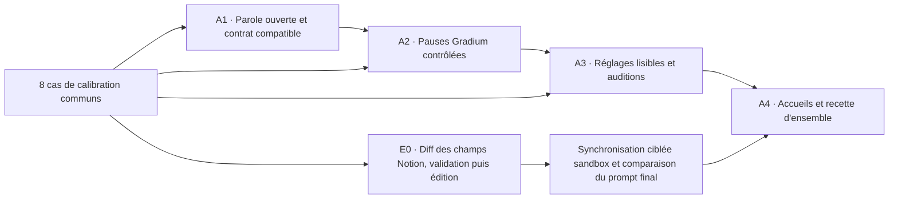

# Plan — Lot B : rendre les états de parole audibles

## Atelier de parole AP1–AP6 — contrat courant, 28 octobre 2026

Direction demandée par Ulrich : rendre les réglages existants compréhensibles,
comparer puis conserver des variantes, et éprouver la crédibilité au fil de
l'interaction. Max d'abord ; écoutes identiques puis conversations guidées ;
séances accompagnées de 10–15 minutes, une hypothèse et deux variantes maximum.
Réglages app et retouches Notion dans des passes séparées. Variantes et avis
persistants dans le back-office ; audio exact seulement pendant la séance.

**État : AP1 implémenté le 28 octobre 2026 ; persistance AP2 préparée, non lancée.**
Cette section est le contrat de la nouvelle série ; les sections datées
ci-dessous décrivent les livraisons précédentes. A4R confirme les copies E0
le 26 octobre, mais ni A4R ni F4 ne valent acceptation du naturel vocal.
La recette F4 reste distincte ; aucun gel de démo ni publication implicite.

| Lot | Périmètre et résultat observable | Dépendance / sortie | Statut |
| --- | --- | --- | --- |
| AP1 | Atelier lisible, réglages expliqués et écoute A/B fidèle au transport actuel ; réemploi du banc | Livraison technique vérifiée ; [prompt autonome](prompt_reprise_atelier_parole_lot_ap1.md) | Implémenté ; vérifications et reçu ci-dessous |
| AP2 | Variantes nommées, différences, appréciations, décision et export ; retrouvables après reconnexion | AP1 livré ; stockage sandbox strict et relecture | Planifié |
| AP3 | Première séance Max, deux répliques initiales, une hypothèse et deux variantes | AP2 livré ; bilan humain, référence et prochain défaut observé | Recette à organiser |
| AP4 | Conversations courtes guidées, nouvelle session par essai, références et versions réellement utilisées | Bilan AP3 ; états proposés/déclarés/livrés et coupures distingués | Planifié |
| AP5 | Affiner Max par passes : Notion, GM effectif, LLM ou restitution ; une couche par comparaison | Observations humaines ; sous-lots AP5.1… définis avant leur exécution | Itératif, non lancé |
| AP6 | Emma avec ses propres états, puis Max ↔ Emma et conversation plus longue | Méthode éprouvée sur Max ; bilan distinct par personnage | Planifié |

### Bonne pratique obligatoire pour cette série

- Un lot actif, un agent et une branche/PR par lot de code. Avant l'exécution,
  inscrire objectif, périmètre, dépendances, sortie observable, vérifications et
  retour arrière. Aucun lot futur n'est réputé livré avec son seul plan.
- Enchaîner les développements déjà cadrés et autorisés sans redemander l'accord
  à chaque étape ; le présent tour livre seulement le prompt AP1, sans lancement.
  L'exécution d'AP1 reste bornée à AP1 ; préparer AP2 à sa clôture. Une reprise
  ne lance pas le prochain lot. Les écoutes requises restent des décisions
  humaines ; aucune préférence artistique inventée pour poursuivre AP5.
- Séparer les statuts technique et humain. Une CI verte ne prouve pas la
  crédibilité ; une écoute réussie ne remplace pas les contrôles de livraison.
- Réutiliser les contrôles, adaptateurs, cache et traces existants. Pas de
  nouveau paramètre de jeu, catalogue d'états commun, juge LLM ni réglage vocal
  ajouté pour ce chantier. Les presets capturent des réglages, pas un état figé.
- AP2 réutilise des enregistrements dédiés dans `admin_settings`, sans migration
  pour ce lot, avec types, lecture sandbox stricte, conflit détecté et readback.
  Pas de stockage audio durable, transcript complet ou copie du prompt intégral.
- Clôture code : qualité locale et garde de livraison, CI PR/HEAD exact contenant
  main, garde versionnée, arbre/parent fusionnés vérifiés, seule branche du lot
  nettoyée, synchronisation Lovable contrôlée. Aucune seconde campagne complète
  sur main ; le contrat AGENTS/ADR CT1 prime sur les anciennes consignes ci-dessous.
- Avant le premier push : plan, CHANGELOG et prompt autonome du prochain lot
  identifiés et committés avec le code. Donner leurs liens dans le bilan ;
  aucun commit circulaire pour inscrire le futur SHA de fusion. Après fusion,
  reçu et faits durables dans la tâche Notion existante, écritures relues.
- Suivi minimal : lot, résultat, preuves, limites, recette humaine, local/GitHub/
  preview/production et prochaine action. Lot bloqué : reste exact et seule
  action humaine indispensable, sans déléguer l'attente de CI à Ulrich.
- Mesure CT2 par lot de code : préparation, premier push, qualité locale, run/job,
  installation navigateurs, E2E, retries/annulations et fusion ; travail et attente
  distincts. #104 (46 min 42 s de jobs) reste une référence descriptive ; aucune
  moyenne de lots hétérogènes ni conclusion sur la vitesse du modèle.

### Sources et état de départ vérifiés

Le 28 octobre : main et Lovable concordent sur CT1 #107,
`10e1bfaeff6c3ed1007c2d55c91c73c21ba00a07`,
[CI PR verte 40683839668](https://github.com/memoways/ava-proto1/actions/runs/40683839668).
Lire le main réel au démarrage, sans restaurer cette révision.
Gamilab natif confirmé `7e1a9a09-09cb-4deb-a306-83a29b831bc2` ;
[tâche générale](https://app.notion.com/p/f3944bc8e9ce48138f2b309db223035d),
[rapport éditorial](https://app.notion.com/p/40462322e59580ca98a4d6148d8ce406).
Fiches actives : Max `ef4cfaa6-70e3-4e87-9b9e-079815fd0cd9`,
Emma `dfcc15f8-9d37-45f7-8c84-d0c24a4288cf` ; leur jeu ne demande pas de
bégaiement systématique. Le prompt GM publié et le prompt de base du code
sont distincts : vérifier l'effectif, ne pas diagnostiquer sur le seul code.

Lecture native Lovable Ava : sandbox-ulrich, Max rugosité 3 / Emma 2, Gradium,
`streamingEnabled=false`, pauses expérimentales absentes donc inactives, tags
fermés, mapping actif `2026-10-25T11:39:32.000Z`. Le banc A3 force actuellement
WS si disponible : AP1 corrige cette différence de comparaison sans activer WS
dans le jeu. Ces valeurs sont des observations, pas des réglages à restaurer.

## Exécution AP1 — 28 octobre 2026

Objectif et périmètre du prompt AP1 conservés : Expérience → Atelier de parole,
Max et son fournisseur courant, explication des cinq familles puis préparation,
écoute et appréciation. AP2 est préparé séparément ; aucune persistance ajoutée.
Branche `codex/ap1-atelier-parole-max`, base main
`c425771d663978cf8ec3785d443969a04dfd24db`. PR #24 et branches historiques
préservées, un seul agent. Retour arrière : revert du squash AP1 via un lot
contrôlé ; aucun rollback Cloud nécessaire puisqu’aucun réglage n’est écrit.

### Résultat applicatif

- Route `/admin/experience/atelier-de-parole`, mêmes droits admin/sandbox ; banc
  `SpeechAuditionBench` réutilisé, TTS Config conservé. Un seul banc monté à la
  fois, arrêt et nettoyage du propriétaire audio à la fermeture/navigation.
- Fiche/copie, états propres, rugosité, orchestration publiée, compilateur,
  modèles/paramètres LLM, mapping/version, voix et paramètres vocaux lisibles.
  Références en lecture seule, dates/copies inconnues et replis distingués ;
  metadata seules pour la copie et l’orchestration, sans prompts intégraux.
- A capture les réglages chargés, y compris mapping désactivé/absent et rugosité
  zéro. B modifie un seul contrôle vocal borné : padding, température ou fidélité.
  Proposition initiale : padding actuel contre zéro, ou pas de 0,2 si déjà nul.
  Diff lisible, hypothèse sans préférence artistique inventée ni adoption live.
- M1/M2 de Max d’abord, autres cas explicitement cochés. Chaque cas attend une
  sélection d’état propre à la fiche ; mêmes mots éditables, état, voix,
  rugosité et transport entre A et B. Le parcours historique garde Emma et les
  autres fournisseurs. Aucun état attribué silencieusement au corpus.
- Gradium chargé avant capture du snapshot ; REST direct si streaming désactivé,
  WS explicitement choisi sinon. Pauses A2 en comparaison séparée. Le cache est
  indexé aussi par transport demandé ; requêtes et transport effectif/repli sont
  conservés. Rejeu exact sans appel, cache 16 écoutes / 16 Mio et capture bornée
  réutilisés. Le repli REST ne valide pas les pauses WS.
- Paramètres préparés séparés des requêtes attestées ; padding de base, modulation
  par état et valeur effectivement envoyée lisibles, JSON/preuves repliés. Acting,
  émotion/delivery/instruction/débit relatif Gradium non appliqués, tags fermés.
- Avis/export temporaires, disparition après fermeture annoncée ; régénérer
  après fermeture n’est pas rejouer l’audio exact. Aucun bouton d’adoption.
- Le test admin a révélé une écriture préexistante de normalisation LLM au
  chargement. Mode de bootstrap `readOnly` ajouté pour l’atelier uniquement ;
  les autres parcours conservent leur comportement. Le test injecte un ancien
  modèle invalide et vérifie zéro écriture, zéro audio, clavier et largeur 390 px.

### Preuves et limites

32 tests ciblés initiaux verts, puis couverture de normalisation en lecture
seule ajoutée. Test navigateur AP1 ciblé vert, fournisseurs et compte admin
simulés ; aucun audio fournisseur réel. L’assertion mobile a d’abord révélé un
select débordant, corrigé. Une assertion diagnostique intermédiaire comptait
également les onglets volontairement défilants ; le contrôle final porte sur
la largeur du document. Le test de zéro écriture a ensuite révélé et fait
corriger le bootstrap LLM décrit ci-dessus. Pas de contrôle retiré.

`npm run test:quality` final vert : lint (un avertissement IndexPRD4 préexistant),
typage, 71 régressions, 1 126 unitaires, 42 intégrations et build.
`npm run test:delivery` : 23/23 verts. Run/job PR, SHA HEAD/main et reçu arbre/parent sont consignés
dans le compte rendu de PR et la tâche Notion après fusion, sans commit circulaire.
La preview authentifiée est vérifiée après synchronisation Lovable. Une seule
campagne complète sur PR ; aucune seconde campagne complète sur main.

Lecture native Lovable le 28 octobre : sandbox-ulrich, Max Gradium / rugosité 3,
base padding 0,2, température 0,7, fidélité 2, streaming désactivé, mapping actif
`2026-10-25T11:39:32.000Z`, pauses A2 absentes, tags fermés. Valeurs observées,
aucune restauration ni sauvegarde. Gamilab confirmé et tâche/fiche/rapport lus.
Fiches Notion, prompt GM effectif, voix, budgets, capture/STT, mains libres,
transferts, backend et publication production préservés.

La crédibilité vocale reste une recette humaine ouverte : ce lot ne revendique
ni écoute réelle, ni acceptation du timbre ou des pauses, ni latence voix-à-voix.
[Prompt autonome AP2](prompt_reprise_atelier_parole_lot_ap2.md) enregistré dans
ce même lot, à fournir directement à la clôture ; AP2 et AP3 non lancés.

### Mesure CT2 AP1

Début de chat observé : 28 octobre 2026, 16:27:58 UTC (17:27:58 Europe/Zurich).
Branche AP1 créée à 16:28:42 UTC. Préparation documentaire préalable #108
séparée de cette mesure. Dépendances et navigateurs déjà installés en local ;
pas d’installation supplémentaire. Une tentative de lancement du serveur E2E
bloquée par EPERM en sandbox avant tout test ; contexte système autorisé ensuite.
Qualité locale finale : 16:38:23–16:39:21 UTC (57.9 s). Trois passes
locales complètes vertes au fil des corrections ; la dernière couvre tout le code
final. Test de garde : 23/23, 0,52 s. E2E ciblé final vert : 2,4 s
d’exécution (4,0 s avec démarrage). Quatre exécutions ciblées rouges pendant le
diagnostic (mobile, instrumentation des onglets, puis écriture de normalisation),
avant cette réussite ; aucun retry automatique local.
Horodatages premier push/run/job/installation/E2E/fusion et durées
travail/attente complétés dans le bilan de PR/Notion après livraison. Pas de
moyenne avec #104 ni d’attribution à la vitesse du modèle. Référence descriptive
#104 : 22 min 26 s PR + 24 min 16 s main, dont 40 min 28 s E2E.

## Exécution coordonnée Notion / app — 25 octobre 2026

**Statut vérifié le 26 octobre 2026 : A1/A2/A3/A4 techniquement livrés ;
A4 reste incomplet pour l'intégration E0 et la recette humaine.** A4 est dans
main `26cfc2caf5812e1907d3a2d4db1730ed8f8948ec` par
[#81](https://github.com/memoways/ava-proto1/pull/81), CI PR/main vertes,
E2E compris. Lovable annonce le même SHA, `ready`, agent terminé ; la preview
connectée a été vérifiée à la livraison. Aucune publication production par A4 ;
pauses expérimentales désactivées. Voir le bilan exact ci-dessous.
**Accès Gamilab rétabli et vérifié le 26 octobre :** workspace natif
`7e1a9a09-09cb-4deb-a306-83a29b831bc2`, fiches Max/Emma lisibles,
66 outils sur deux démarrages indépendants. E0 et recette humaine restent ouverts.
La reprise restante est le [prompt autonome A4R](prompt_reprise_integration_recette_lot_a4r.md),
qui ne lance pas l’intégration E0 ni la recette humaine. Cette section est le plan
opérationnel courant ; elle remplace les découpages historiques ci-dessous.

**Historique de reprise A1 — 25 octobre 2026 :** Ulrich travaille dans Notion
sur les champs prompts ; la préparation app doit avancer indépendamment, sans
édition de ces champs ni synchronisation automatique. Le
[prompt autonome A1](prompt_reprise_parole_ouverte_lot_a1.md) est prêt pour
l'implémentation et la livraison du premier lot. Plan, tâche éditoriale et
instructions de routage sont conservés dans la préparation documentaire de la
branche `codex/parole-ouverte-a1`. Aucun code app modifié pendant sa préparation.
Le test natif Gamilab après redémarrage échoue encore à l'initialisation OAuth ;
le plugin distinct répond pour Ulrich. A1 ne dépend pas de cette connexion.

Le [plan de direction](plan_parole_incarnee_personnages.md#direction-après-écoute--25-octobre-2026)
porte les choix de jeu validés. Le [contenu de la tâche éditoriale](tache_notion_parole_incarnee_personnages.md)
est prêt pour la base Gamilab explicitement demandée :
[a789687e3d57461696f134af9b766f28](https://app.notion.com/p/gamilab-prov/a789687e3d57461696f134af9b766f28?v=23a0333beea1467eae928b7470b67fef).
La proposition E0 locale n'a pas été créée comme nouvelle tâche par l'agent.
L'accès natif rétabli a permis de retrouver la tâche existante
[Rendre les dialogues de tous les personnages moins écrits et moins lisses](https://app.notion.com/p/f3944bc8e9ce48138f2b309db223035d),
dans cette base. La relire et comparer la proposition E0 avant tout ajout ;
ne pas créer de doublon ou substituer le workspace personnel Ulrich.

### Mécanique retenue : deux sources, un corpus, une intégration à la fois

- **Notion : contenu éditorial.** Une tâche E0 pour les deux fiches ; diff par
  propriété, validation, édition et relecture. Pas quatre copies de la même
  psychologie dans les lots techniques. Les états et leurs déclencheurs viennent
  des fiches ; les exemples sont des calibrations, pas des règles en dur.
- **Dépôt : exécution technique.** Quatre lots app avec résultat observable,
  fichiers concernés, tests adaptés et retour arrière. Un seul lot et agent
  actifs sur le dépôt, une branche/PR par lot, aucun chantier parallèle sur les
  mêmes fichiers. Le travail éditorial peut avancer à part sans toucher au repo.
- **Contrat commun de recette.** Huit cas courts avec contexte autorisé,
  personnage, état attendu si pertinent, texte de calibration et appréciation
  humaine. Même corpus pour les propositions Notion et le banc audio existant.
  Figer le texte pour comparer le rendu ; figer le rendu pour comparer les mots.
- **Traçabilité minimale.** À chaque comparaison : version de fiche synchronisée,
  variante du compilateur, rugosité épinglée, version du mapping, voix/fournisseur
  et texte effectivement entendu. Utiliser traces et reçus existants ; pas de
  nouveau tableau de bord ni d'appel LLM supplémentaire par tour.

A1 utilise d'abord les fiches actuelles synchronisées : il ne dépend pas de
l'édition E0. Les tests déterministes A2 et la clarification A3 peuvent aussi
être préparés avec ces versions. L'acceptation du rendu final et la recette A4
attendent les textes E0 approuvés et intégrés. Aucun lot ne change simultanément
prompts, modèle, voix, température et rythme.

### E0 — tâche éditoriale dans Notion Gamilab

**Livrable :** champs Max/Emma proposés avant/après, puis version approuvée et
relue. Périmètre exact dans le [corps de tâche prêt](tache_notion_parole_incarnee_personnages.md).
Le schéma de la base doit être lu et les doublons recherchés avant création ;
pas de responsable, échéance, statut ou relation inventés. Renvoyer l'URL réelle
après création vérifiée. L'autorisation de créer cette tâche ne vaut pas
autorisation d'appliquer toutes les propositions aux fiches maintenant.

### A1 — laisser la pensée ouverte sans casser la réponse

**Résultat observable :** « Moi, ça va. Non. J'en sais rien. Mais elle… » peut
rester la fin voulue d'un tour ; le moteur n'exige pas une conclusion explicative
et ne transforme pas ce fragment volontaire en panne.

- Reprendre les contrats techniques dans `src/agents/maxAgent.ts`, les trois
  compilateurs `maxPromptCompiler.ts`, `maxRichPromptCompiler.ts`,
  `maxOptimizedPromptCompiler.ts`, et `src/services/responseIntentStream.ts`.
  Distinguer fin technique normale et pensée inachevée ; conserver brièveté,
  budget et en-tête privé. Les fragments sont déjà acceptés par le parseur :
  n'élargir sa validation que si un cas précisément autorisé l'exige.
- Examiner `src/services/speechRugosity.ts` : le niveau 3 ne doit pas remplacer
  les déclencheurs Notion par une préférence systématique pour Bloqué. Garder
  les cinq états propres, sans rotation imposée ni ajout automatique de tics.
- Respecter la réserve des champs éditoriaux déjà réparée en #75. Ajouter
  seulement les vérifications nécessaires à la compatibilité des prompts et
  aux limites : fragment intentionnel, vrai length/abandon, citation ouverte,
  tag privé, identité étrangère et consentement rétracté.

**Validation :** replays ciblés et prompts effectifs des quatre variantes ;
quelques sorties sur le corpus lorsque le banc le permet. La présence d'une
consigne ne suffit pas à prouver le jeu. Vérifier le passage Max ↔ Emma sans
changer son validateur. **Retour arrière :** revert du lot, fiches et mapping
conservés. **Sortie :** prise de parole ouverte techniquement fiable ; aucune
promesse de souffle ou de timbre émotionnel à ce stade.

### Exécution A1 — 25 octobre 2026

Base vérifiée : main `147cdfff893555ede4f903158c5506dcf586e116` (#76).
Préparation documentaire `ca8e787` conservée sur `codex/parole-ouverte-a1`.
La PR étrangère #24 ne recoupe aucun fichier du lot ; elle et les branches
étrangères restent intactes. Dépôt public, CI PR et main conservées sans
modification de workflow. Identité GitHub existante `Ulrfis` vérifiée ; aucune
configuration GitHub App présente sur ce poste.

Corrections app : fin technique normale distinguée de la pensée ouverte dans
le contrat de sortie ; phrases ou fragments dans les quatre variantes, avec
les mêmes plafonds. Le compilateur compact reçoit son contrat depuis maxAgent :
aucun changement de sélection ni de réserve dans maxPromptCompiler nécessaire.
Les niveaux 1–3 modulent les possibilités de la fiche sans priorité à Bloqué.
La proposition GM est facultative, soumise aux déclencheurs ; ni prompt ni
filtre n'imposent de rotation après deux états identiques. Le contrat courant
GM s'applique aussi après le prompt publié v7, sans en modifier la version.
La déclaration réellement livrée reste validée contre la fiche courante ;
aucune requalification en état joué. Le parseur et les règles de passage sont
inchangés.

Reproduction avant correction : **11 échecs / 108 réussites** dans les suites
existantes prompts/états/GM/contrat. Cas concret du filtre : la proposition
« État propre actuel », encore pertinente après deux occurrences, devenait
null dans le véritable évaluateur GM. L'historique forçait aussi une rotation
même à rugosité 0. Ces deux contraintes sont retirées, sans état alternatif
inventé. Contrôle élargi : **229/229** tests ciblés verts. `npm run test:quality`
final vert : lint/types/build, **66 régressions, 967 unitaires, 41 intégrations**.
Le premier passage avait rencontré un timeout de 5 s dans
LatencyBlockingTab.test.tsx, pendant les contrôles simultanés ; rejeu isolé
8/8 puis nouveau passage complet vert, sans modification de ce composant,
des attentes ni des délais. Avertissements préexistants : dépendance useCallback
et taille des chunks. `npm run test:e2e` : **78/78 verts sans retry, 14,2 minutes**,
Chromium et contrôles média Firefox/WebKit. Passage bidirectionnel jusqu'au clic,
refus/rétractations/différé, références invalides, résultats tardifs, persistance
et CAS conservés. Les replays de reçu gardent delivered / uncertain / private
séparés, sans rejeu après son ; récupération préalable toujours unique et bornée.

Livraison GitHub : squash conditionné à `regression-gates` vert sur le HEAD exact,
puis contrôle de main/E2E, synchronisation du même SHA dans Lovable et lecture
du bundle réellement servi en preview. Les SHA, runs et branches finales sont
relevés dans le bilan GitHub de la PR A1, sans boucle documentaire pour inscrire
son propre SHA. Seule la branche A1 doit être supprimée ; toutes les branches
étrangères et #24 sont conservées. Production non publiée.

Snapshot de calibration conservé : fixtures Cloud Max/Emma datées du
24 octobre, collectées le 25 (`speechSandbox20261025.json`), sans édition.
Les prompts effectifs restent propres au personnage, avec parole et moteur
intime entiers, sous les plafonds existants ; témoin Max 3 / Emma 2.
Comparaison textuelle déterministe : l'ancien contrat disait « achève ta
réponse » et imposait une rotation ; le nouveau permet une pensée ouverte et
maintient l'état pertinent. Les textes simulés « Moi, ça va. Non. J'en sais
rien. Mais elle… » et « Je la laisserai pas toute seule. » gardent leurs mots
jusqu'au reçu, avec flux SSE stop + DONE. Les négatifs existants restent requis.
Ce replay ne mesure pas une amélioration de sortie modèle ou du jeu. Le banc
juge existant orchestre répétitions et appels personnage/GM/juge ; aucune
campagne ni infrastructure ajoutée, aucun appel modèle/audio réel dans A1.

Le seul connecteur Notion exposé vérifie `self.workspace.id` personnel
`377e8583-7838-4c05-9f76-8833a450f304` : mauvaise cible pour Ava, aucune lecture
ciblée ni écriture. A1 ne dépend pas de Gamilab. Ulrich garde l'édition et le
moment d'intégration ; ni sync automatique, ni prompts Cloud écrasés, ni RAG
reconstruit, ni tâche doublon. Capitalisation Notion projet non sauvegardée.

Restent distincts : A2 pauses Gradium, A3 réglages/banc, A4 accueils et intégration
des nouvelles fiches puis écoute humaine. A1 ne promet ni souffle ni timbre
émotionnel, ne change aucun réglage enregistré et ne publie pas en production.

### A2 — restituer les ruptures dans Gradium

**Résultat observable :** une suspension choisie produit un vrai temps d'arrêt,
avec les mêmes mots entendus et affichés, sans ralentir toute la réplique.

- Périmètre : `src/services/tts/providers/gradium.ts`,
  `src/services/tts/gradiumStreamPlayer.ts`,
  `src/services/tts/performanceIntent.ts` et leurs tests. Réutiliser le banc
  d'audition ; aucun nouveau moteur vocal.
- Après validation du texte, préparer les mots puis insérer les seuls contrôles
  de pause autorisés par l'adaptateur. Aucun tag produit par le LLM ne devient
  accepté. Ne pas retirer globalement le nettoyage qui évitait les hoquets.
- Déterminer les pauses depuis les ruptures explicites et le mapping validé,
  pas depuis une virgule quelconque ni une ponctuation aléatoire. Essais bornés
  autour de 0,25 / 0,6 / 1 seconde ; réglage final après écoute. Vérifier la
  capacité réelle des chemins WebSocket et REST avant activation.
- Texte des sous-titres et preuves inchangé. Contrôles TTS séparés des mots ;
  un silence n'atteste pas la livraison du mot suivant. Garder l'échéance,
  l'annulation et le comptage de lecture corrects pendant une pause.
- Activation expérimentale sandbox distincte, désactivée par défaut tant que
  l'écoute n'est pas acceptée ; réutiliser les réglages JSON existants, sans
  migration si possible. Pas de changement production, voix ou température.

**Validation :** cohérence texte entier / segments / repli REST, zéro tag
arbitraire, aucun mot perdu/doublé, arrêt pendant silence et reprise sans rejeu.
Conserver les décisions mains libres dans handsFreeVoice ; le silence voulu
ne devient pas un échec réseau ou une nouvelle décision de tour. **Retour
arrière :** désactiver les pauses expérimentales sandbox. **Sortie :** pauses
acceptées sur le corpus, sans clic/hoquet ; voix étranglée et souffle restent
des qualités à juger séparément, pas des capacités garanties par break.

### Exécution A2 — 25 octobre 2026

Base A1 `e006db65419c70b345abbe735d783f47257e7559` (#77), checkout canonique
à jour, branche unique `codex/ava-a2-audible-pauses`. PR étrangère #24 sans
recoupement ; ses fichiers et les 16 branches locales étrangères sont conservés.
Lovable cible vérifiée : `1265958d-b74e-40f2-917d-182fe05163fc`.

**Protocole vérifié le 25 octobre.** Le [guide WebSocket Gradium](https://docs.gradium.ai/guides/text-to-speech)
documente `<break time="1.5s" />`, borné de 0,1 à 2 secondes, entouré d'espaces.
`<flush>` force la génération du contexte déjà envoyé, sans durée de pause :
A2 n'en a pas besoin. Les messages texte successifs ajoutent un espace ; on
envoie des unités validées, avec mots et ponctuation attachés, jamais des tokens
SSE ni une ponctuation isolée. La [référence WS](https://docs.gradium.ai/api-reference/endpoint/tts-websocket)
décrit audio PCM et timestamps texte `start_s`/`stop_s`. Le lecteur suit les
samples, y compris le silence renvoyé, sans timer de pause applicatif ; ce
comportement est vérifié ici sur un fournisseur simulé, sans mesure acoustique.
L'exemple de [l'intégration libre LiveKit](https://docs.livekit.io/reference/python/livekit/plugins/gradium/)
confirme le schéma setup/text/audio/EOS ; aucun SDK ajouté.

Le [contrat REST](https://docs.gradium.ai/guides/text-to-speech-rest) distingue
audio brut et flux JSON. Le proxy Ava utilise `only_audio=true` : pas de
timestamps exploitables. L'équivalence des breaks avec ce chemin REST n'est
pas suffisamment établie par les exemples consultés ; **repli sans pause
contrôlée**, avec nettoyage historique et mêmes mots. Aucun message WS dans
le POST. La métadonnée `pauseRendering: rest_unavailable` et un diagnostic
explicite signalent cette différence si des ruptures étaient éligibles.
Proxy Cloud et secrets inchangés ; aucune intervention Cloud dans A2.

**Implémentation.** `gradiumSpeech.ts` sépare les parties texte et pause, retire
les commandes provenant de l'entrée avant tout nettoyage, puis sérialise les
seuls breaks construits par l'adaptateur. Les points de suspension et les tirets
de rupture explicites sont éligibles ; virgules, traits d'union lexicaux et
réponses nettes n'ajoutent rien. Essais `short=0,25`, `normal=0,6`, `long=1`
seconde, huit pauses au maximum par tour (maximum ajouté de huit secondes),
sans bruit aléatoire. Les ruptures supplémentaires gardent le nettoyage
historique. Aucun ralentissement global supplémentaire, appel LLM ou socket.

`performanceIntent.ts` exige une intention `speech_state`, un état et une
version correspondant au mapping du personnage et l'activation sandbox.
Le setup est toujours fixé avant le premier segment ; la configuration ne
change plus après append. `streamedVoiceTurn` envoie la parole validée brute
à l'adaptateur, conserve les textes originaux et compare les mots nettoyés aux
timestamps audibles. Les éventuels contrôles renvoyés dans un timestamp sont
filtrés. Silence généré ou EOS ne suffit pas pour confirmer les mots suivants.
Les reçus restent conservateurs par unité validée, sans proportion texte/audio
inventée. Arrêt, candidat réversible, reprise, annulation et callbacks périmés
gardent les barrières existantes ; aucun rejeu après samples programmés.
Buffers, bornes réseau, récupération préalable et mains libres inchangés.

**Activation : désactivée, non sauvegardée.** Nouveau booléen optionnel
`gradiumPausesEnabled` dans le JSON d'environnement `ava_speech_performance` ;
absent/false, mapping inactif, rugosité 0, état/version invalide ou prod →
nettoyage historique sans break. Pas de migration ni d'interface A3 ajoutée.
Un futur essai doit modifier uniquement ce booléen dans une copie isolée des
réglages, préserver version et mapping ; aucun essai live ni sauvegarde réalisés
ici. Le mapping sandbox `2026-10-25T11:39:32.000Z`, Max 3 / Emma 2, les voix,
modèles, températures et budgets 220/950 sont conservés. Tags émotionnels fermés.

**Audition courte préparée, non exécutée.** Dans le banc existant : Max 3,
« Allô ? Oui… c'est vous qui deviez… Oui. » puis Emma 2,
« Je la laisserai pas toute seule. » et « Moi, ça va. Non. J'en sais rien.
Mais elle… ». Exemples non canoniques, contexte à approuver, même voix et même
mapping ; noter mots, durée de silence, clic/hoquet et naturel, une seule écoute
à la demande. Le banc actuel utilise REST : il fournit le témoin nettoyé et ne
peut **pas** accepter les pauses WS d'A2. Le raccord d'audition au transport WS
reste dans A3 (hors périmètre explicite), sans nouveau banc ni matrice.
Les simulations A2 vérifient le protocole et les samples ; aucune audition,
durée acoustique réelle, latence réelle, souffle, sanglot ou affect n'est revendiqué.
Cette limite n'empêche pas la livraison technique désactivée et interdit
l'activation ou une déclaration d'acceptation humaine.

**Vérifications locales.** 20 tests du compilateur/adaptateur final verts ;
les suites lecteur/reçus couvrent aussi silence PCM simulé, EOS avant drain,
curseur conservé, annulation et callbacks tardifs. `npm run test:quality` vert :
lint/types/build, **66 régressions, 987 unitaires et 41 intégrations**. Les deux
premiers échecs ciblés ont permis de corriger les ruptures adjacentes séparées
seulement par de la ponctuation ; l'écart d'espace inter-message est normalisé
dans la comparaison, conformément au protocole. Avertissements préexistants
useCallback et taille des chunks. **78/78 E2E verts sans retry, 12,9 minutes**,
sur le code final, Chromium et média Firefox/WebKit ; le premier
lancement sandbox a été arrêté avant tout test (port local interdit), puis
relancé avec l'accès système nécessaire sans changer le code ou les protections.

**Livraison vérifiée :** [PR #78](https://github.com/memoways/ava-proto1/pull/78),
HEAD `61ad6e09aff6fd6b0312159a66b983ae8fac74bd` après
[CI PR verte](https://github.com/memoways/ava-proto1/actions/runs/40227877871),
78 E2E sans retry en 13,9 minutes. Squash main
`a63ee8a379dcee47346903b43efab2e627f9ed7c`, arbre identique, puis
[CI main verte](https://github.com/memoways/ava-proto1/actions/runs/40229327400),
78 E2E sans retry en 14,8 minutes. Lovable : même SHA, ready/agentFinished,
édition completed ; preview connectée sandbox Ulrich et banc chargés, bundle
`/assets/index-BCNMaBQN.js`. Quatre messages console d'accès au stockage refusé
observés, origine non établie ; aucune protection modifiée pour les contourner.
Checkout propre sur main, seule branche A2 supprimée. Distantes restantes :
main et `agent/test-gap-invitation-validity-multi-use` ; #24 et les 16 branches
locales étrangères conservées. Aucune publication production.
Notion `self` vérifie le workspace Ulrich, mauvaise cible Ava : aucune lecture
de fiche, édition, tâche doublon, sync ou RAG ; faits durables non sauvegardés
dans Gamilab, travail technique poursuivi conformément à la demande.

### A3 — rendre les réglages et le banc d'écoute fiables

**Résultat observable :** l'admin montre ce qui est réellement envoyé au
fournisseur ; une comparaison A/B courte est rejouable et attribuable.

- Périmètre : `src/components/SpeechAuditionBench.tsx`,
  `src/components/TTSConfigTab.tsx`, `src/services/tts/speechAudition.ts`,
  `src/services/tts/speechPerformanceSettings.ts` et tests utiles.
- Pour Gradium, distinguer débit global, pauses explicites, émotion/acting
  non appliqués et capacités encore fermées. Les champs utilisables par les
  autres fournisseurs gardent leur sens ; ne pas masquer une limitation par
  une instruction affichée qui ne sera jamais envoyée.
- Afficher les noms/descriptions issus de Notion, le réglage enregistré et sa
  version, le texte source, le texte de synthèse et les paramètres appliqués.
  Garder les mots d'acting éditoriaux dans Notion, pas dans un nouveau prompt app.
- Utiliser huit cas au total. Première écoute A/B sur quatre textes au plus,
  puis seulement les finalistes ; pas de génération automatique des centaines
  de combinaisons historiques. Un appel à la demande, arrêt et cache de rejeu.
- Séparer appréciations mots/pensée, pauses/rythme, affect/timbre et artefacts.
  Afficher nombre d'appels et coût seulement s'il est connu. Voix de banc isolées
  des profils de jeu. Max 3 / Emma 2 restent d'abord le témoin.

**Validation :** affichage fidèle aux paramètres consommés, sauvegarde/relecture
du seul environnement sandbox, isolation des voix, cache invalidé par les
changements pertinents, pas d'appel lors d'un rejeu identique. **Retour arrière :**
désactiver le rendu expérimental ; réglages précédents relus avant restauration.
**Sortie :** comparaison exploitable et acceptée. Si le timbre reste détaché
malgré mots/pauses justes, proposer au plus deux auditions de voix alternatives,
sans changer automatiquement le fournisseur de jeu.

### A4 — accueils et recette d'ensemble

#### Vérification A4R — 26 octobre 2026

**E0 est déjà synchronisé ; aucune resynchronisation exécutée.** Ce contrôle
remplace les hypothèses d'intégration restante des bilans A4 et #83. La recette
humaine demeure ouverte. Base documentaire reprise :
`5b9a5c107c2f2c103ad310afcdcde78220ccf73d`, #83. L'autre chat a terminé sa
livraison avant toute écriture A4R ; aucun travail étranger modifié.

**Sources natives.** `get-self` confirme Gamilab
`7e1a9a09-09cb-4deb-a306-83a29b831bc2`. La
[tâche E0](https://app.notion.com/p/40462322e59580ca98a4d6148d8ce406)
contient le rapport d'édition sur validation explicite d'Ulrich du 25 octobre,
avec avant/après par propriété. Elle complète la
[tâche générale](https://app.notion.com/p/f3944bc8e9ce48138f2b309db223035d).
Aucune nouvelle tâche nécessaire. Les fiches indiquées actives dans l'ancien
prompt sont devenues Backup ; la requête de la base confirme deux nouvelles
fiches « En cours » :

| Personnage | Page active | Dernière modification source UTC | Copie sandbox UTC |
| --- | --- | --- | --- |
| Max | [ef4cfaa6…](https://app.notion.com/p/ef4cfaa670e34e879b9e079815fd0cd9) | 2026-10-25 17:30:48.186 | 2026-10-25 17:35:07.189 |
| Emma | [dfcc15f8…](https://app.notion.com/p/dfcc15f89d3745f78c84d0c24a4288cf) | 2026-10-25 17:30:48.329 | 2026-10-25 17:35:13.983 |

**Comparaison source/copie.** Lecture SQL uniquement par MCP Lovable Ava,
projet `1265958d-b74e-40f2-917d-182fe05163fc`, base activée vérifiée.
`characters.notion_id` porte déjà les nouveaux IDs. Décodage de la présentation
MCP : `br` vers sauts de ligne, retrait des balises de mise en forme,
échappements Markdown décodés, extrémités nettoyées ; aucun changement des mots,
de la ponctuation ou des espaces intérieurs. Dix-huit propriétés concordent
en sandbox-ulrich :

| Propriété | Max, caractères | Emma, caractères | Résultat sandbox |
| --- | ---: | ---: | --- |
| Identité fondamentale | 2918 | 2974 | égales aux sources |
| Qui tu es | 3449 | 3604 | égales aux sources |
| Manière de parler | 2647 | 2756 | égales aux sources |
| Dynamique de la conversation | 7836 | 8407 | égales aux sources |
| Ce que tu ne fais jamais | 3122 | 3419 | égales aux sources |
| Qui t'appelle | 3313 | 3331 | égales aux sources |
| Sujets sensibles | 4176 | 3827 | égales aux sources |
| Références intellectuelles | 8820 | 4340 | égales aux sources |
| Timeline | 9822 | 10834 | égales aux sources |

Les cinq états de chaque fiche sont présents en DB et dans la preview, avec
leurs descriptions propres. Les mêmes 18 propriétés sont déjà présentes dans
la base prod (Max : 25 octobre 18:38:05.050 UTC ; Emma : 18:38:11.072 UTC).
Ce constat préexiste à A4R ; aucune écriture production, et aucune publication
du frontend déduite de ces dates. RAG, doublons d'index et caches d'une session
déjà ouverte ne sont pas réaudités ; aucun changement d'index nécessaire ici.

**Rendu vérifié sans génération.** Preview authentifiée dans Brave, environnement
Sandbox — Ulrich. Fiches Max/Emma et cinq états affichés, versions de copie
ci-dessus. Aperçus `rich_v2` : Max 11 893 caractères statiques, manière de
parler 2647/2647 et moteur intime 793/793 ; Emma 11 917, manière de parler
2756/2756 et moteur intime 954/954. Sections injectées Emma relues : pensée
sans réparation et absence de retour imposé à Ava présentes. Ce sont des aperçus
admin ; aucun nouveau prompt live envoyé au LLM ni conclusion sur le jeu entendu.
Les accueils A4 sandbox correspondent aux phrases approuvées ; ceux de prod
gardent leurs valeurs antérieures. Aucun profil sauvegardé.

**Livraison et reste.** Code applicatif et workflow inchangés ; diff et liens
documentaires vérifiés, suites lourdes non rejouées. Dernière
[CI qualité/E2E du code](https://github.com/memoways/ava-proto1/actions/runs/40298606848)
verte sur `26cfc2caf5812e1907d3a2d4db1730ed8f8948ec` ; exception documentaire.
SHA documentaire final et résultat de livraison dans le bilan de PR, pour éviter
une boucle de commit du propre SHA. Aucun appel fournisseur audio, sync,
réécriture de fiche/prompt Cloud, activation live ou publication production.
Restent la recette au casque et la vérification du comportement effectif des
sessions neuves avec Ulrich. Une pause n'atteste ni souffle ni sanglot ;
l'acceptation exige son retour explicite. La
[reprise A4R](prompt_reprise_integration_recette_lot_a4r.md) porte ce seul reste.

#### Exécution A4 — 26 octobre 2026

**Mise à jour Gamilab après #82 :** renouvellement officiel réussi avec le CLI
stable 0.164.0. `notion_gamilab` est chargé dans ce chat ; `get-self` confirme
Gamilab `7e1a9a09-09cb-4deb-a306-83a29b831bc2`. Les fiches Max et Emma et la
tâche éditoriale existante ont été lues. Deux démarrages natifs indépendants
(client intégré puis CLI stable) conservent OAuth et 66 outils. Le blocage
d'accès ci-dessous est historique et levé pour Gamilab. La connexion native
Ulrich reste `notLoggedIn` ; son plugin séparé reste exploitable. Aucune
restauration globale de tous les workspaces n'est revendiquée.

Le routage vérifié est consigné dans AGENTS et la fiche projet Notion existante.
Aucune édition de personnage, intégration E0, sync Cloud ou recette humaine
effectuée par cette reconnexion. Reprendre A4R directement par les sources
actuelles et la tâche existante, sans nouvelle autorisation Gamilab.

**Clôture technique relue le 26 octobre 2026 :**

- [PR #81 fusionnée](https://github.com/memoways/ava-proto1/pull/81), main
  `26cfc2caf5812e1907d3a2d4db1730ed8f8948ec`. [Bilan détaillé de livraison](https://github.com/memoways/ava-proto1/pull/81#issuecomment-6412874906).
- HEAD exact `4e35dc70f1d025776f04764aa3fa481bbfcde0e5` :
  [CI PR verte](https://github.com/memoways/ava-proto1/actions/runs/40296314456).
  [CI main verte](https://github.com/memoways/ava-proto1/actions/runs/40298606848)
  sur le SHA de fusion, qualité et E2E tous deux réussis. Résultat local final :
  81 E2E sans retry, 12,9 minutes ; 66 régressions, 1 019 unitaires,
  41 intégrations, lint/types/build verts. Fournisseurs simulés.
- MCP Lovable relu après le redémarrage signalé par Ulrich : projet Ava
  `1265958d-b74e-40f2-917d-182fe05163fc`, même SHA, `ready`,
  `agentFinished=true`. La vérification visuelle connectée reste celle du bilan
  #81 ; aucun nouveau contrôle audio ou visuel revendiqué. Les messages de
  preview « Access to storage is not allowed from this context. » restent
  d'origine non établie et à recouper si la recette reproduit un problème.
- Notion revérifié après redémarrage : `fetch("self")` du connecteur exposé
  confirme Ulrich `377e8583-7838-4c05-9f76-8833a450f304`. Le diagnostic du
  client MCP natif retourne `notLoggedIn`, zéro outil pour `notion_gamilab`
  et `notion_ulrich_fischer`. La restauration de toutes les connexions natives
  n'est donc pas validée. Aucun accès ciblé ou écriture Gamilab effectué.
  Le diagnostic antérieur avait établi un refus de renouvellement puis une
  erreur d'écriture du Trousseau ; ne pas relancer OAuth en boucle sur le seul
  résultat de ce nouveau contrôle. Reprise préalable détaillée dans A4R.
- Branche A4 supprimée localement et à distance. GitHub conserve `main` et
  `agent/test-gap-invitation-validity-multi-use` ; seule PR ouverte : #24,
  étrangère, inchangée depuis le 11 octobre. Les 16 branches locales étrangères
  sont conservées. La présente correction est documentaire : aucun code,
  réglage Cloud ou contenu de personnage modifié ; CI lourde non relancée.

**Reste :** comparaison des éditions E0 effectivement approuvées puis intégration
ciblée si nécessaire, complément de capitalisation des lots vocaux, recette au
casque avec Ulrich et décision distincte sur une publication production.
Les accueils app approuvés ne valent ni approbation E0 ni acceptation acoustique.
Le [prompt A4R](prompt_reprise_integration_recette_lot_a4r.md) est actualisé ;
ce bilan ne lance pas sa réalisation.

Base réelle : `1b0fcd4340f79b4c8184c7100b0e96840bf4c938`, A3 #80.
[Bilan A3 et CI exactes](https://github.com/memoways/ava-proto1/pull/80#issuecomment-6409951717) relus ;
Lovable annonce le même SHA, prêt, agent terminé. Checkout propre avant A4,
main mis à jour ; PR étrangère #24 sans recoupement, branches étrangères préservées.
Un seul agent, branche `codex/accueils-integration-a4`.

Diagnostic : l'accueil initial lit `character_runtime_profiles.opening_line` ;
les transferts/retours utilisent déjà des répertoires distincts. L'ancien cache
singleton n'est plus appelé par le parcours et ne distingue ni voix ni environnement.
L'accueil initial n'a pas de verrou synchrone avant ses attentes ni de signal
d'annulation propre. Les transferts ont déjà un verrou et une provenance.

Travail technique indépendant implémenté : conserver le champ app existant en acceptant
un répertoire app approuvé, lié à la phrase de référence du profil et à sandbox-ulrich, choisir une fois par appel,
éviter le dernier choix lorsque plusieurs textes sont disponibles, et empêcher
les doubles lectures/callbacks périmés. Réutiliser la sortie et la queue existantes ;
cache borné des blobs REST complets seulement, clé texte/personnage/environnement/
fournisseur/voix/modèle/réglages/intention/stitching. Le streaming WS garde son
chemin A2, sans capture live nouvelle ni changement de buffers ou de pauses.
Tests aux points d'appel, puis qualité et E2E séquentiels ; aucun audio réel automatique.

Contrôle de compatibilité avant toute écriture Cloud : deux lignes dans le champ
existant seraient toutes deux lues par les anciens clients publiés, même en
sandbox. Ce format est donc abandonné avant activation. Le champ garde une seule
référence ; le répertoire approuvé est affiché dans l’admin A4 et ne s’applique
que lorsque environnement, personnage et référence correspondent. CI initiale
`40292294076` annulée sur le HEAD remplacé, sans fusion ; validations relancées
sur le code compatible final. Aucune donnée Cloud multiligne écrite.

**Diff éditorial approuvé par Ulrich dans ce chat le 26 octobre 2026, écriture Cloud effectuée et relue :** lecture Cloud MCP
Lovable le 26 octobre ; cible Ava vérifiée. Remplacer seulement `opening_line`
de sandbox-ulrich par la première formulation approuvée ci-dessous, sur une seule
ligne. Le code A4 propose la seconde uniquement dans sandbox-ulrich et tant que
la référence du profil correspond. Une édition ultérieure du profil prime toujours :

| Personnage | Avant (sandbox) | Après approuvé (2 choix) |
| --- | --- | --- |
| Max | Bonjour, qu'est-ce qui t'amène à me contacter ? | Allô. Max à l’appareil. Je vous écoute. / Oui, c’est Max. Qu’est-ce qui vous amène ? |
| Emma | Bonjour. Qui êtes vous, que me voulez-vous ? | Allô… c’est Emma. À qui je parle ? / Oui… je suis là. Vous vouliez me parler ? |

Les répertoires existants de premier transfert et retour restent proposés à la
recette, sans réécriture automatique. Aucun des huit cas du banc n'est promu
en accueil canonique. Production inchangée : Max conserve son texte actuel,
Emma « Salut, je suis Emma - tu es... qui ? ».

E0 : aucune version approuvée fournie dans la demande. Le MCP Notion exposé
annonce encore Ulrich `377e8583-7838-4c05-9f76-8833a450f304`, mauvais routage
pour Ava. Aucune lecture ciblée Gamilab, aucune sync, RAG ou édition de prompt
Cloud ; intégration E0 et recette humaine restent distinctes de cette livraison.
La configuration Codex contient une connexion native Gamilab activée, mais
aucun de ses outils n’est exposé dans cette session ; seule la connexion Ulrich
est exploitable. Ne pas confondre configuration et disponibilité, ni relancer OAuth.
La réponse explicite « Valider les quatre formulations en sandbox » autorise
uniquement ces deux propriétés app de sandbox-ulrich ; elle ne valide pas E0.

Écriture native MCP Lovable à **2026-10-26 08:41:44.724487 UTC**, transaction
conditionnée aux deux profils attendus et à leurs versions/textes précédents :
Max `Allô. Max à l’appareil. Je vous écoute.` ; Emma
`Allô… c’est Emma. À qui je parle ?`. Une seule phrase par profil, aucune donnée
multiligne. Deux lignes mises à jour puis relecture exacte des quatre profils
Max/Emma sandbox/prod : empreintes de tous les autres champs identiques, voix
et fournisseurs conservés ; les deux profils prod sont intégralement inchangés.
Le code A4 fournit le second choix approuvé dans la preview après livraison.
Aucune édition de fiche, sync Notion, reconstruction RAG, activation de pauses
ou publication de production effectuée.

Vérifications ciblées : 19 tests unitaires verts ; 7 E2E Chromium verts
(premier contact Max/Emma avec une seule alternative et zéro appel LLM/GM,
fiche arrivée après raccrochage, reprise après format invalide, aller-retour,
provenance et mémoire isolée). Fournisseurs simulés. Qualité complète verte : lint/types/build,
66 régressions, 1 019 unitaires et 41 intégrations ; un avertissement lint
préexistant, aucune erreur. Premier passage E2E complet : **81/81 verts sans retry**,
12,8 minutes. Après l’ajustement de compatibilité du format Cloud : qualité
complète verte et 3 E2E A4 ciblés verts, forçant la seconde variante avec une
session membre simulée ; la garde publique refuse toujours un simple `?env=`
anonyme. Rejeu E2E complet du code compatible lancé ; son résultat final et les
CI du HEAD exact puis main sont consignés dans le bilan de livraison de la PR #81
avant clôture technique.
Incident CI de livraison : sur `5e335ed`, qualité GitHub verte mais
installation Playwright ralentie par les téléchargements de paquets Ubuntu
sur `azure.archive.ubuntu.com` (142 Mio annoncés ; archives de quelques Mio
prenant plus d’une minute, une archive ignorée/retentée dans le log). Tentative 1
annulée puis un rejeu du même HEAD ; ce rejeu reste sur l’installation. Aucune
fusion sur ces contrôles incomplets. Le workflow garde Ubuntu, npm/Node 22,
la qualité complète et Chromium/Firefox/WebKit, avec son plafond de 20 minutes.
La source de paquets du runner passe au miroir officiel `archive.ubuntu.com`,
avec les mêmes signatures APT ; aucune protection ni contrôle retiré.
Mise en conformité associée : concurrence annulant les anciens HEAD, cache npm
indexé sur Node 22 (pas le lockfile), lots purement documentaires ignorés.
Une installation et un build par passage, artefacts uniquement en échec/7 jours
conservés. Dépôt public : CI PR et main maintenues. Le code applicatif reste celui
des **81 E2E finaux verts sans retry (12,9 min)** ; YAML et shell du workflow
vérifiés séparément avant sa CI finale. Aucune chaîne de publication substituée.

Le premier son d'accueil est maintenant horodaté sur le callback de lecture,
séparément de la fin de lecture. Le reçu ne déclare aucun préfixe aligné pour
une lecture partielle : toute la phrase commencée reste incertaine.

Retour arrière : revert de la PR A4 et remise des deux anciens `opening_line`
ci-dessus dans sandbox-ulrich. Aucun autre champ app ni propriété Notion à
restaurer. La reprise restante est [A4R : intégration E0 et recette humaine](prompt_reprise_integration_recette_lot_a4r.md),
enregistrée dans ce tour sans lancer ce reste.
Le cache est mémoire uniquement (16 entrées / 8 Mio), sans préfetch
spéculatif ; le WS ne lui confie aucun sample ni contrôle A2.

**Résultat observable :** le premier contact correspond au personnage, avec
des entrées distinctes pour appel initial, premier transfert et retour.

- Périmètre : profils d'accueil app, `src/services/characterConversationContinuity.ts`,
  `src/services/openingTTSCache.ts` et les points d'accueil de
  `src/pages/IndexPRD4.tsx`. Les textes sont un contenu d'accueil identifié,
  pas une réécriture concurrente de la fiche Notion.
- Petit répertoire validé Max/Emma sans nouvelle génération LLM à l'ouverture.
  Sélection une fois par appel, pas de répétition immédiate quand un choix
  existe, cache indexé sur le texte/voix/réglages pertinents.
- Avant la recette finale : intégrer seulement les éditions E0 approuvées,
  synchroniser les champs des deux fiches vers sandbox-ulrich, relire et
  comparer le prompt final. Pas de rebuild RAG pour ces seules propriétés.
- Recette courte avec Ulrich : premiers contacts, un sujet concret, une rupture,
  un éclair d'espoir/fatalisme, puis passage Max ↔ Emma. Pas de confidence
  forcée, pas de visite physique ou de conférence inventée.

**Validation :** accueils sans confidence précoce, trois contextes conservés,
pas de répétition/double lecture, reçus et offres toujours justes ; écoute
humaine du rendu final après contrôle technique. Premier son mesuré séparément
des silences voulus et de la durée totale. **Retour arrière :** répertoire et
mapping précédents, versions de fiches antérieures documentées. **Sortie :**
recette acceptée ou écarts précisément nommés ; publication production distincte.

### Ordre de lancement et contrat de livraison

1. Vérifier E0 dans la tâche Gamilab existante désormais accessible, comparer
   le corps préparé et enrichir seulement les éléments validés sans doublon.
2. Calibrer les huit cas avec la direction déjà validée. Notion peut travailler
   les champs pendant qu'A1 est traité sur les versions actuelles.
3. Implémenter et livrer A1, puis A2, A3, A4 séquentiellement. Pour chaque lot :
   scénario rouge/vert pertinent, revue du diff, contrôles qualité/E2E du contrat
   du dépôt, PR/CI requises, main et Lovable vérifiés, seule branche du lot
   nettoyée. Pas de nettoyage des branches étrangères, notamment #24.
4. Garder les fonctionnalités audibles nouvelles en sandbox jusqu'à l'écoute
   acceptée. Ne pas confondre fusion GitHub, synchronisation Lovable, activation
   d'un réglage, acceptation humaine et publication de production.
5. Après chaque lot, inscrire acquis, limites et prochain lot dans ce plan et
   le CHANGELOG, puis livrer le prompt autonome du lot suivant avec son lien
   direct dans le compte rendu. Ne pas rouvrir le diagnostic déjà établi sans
   nouvelle preuve. Le prompt transmis porte aussi cette obligation de passation.

A1 et A2 sont livrés ; leurs contrôles et livraisons sont consignés ci-dessus.
A3 et A4 sont également livrés techniquement. Le reste opérationnel courant est
**A4R**, dans [son prompt autonome](prompt_reprise_integration_recette_lot_a4r.md) :
intégration éditoriale E0 et acceptation humaine du rendu final. Les propositions
et bilans datés ci-dessous conservent leur contexte historique.

## Direction après écoute — 25 octobre 2026

Ulrich confirme le passage entre personnages, mais refuse toujours le jeu trop
lisse. Il accepte des pensées réellement abandonnées, avec des éclairs nets ;
souffle, silences, reprises et retenue dominent, les débordements vocaux restent
rares. L'analyse actuelle des copies éditoriales Cloud, des réglages réellement
épinglés et du rendu Gradium, les propositions champ par champ pour Notion et
le plan d'audition sont centralisés dans
[la direction après écoute](plan_parole_incarnee_personnages.md#direction-après-écoute--25-octobre-2026).
Cette proposition remplace le prochain lot décrit ci-dessous, sans nouvelle
implémentation ni réglage sauvegardé. Les sources Notion Ava sont toujours dans
**Gamilab**, conformément à la correction explicite d'Ulrich et à
[la règle permanente](../AGENTS.md#notion-ava--workspace-gamilab-obligatoire).
Les `NOT_FOUND` précédents ont été obtenus depuis le workspace personnel
Ulrich : ils ne démontrent aucun défaut de partage des fiches. La lecture
directe attend une connexion native Gamilab. Ulrich confirme que les champs Notion
sont synchronisés et à jour : aucun retard de sync n'est diagnostiqué.
Notion garde le contenu du jeu ; l'app règle et réalise son rendu, sans
direction éditoriale concurrente dans le code. Les réglages sandbox Max 3 / Emma 2 et
le mapping sont déjà actifs : augmenter un curseur ne suffit pas à corriger
le lissage textuel et les pauses converties en ponctuation.

## Suite de recette — 25 octobre 2026

La recette d'Ulrich confirme une amélioration mais refuse encore les hésitations
artificielles, le manque de ruptures émotionnelles et l'accueil sec/répétitif.
Le plan courant et le découpage proposé sont centralisés dans
[la suite du plan parole](plan_parole_incarnee_personnages.md#suite-après-recette--proposition-du-25-octobre-2026).
Le lot 3 traite protocole et transfert ; son
[exécution](plan_parole_incarnee_personnages.md#exécution-du-lot-3--25-octobre-2026)
préserve les réglages Gradium et le mapping. Le lot 4 accueil/jeu vocal reste
proposé, sans implémentation dans ce lot.

Limite désormais établie : `prepareTextForGradium` remplace les suspensions par
de la ponctuation ; les instructions d'acting affichées ne sont pas des commandes
d'émotion Gradium. Les pauses short/normal/long du mapping modulent le padding,
pas des silences intra-phrase. Ne pas annoncer des sanglots ou une voix étranglée
comme une capacité active. Six des huit réponses livrées de la recette déclarent
« Bloqué » ; une suggestion GM ne suffit pas à prouver le jeu ou sa variété.

La [documentation officielle des pauses](https://docs.gradium.ai/guides/text-to-speech#flushing-and-pauses),
relue le 25 octobre, décrit `<break time="1.5s" />` : durée 0,1 à 2 s,
espaces avant/après. Cela ouvre une adaptation technique ciblée à vérifier,
distincte des tags émotionnels dont la capacité reste fermée. Les tags de pause
éventuels seront produits par l'adaptateur après la garde, jamais par le LLM ;
pas d'assouplissement des tags privés ou d'identité dans le parseur de parole.
Vérifier aussi le chemin REST réellement utilisé avant d'y activer ce format.

Pour la prochaine écoute : huit textes au total Max/Emma, A/B borné puis choix
des seuls candidats retenus. Répertoire d'accueil propre à chacun, aucun nouvel
appel LLM d'ouverture. Pas de comparaison exhaustive des fournisseurs, de voix
production modifiée ou d'activation de tags émotionnels spéculatifs.

## Lot 2 — sauvegarde sandbox et contrôles Gradium, 25 octobre 2026

Le diagnostic et la protection des compilateurs sont suivis dans
[le plan de parole incarnée](plan_parole_incarnee_personnages.md#lot-2--protection-effective-et-gradium-25-octobre-2026).
Les bilans du 24 octobre ci-dessous restent historiques.

- SELECT initial MCP Lovable : aucune ligne `ava_speech_performance` dans
  admin_settings. Les suggestions de l'admin n'étaient donc pas un réglage Cloud.
- Sauvegarde explicite via MCP Lovable du projet Ava, seulement sandbox-ulrich,
  puis SELECT et comparaison intégrale : enabled=true, version
  `2026-10-25T11:39:32.000Z`, tags Gradium=false, cinq états exacts de chaque fiche.
  Ligne créée le 25 octobre à 11:40:01 UTC ; aucune ligne production ajoutée.
  Fixture de contrôle : `src/agents/__fixtures__/speechMappingSandbox20261025.json`.
- Mapping différencié : cascade/digue/espoir → rythme plus vif ; blocage/décrochage
  → retenu ; reprises et états pratiques gardent leur nuance. Chez Gradium,
  seules les pauses short/normal/long modulent padding à ce stade (±0,6 max),
  le débit relatif et les instructions ne sont pas des paramètres émotionnels
  pris en charge. Ils ne sont pas présentés comme tels.
- Réglages vocaux existants lus : Max temp 0,70/padding 0,20, Emma 0,65/0.
  Aucun changement de voix, température, fournisseur actif ou réglage production.
- Tests du vrai adaptateur : les dix états passent par generate batch,
  configure incrémental et generateFallback avec les mêmes json_config et voix ;
  version du mapping retenue par l'intention ; température conservée, texte sûr.
  Les tests du player vérifient setup unique avant texte et reçus après audio.
  Les segments conservant « Je… je » produisent la même préparation Gradium que
  le texte entier, quelle que soit la frontière SSE. Aucun tag spéculatif.
- L'événement prd4_tts_performance porte maintenant l'état validé et la version
  du mapping dans les deux sorties, au moment de son application. Il ne prouve
  pas à lui seul une livraison sonore ; seul le reçu de lecture fait foi.
- Rollback sandbox : désactiver « Rendu par état en sandbox » puis sauvegarder.
  Les sessions de rugosité 0 et la production gardent le chemin existant.

Documentation officielle consultée le 25 octobre :
[réglages Gradium](https://docs.gradium.ai/guides/voice-settings),
[protocole et exemples SDK](https://docs.gradium.ai/guides/text-to-speech).
padding_bonus règle la vitesse, pas une pause exacte intra-phrase ; aucun tag
émotionnel documenté dans ces sources. La capacité reste fermée.

Recette humaine encore requise : nouvelles conversations Max/Emma sur la preview
Lovable synchronisée, au casque avec Ulrich ; comparer texte prononcé, variété,
reprises, pauses, naturel, diction, premier son et latence voix-à-voix. Aucun
appel fournisseur réel ni gain acoustique n'est revendiqué par les simulations.
Aucune publication de production autorisée.

Contrôle visuel connecté : compte Ulrich, environnement « Sandbox — Ulrich »,
TTS Config ; interrupteur chargé à true, cinq états propres à Max puis Emma et
mapping différencié visibles. Aucun bouton Sauvegarder ou Écouter activé pendant
ce contrôle ; zéro appel audio fournisseur. Le SELECT MCP reste la preuve de
persistance/version ; ce contrôle ne prouve pas une écoute humaine.

Date : 24 octobre 2026. Statut : plan approuvé, code implémenté en preview ; auditions réelles et livraison finale non vérifiées.

## Résultat attendu

La voix suit l'état propre au personnage : une digue qui cède peut accélérer malgré des hésitations ; un blocage peut ralentir et laisser davantage de pauses. Les mots et les sous-titres restent inchangés. Les fournisseurs ne sont pas supposés produire des rendus équivalents.

Périmètre : Max et Emma aujourd'hui ; les autres personnages utiliseront leurs propres fiches quand elles seront disponibles. Sandbox uniquement, Lovable Cloud, aucune publication production, aucun changement de fournisseur actif ou de voix sauvegardée.

## Audit vérifié dans le code

| Élément | Comportement actuel | Conséquence |
|---|---|---|
| `prepareTextForTTS` | Normalise `…` en `...`, nettoie narration/markdown, espaces et sigles | « euh » et les répétitions restent ; les coupures ne sont pas réécrites en phrases complètes |
| `prepareTextForGradium` | Convertit les suspensions internes en virgules, finales en points ; tirets espacés en virgules | La rupture devient une ponctuation régulière ; réintroduire aveuglément les anciens signes risquerait les clics/hoquets corrigés en septembre |
| `PerformanceIntent` | Lexique, ancienne émotion GM, baseline Max/Emma ; `…` peut imposer fragile/mesuré | Aucun état de parole du lot A reçu ; le rythme peut contredire la fiche |
| Sortie batch | Intention dérivée du texte dans `IndexPRD4` | État privé non utilisé pour la synthèse |
| Sortie Gradium incrémentale | Paramètres figés à la préparation avec texte vide ; événement privé conservé dans le reçu | L'état arrive après préparation mais avant la parole ; il faut l'utiliser avant le premier envoi, pas attendre la fin de lecture |
| TTS Config | Phrase unique et émotions manuelles ; sélection personnage Gradium seulement | Aucun corpus 10 × 3 × 5 ni comparaison par état |

Important : l'état déclaré, validé sur la fiche, peut piloter la voix avant la synthèse ; il devient « joué » dans les traces uniquement après livraison confirmée. Ne jamais confondre ces deux instants.

## Proposition d'implémentation, après validation

### 1. Transporter l'état sans ralentir le tour

- Propager personnage, état privé validé, rugosité épinglée et mapping vocal aux sorties batch et incrémentales.
- Priorité : état connu + mapping du personnage ; sinon dérivation actuelle lexique/ponctuation/ancienne émotion GM. La ponctuation ne surcharge jamais un mapping explicite.
- Rugosité 0 ou fonctionnalité inactive : comportement existant. Niveaux 1–3 : modulation bornée de l'écart au réglage de base, pas changement des faits ni ajout automatique de « euh ».
- En Gradium incrémental, conserver la préparation anticipée du transport ; figer les paramètres depuis l'en-tête privé avant le premier texte envoyé. Vérifier la faisabilité du protocole setup ; ne pas ouvrir une seconde connexion ni attendre la réponse complète.
- Aucun appel LLM supplémentaire, aucune lecture distante par segment. Chargement du mapping avec la configuration d'environnement, figé pour le tour ; préserver l'épinglage du lot A et la comptabilité des interruptions.

### 2. Mapping éditable dans TTS Config

- Section « Rendu par état » : personnage, états réellement synchronisés, débit relatif, pauses courtes/normales/longues, delivery et instruction d'acting bornée.
- Mapping distinct par personnage et état, versionné dans les réglages d'environnement existants ; pas de catalogue commun de styles narratifs codé en dur.
- Propositions initiales visibles et à sauvegarder : Max « La digue cède » rapide/peu de pauses, « Bloqué » pauses longues si ces noms existent dans la fiche. Les autres valeurs se fondent sur les descriptions réelles et restent modifiables.
- Garder les réglages Gradium par personnage : température, padding, similarité, prononciation. La modulation part de ces bases, reste bornée et réversible ; ne pas monter la température pour simuler une hésitation.
- Tout nouveau réglage du lot B est inactif en production et inaccessible en écriture hors sandbox. Prévoir un arrêt global sandbox revenant au rendu actuel.

### 3. Préparation de texte adaptée, sans modifier les sous-titres

- Séparer texte affiché et texte de synthèse ; conserver les mots, reprises (« je… je »), « euh » et phrases inachevées.
- Conserver les suspensions/tirets chez les fournisseurs compatibles ; pour Gradium garder une représentation sûre tant que le banc d'écoute n'a pas démontré l'absence d'artefacts, et porter l'intention de pause via le mapping.
- Ne pas promettre une pause exacte en millisecondes si l'API ne la permet pas. Ne pas multiplier les petites requêtes ni ajouter des silences artificiels entre chaque mot.
- Tests de nettoyage, idempotence, frontières de segments et alignement du reçu audio ; narration/crochets privés toujours exclus.

### 4. Banc d'audition sandbox dans TTS Config

- 10 répliques éditables par personnage, chacune associée à un état de sa fiche, avec variantes préparées pour rugosité 1, 2 et 3 ; 0 sert de témoin hors matrice principale.
- Corpus de test clairement identifié comme proposition, non canon Notion. Aucun LLM requis pour le préparer ou le jouer.
- Comparaison Gradium, Hume, Inworld, ElevenLabs **v3**, Cartesia : 150 combinaisons par personnage, 300 pour Max + Emma. Pas de génération automatique de toute la matrice.
- Écoute à la demande, arrêter/rejouer ; parcours comparatif limité et annulable. Afficher texte source, texte synthèse, état, intention appliquée, modèle, voix, premier octet/premier son/durée, erreur et appréciation diction/artefacts/naturel.
- Réglage de voix propre à chaque couple personnage/fournisseur dans le banc. Ne jamais envoyer un Voice ID Gradium à ElevenLabs, ni inventer une voix manquante : signaler « voix à renseigner ». Les réglages du banc ne changent pas le fournisseur actif ou les profils de jeu.
- Forcer eleven_v3 uniquement pour l'audition, sans sauvegarder ce modèle comme modèle live. Les appels utilisent les fonctions Lovable Cloud existantes et leurs contrôles d'accès.
- Export des résultats et métadonnées ; cache local des auditions pour rejouer sans nouvelle facturation, annulé lors d'une modification pertinente. Afficher le nombre d'appels avant une série ; coût fournisseur non garanti si l'API ne retourne pas de coût.

### 5. Adaptateur de tags Gradium préparé, fermé par défaut

- Au 24 octobre, l'annonce citée pour novembre est future ; format, modèle et disponibilité des tags émotionnels ne sont pas établis pour cette date.
- Préparer l'interface, la validation et un flag sandbox **false** ; sans capacité officiellement documentée, l'adaptateur reste un no-op même si le flag est manipulé.
- Aucun tag spéculatif envoyé. Lors d'une activation future : liste autorisée issue de la documentation fournisseur, tags créés uniquement à la frontière TTS depuis l'état validé ; aucune modification du LLM ni de sa garde d'identité.
- Tester flag absent/false, état inconnu, fournisseur incompatible : zéro tag. Pas d'activation dans ce lot.

## Capacités et limites à rendre explicites

- Hume : description + débit ; éviter que la description générale tronque l'instruction d'état.
- Inworld : instruction + débit/delivery ; respecter les bornes existantes.
- ElevenLabs v3 : tags internes à l'adaptateur, jamais dans le texte affiché ; qualité et latence à auditionner.
- Gradium : modulation limitée température/padding ; ne pas présenter le padding comme des pauses intra-phrase exactes.
- Cartesia FR : vitesse/volume dans l'implémentation actuelle ; pas de garantie d'émotion nommée française.

## Fish Audio — évaluation documentaire uniquement

Sources officielles à revalider avant toute décision :
- https://fish.audio/text-to-speech-api/
- https://fish.audio/fr/text-to-speech-api/
- https://docs.fish.audio/developer-guide/models-pricing/models-overview

Les pages consultées annoncent 80+ langues, environ 100 ms jusqu'au premier audio et 15 USD par million d'octets UTF-8. Ce sont des annonces fournisseur, non des mesures Ava ; leur disponibilité historique au 24 octobre et la qualité française ne sont pas confirmées. Les accents français utilisent plusieurs octets : ne pas assimiler octets et caractères.

Évaluation proposée pour une décision ultérieure : compréhension française, noms Ava/Lausanne, hésitations sans tics, reprise et diction, p50/p95 jusqu'au son depuis la même région, facturation réelle par octets, voix/licences/confidentialité. Aucun SDK, proxy, secret, connexion ou audio Fish dans le lot B.

Gradium, sources de veille : https://docs.gradium.ai/guides/text-to-speech et https://docs.gradium.ai/guides/voice-settings ; elles ne valident pas ici une disponibilité des tags émotionnels en octobre.

## Validation et critères de livraison

1. Tests concrets : priorité état sur ellipsis/lexique, isolation Max/Emma et sandbox/prod, rugosité 0 inchangée, bornes providers, conservation mots/reprises, zéro tag Gradium désactivé, modèle v3 limité au banc, 10 × 3 × 5, voix par fournisseur, arrêt/cache sans appels superflus.
2. Suites streaming/queue/reçus existantes : annulation et barge-in, pas de replay après début audible, pas d'état joué sur texte non livré. Ne pas toucher aux décisions mains libres.
3. Vérification du banc connecté par navigateur ; tests simulés sans facturation d'abord. Auditions réelles déclenchées explicitement dans le banc, pas de sessions de jeu synthétiques.
4. Recette humaine : naturel et mots compréhensibles sans nouveaux clics/hoquets sur Max/Emma ; comparaison avant/après aux mêmes textes et réglages.
5. Latence : aucun buffer, timeout ou appel réseau de contrôle supplémentaire sur le chemin critique. Mesurer premier son TTS et voix-à-voix séparément ; cible existante médiane ≤2 s, p95 ≤4 s. Ne pas annoncer « aucune régression » sans mesures comparables. Régression → désactivation sandbox du lot B.
6. Rapport après implémentation : fichiers/comportements changés, parcours d'écoute, limites par fournisseur, tests et mesures réellement effectués, reste humain/documentaire, statut production.
7. La livraison GitHub main/CI/branches doit être vérifiée pour déclarer le lot terminé. Ici le checkout est géré par Lovable et les opérations Git d'écriture ne sont pas disponibles à l'agent ; ne pas revendiquer une fusion ou un nettoyage non vérifiés.

## Ordre proposé

Mapping et tests → propagation état aux deux sorties → adaptations de texte prudentes → banc d'audition → adaptateur Gradium fermé → vérification et rapport. Aucun code vocal, migration, secret ou déploiement avant validation de ce plan.

## Rapport d'implémentation — 24 octobre

### Technique

- `speechPerformanceSettings.ts` : clé d'environnement `ava_speech_performance`, version à la sauvegarde, mapping par personnage/état ; lecture/écriture lot B refusée en production côté service, droits Cloud existants conservés. Aucune migration ni nouvelle permission.
- `performanceIntent.ts` : état validé + mapping prioritaire, modulation rugosité 1–3, 0 et désactivation gardent le chemin historique. Débit relatif ElevenLabs/Inworld, Hume instruction prioritaire, Gradium température de base conservée et padding borné. Aucun délai artificiel ni LLM supplémentaire.
- `prd4Orchestrator.ts` transmet liste réelle/rugosité avant génération et état validé en résultat batch ; `IndexPRD4` relie ces informations à la synthèse. Mapping lu en cache d'environnement, chargement anticipé à l'ouverture ; aucun accès Cloud par segment.
- `gradiumStreamPlayer.ts` conserve token/socket anticipés et diffère le seul setup jusqu'à configuration depuis le premier segment et son en-tête. Pas de socket supplémentaire, buffers et timeouts inchangés. `streamedVoiceTurn` configure avant append, conserve les reçus et règles d'interruption.
- Le nettoyage texte historique est volontairement conservé : reprises et « euh » restent, Gradium traduit les signes risqués en ponctuation sûre. Le réglage de pauses est indicatif via acting/padding, pas un silence exact intra-phrase. Les sous-titres n'ont pas été modifiés.
- `gradiumEmotionalTags.ts` : interface no-op, capacité false ; aucun tag même si flag manipulé. Fish : documentation seulement.

### Expérience et mode d'emploi

Dans **sandbox → Technique avancée → TTS Config**, nouvelle section **Lot B — Rendu par état et auditions**.

1. Choisir Max ou Emma : les cinq états de leur fiche s'affichent. Ajuster débit, pauses, delivery, émotion et instruction. Les propositions ne deviennent mapping live qu'après adoption/édition et sauvegarde.
2. Pour un nouveau test de conversation : adopter les états souhaités, activer **Rendu par état en sandbox**, puis **Sauvegarder le rendu**. Rien n'a été activé ni sauvegardé par l'agent. Rugosité du personnage reste dans Expérience → Réglages personnages ; elle est toujours épinglée à la session par le lot A.
3. Dans le banc : choisir réplique 1–10, niveau 1–3, état et fournisseur. Les propositions sont utilisées localement pour l'audition, indépendamment de l'interrupteur live. Les voix absentes doivent être renseignées par fournisseur ; la voix configurée du profil n'est préremplie que pour son propre fournisseur.
4. **Écouter** lance un seul appel ; **Arrêter** annule ; réécouter les mêmes paramètres utilise le cache en mémoire. Export JSON et notes diction/artefacts/naturel. Corpus et voix d'audition sont temporaires, pas sauvegardés comme canon ou voix live. Aucune série massive automatique.
5. ElevenLabs force v3 dans cet appel seulement. Les métriques REST sont premier octet, premier démarrage logiciel du son et durée ; le rejeu est marqué cached dans l'export. Ces chiffres ne sont pas une latence voix-à-voix.

### Vérifications réellement effectuées

- 878 tests réussis, 136 fichiers ; nouveaux tests : priorité état sur suspensions, isolation personnage/prod, refus sauvegarde prod, rugosité 0 et modulation 1–3, température Gradium conservée, débit relatif, Hume, tags fermés, reprises intactes, matrice exacte, voix isolées et setup unique/configuration avant segment. Suites interruptions/streaming/queue existantes incluses.
- Compilation automatique Lovable verte après changements.
- Navigateur connecté au compte demandeur : cinq états Max chargés, matrice 150, adoption temporaire, sélection ElevenLabs v3 et niveau 3 ; Emma reçoit son texte distinct et aucune voix ElevenLabs venant de Max. Réplique modifiée relue à l'écran ; zéro pageerror. Pas de sauvegarde Cloud effectuée dans cette recette.
- Aucun audio fournisseur ou session de jeu synthétique généré ; aucun secret, provider actif, fiche Notion ou configuration production changé ; aucune fonction Cloud déployée ni publication.

### Ce qui reste non vérifié

- Appels réels des cinq fournisseurs, disponibilité des voix/modèles, facturation et sauvegarde/readback Cloud du mapping.
- Diction/naturel et latence avant/après : aucune promesse de non-régression mesurée. Le protocole Gradium setup différé est couvert localement mais demande une audition réelle sur le service.
- Tags Gradium : format/capacité future à confirmer, désactivés dans tous les cas. Fish : qualité FR et performances non mesurées.
- GitHub main SHA, CI exacte et suppression des branches ne sont pas accessibles dans cette chaîne agent ; lot non déclaré terminé au sens de la règle fin de lot. Production non publiée.

## Exécution A3 — 25 octobre 2026

Base `46d29a573eef5e44b808c37dcef78202499edc47`, checkout canonique, branche
`codex/a3-faithful-pause-auditions`. PR étrangère #24 sans recoupement conservée.
Frontière retenue : snapshot d’audition temporaire de l’environnement courant,
mapping/version enregistrés conservés, activation des pauses seulement dans ce
contexte ; configuration Gradium figée avant setup et repli. Moteur A2 et lecteur
existants réutilisés ; capture PCM bornée pour rejeu WAV sans appel fournisseur.
Huit cas proposés, première sélection M1/M2/E1/E2 (quatre textes), puis finalistes
explicitement sélectionnés ; témoin Max 3/Emma 2, mots/voix/base identiques en A/B.
Sauvegarde séparée : geste explicite, version contrôlée, lecture DB exacte du
même environnement après écriture ; aucune sauvegarde ni audition automatique.
Notion natif vérifié : workspace Ulrich, mauvais routage Ava ; aucune lecture ou
écriture Gamilab possible dans cette session. Lovable vérifié au SHA de base, ready.
Couverture ajoutée : isolation, requêtes effectives WS/REST, capture/cache bornés,
annulation/callbacks tardifs et sauvegarde/readback ; qualité et E2E séquentiels.

### Intégration du main Lovable et décision production A3

Pendant les vérifications, Lovable a livré
`e1c92785f5f3f8f744d171e616039606df28393e` (« Leveré garde et transposé prod »),
avec [qualité et E2E verts](https://github.com/memoways/ava-proto1/actions/runs/40232402896).
Ses quatre fichiers recoupaient A3 ; le lot a été conservé localement et la
livraison suspendue conformément à AGENTS.md. Ulrich a ensuite explicitement
choisi : **conserver le rendu par état en production ; réserver les pauses
expérimentales et les auditions à la sandbox.** Cette décision remplace la
fermeture générale de production du prompt A3 initial.

La branche A3 a été rebasée sur `e1c9278` sans perdre le travail Lovable :
`getSpeechPerformanceSettings`, le chargement et la dérivation de l’intention
continuent de lire/appliquer le mapping production. Seul le résolveur des breaks
expérimentaux rétablit son refus explicite de production, même avec un booléen
true. Le banc, ses snapshots et sa sauvegarde dédiée restent sandbox uniquement.
Les tags émotionnels Gradium restent fermés partout. Aucun mapping Cloud, voix,
fournisseur, modèle ou température n’est modifié par cette résolution.
Les validations finales ci-dessous portent sur cet ensemble intégré.

### Résultat et limites A3

- Le banc existant utilise `createStreamingPlayback` Gradium et le compilateur A2.
  `SpeechAuditionSnapshot` transporte seulement l’environnement, le personnage,
  ses états synchronisés, le mapping temporaire et les paramètres Gradium figés.
  La version enregistrée n’est jamais remplacée par une version inventée ; la
  différence A/B est `gradiumPausesEnabled` dans le seul snapshot. La production
  et les contextes étrangers restent refusés, y compris avant setup après token.
- Huit cas proposés fidèles à la tâche, sans variantes lexicales automatiques ;
  sélection initiale M1/M2/E1/E2, puis finalistes cochés explicitement. Max 3 et
  Emma 2 au départ, mêmes mots/voix/configuration de base entre témoin et pauses.
  Aucun appel de série, audio réel, changement de voix ou fournisseur de jeu.
- Les preuves enregistrent la requête de setup WS effectivement envoyée et les
  corps REST à la frontière fournisseur, les contrôles séparés, le transport et
  le repli éventuel. `padding_bonus` est un rythme global ; émotion, delivery et
  instruction ne deviennent pas un acting Gradium. Aucun tag émotionnel ajouté.
- Capture opt-in des samples WS dans le lecteur existant, 30 secondes maximum ;
  encodeur WAV existant réutilisé avec conservation exacte du PCM16 décodé.
  L’annulation libère la capture ; un dépassement supprime sa conservation, sans
  prolonger buffers/délais. Cache mémoire borné à 16 écoutes et 16 Mio, sans
  persistance. Clé par contenu complet : texte, état/rugosité, personnage, voix,
  fournisseur/modèle, environnement, snapshot/version, paramètres et transport
  demandé. Le rejeu garde la provenance WS/REST et n’appelle pas le fournisseur.
  Les métriques de génération conservées sont celles de l’appel original ;
  premier son/durée de lecture sont mesurés à nouveau au rejeu.
- Un seul propriétaire d’écoute, arrêt sur changement, génération et résultats
  périmés ignorés. Quatre notes séparées : mots/pensée, pauses/rythme, affect/timbre,
  clics/hoquets. Export JSON avec preuves, métriques, `cached`, appels réels
  (repli compris) ; coût inconnu, aucun prix estimé affiché.
- Sauvegarde distincte et explicite : lecture DB exacte de la sandbox, refus de
  version obsolète, compare-and-swap, conservation des champs non édités, relecture
  DB exacte avant publication du cache local. Un échec de stockage/relecture reste
  visible ; le mode A/B ne peut pas activer les pauses live par cette sauvegarde.
- Lecture MCP Lovable réelle : `ava_speech_performance` version
  `2026-10-25T11:39:32.000Z` en sandbox-ulrich et prod ;
  `gradiumPausesEnabled` absent, `gradiumTagsEnabled=false`. Aucune écriture Cloud.
  Le code conserve le rendu par état production et refuse seulement les breaks
  expérimentaux et les auditions en prod, conformément au choix explicite.
- Capacité WS et PCM vérifiée contre le moteur A2, ses tests existants et la
  [documentation officielle Gradium sur le streaming](https://gradium.ai/content/how-to-stream-tts-audio-real-time-bidirectional-streaming).
  Aucune nouvelle dépendance ou implémentation de pauses concurrente.
- Contrat du client de sauvegarde vérifié dans les docs officielles
  [update/select](https://supabase.com/docs/reference/javascript/update) et
  [maybeSingle](https://supabase.com/docs/reference/javascript/maybesingle),
  changelog relu ; aucune mise à niveau nécessaire au lot. Lecture des politiques
  via MCP Lovable : les membres admin disposent de SELECT et UPDATE sur
  `admin_settings`, avec USING et WITH CHECK conservés. Aucun droit modifié.

### Vérifications A3

- 34 tests ciblés verts : snapshots isolés, requêtes effectives A/B et REST,
  caractères/états propres, callbacks tardifs, arrêt, cache sans appel, éviction
  par nombre/octets, samples WAV exacts, capture bornée et sauvegarde simulée.
- `npm run test:quality` vert : lint (un avertissement préexistant IndexPRD4),
  types, 66 régressions, 1 010 unitaires, 41 intégrations et build.
- La vérification finale de la copie a rencontré un timeout de 5 s dans le
  test inchangé `LatencyBlockingTab` (déjà observé en A1) ; rejeu isolé 8/8,
  puis suite qualité complète verte sans modification de son délai ni du code.
- E2E locaux : **78/78 verts sans retry**, 13,5 minutes. Le serveur local
  a requis le contexte système autorisé (EPERM en sandbox avant exécution).
  Un premier passage a été réalisé avant l’intégration de `e1c9278` ; les
  validations finales après intégration : **39 tests ciblés, test:quality complet
  (66 régressions, 1 010 unitaires, 41 intégrations, lint/types/build) et 78 E2E
  sans retry (14,3 minutes), tous verts**. Aucun délai de test ou de lecture
  rallongé. Livraison exacte et runs GitHub dans le bilan de PR A3.
- Réserves : aucune écoute fournisseur réelle ni acceptation humaine ; les
  tests utilisent des fournisseurs simulés. Les pauses ne garantissent pas un
  souffle, un sanglot ou un timbre étranglé. Si mots/pauses conviennent mais pas
  le timbre, proposer au plus deux voix isolées à écouter ultérieurement.
- Gamilab non exposé : ni lecture éditoriale récente ni capitalisation Notion
  revendiquée. Notion Ulrich ne permet pas de conclure sur la synchronisation Ava.
- Aucun accueil, prompt Cloud, RAG, budget, capture/STT, contrôleur mains libres,
  mapping live ou production modifié.

### Reprise après A3

[Prompt autonome A4 — accueils et intégration éditoriale](prompt_reprise_accueils_integration_lot_a4.md).
La livraison technique désactivée ne vaut pas recette humaine. A4 ne commence
pas dans ce lot. Le SHA final et les runs exacts de livraison sont conservés
dans le bilan de la PR A3 (source GitHub), sans commit circulaire pour inscrire
le SHA du commit contenant cette même ligne.
